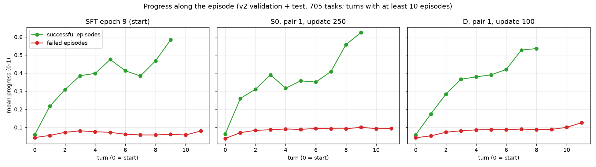
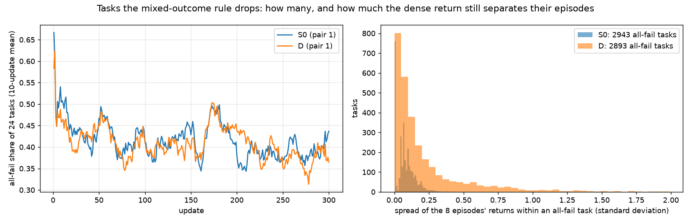
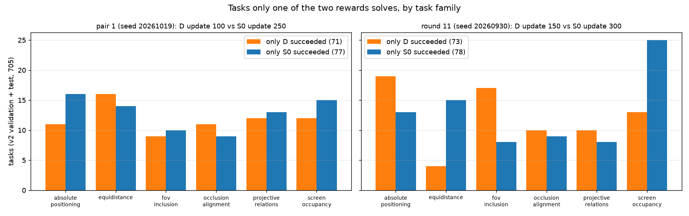

# 密集奖励诊断（第十二轮，2026-10-21，只用已有记录、不用 GPU）

## 结论

1. **现在的密集奖励在失败的题上几乎不起作用。** 进度分没成功时几乎是 0：失败的题终点进度分平均只有 0.06–0.09（满分 1）。所以一条失败轨迹累计拿到的进度奖励平均只有约 0.2，而成功奖励是 5。
2. **密集奖励的大头其实是"成功"本身。** 用来算进度奖励的分数里有一半是"是否成功"。成功那一轮会额外多给约 +5，加上一路的进度奖励，一条成功轨迹累计约 +8.5。也就是说，D 实际上接近"成功奖励加了一倍多的 S0"。这能解释为什么到目前为止 D 和 S0 的成功率几乎一样。
3. **实现是"势能差"形式，刷不了分；"假进步"也很少。** 原地来回一次净得 −0.1 ×（两处分数之和），是负的。进度一直涨却没成功的失败题，只占失败题的 1%–3%。
4. **"为了进度撞过去"的说法不成立。** 一轮的进度奖励超过一次碰撞扣分（0.15）的轮次约占 18%，但 D 发生碰撞的轮次里，进度奖励抵消碰撞扣分还有剩余的只占 5%（S0 是 11%）。D 碰撞多的原因还没找到。
5. **"只用有成有败的题"这条规则，扔掉了一部分密集奖励的信号。** 每次更新抽 24 道题，约 41% 是 8 条轨迹全失败，约 33% 全成功，只剩约 6 道用来更新。在全失败的题里，D 的 8 条轨迹回报差别的中位数是 0.105（S0 是 0.069），最大的 10% 在 0.57 以上。这一部分题密集奖励本来能分出好坏，现在被整题丢掉了。
6. **D 和 S0 各自独有的成功题数很接近**（两个种子分别是 71 对 77、73 对 78），按题族看也没有在两个种子里都成立的偏向。

## 先说清楚几个词

- **进度分**：环境对当前位姿算的"离成功还差多少"，在 0 到 1 之间。它是每个成功条件各自得分的乘积，所以只要有一个条件差得远，整体就接近 0。没成功时它不会到 1。
- **成功分（φ）**：0.5 × 进度分 + 0.5 ×（成功为 1，否则为 0）。
- **进度奖励**：D 在 S0 之外每一轮多给的奖励，等于 10 ×（0.99 × 这一轮之后的 φ − 这一轮之前的 φ）。
- **势能差形式**：每一步的奖励等于"之后的分数"减"之前的分数"。按这种形式，一道题累计的奖励只取决于起点和终点，来回走不能刷分。
- **有成有败的题**：同一道题的 8 条轨迹里既有成功又有失败。标准做法每次更新只用这样的题，**全失败**、**全成功**的题整题丢掉。
- **组内比较**：同一道题的 8 条轨迹互相比回报，比平均好的加强、比平均差的减弱；比较前除以这 8 条回报的标准差。

数据：
- 评测轨迹来自 v2 的验证集加评测集，共 705 道题，每道题走一次，不采样。模型是 SFT 第 9 个 epoch（起点），第一对的 S0 第 250 次和 D 第 100 次（种子 20261019），第十一轮的 P-S0 第 300 次和 P-D 第 150 次（种子 20260930）。
- 训练记录来自第一对 S0 和 D 各 300 次更新，每次 24 道候选题 × 8 条轨迹，全部保留。
- 脚本：`exps/vagen_active_spatial/interiorgs_v10_r12_20261019/scripts/dense_diag_r12.py`；数字：同目录 `analysis/dense_diag_20261021/dense_diag.json`。

## 一、进度分有没有"假进步"

图 1：横轴是第几轮（0 是起点），纵轴是这一轮之后的平均进度分。绿线是成功的题，红线是失败的题，只画还有至少 10 道题在走的轮次。

| 模型 | 成功的题 | 成功的题里进度分上升的轮次占比 | 失败的题 | 失败题终点的平均进度分 | 假进步的失败题（占失败题） |
| --- | --- | --- | --- | --- | --- |
| SFT 第 9 个 epoch | 279 | 75.5% | 426 | 0.058 | 6（1.4%） |
| 第一对 S0 第 250 次 | 323 | 78.7% | 382 | 0.087 | 10（2.6%） |
| 第一对 D 第 100 次 | 317 | 73.6% | 388 | 0.093 | 4（1.0%） |

- 成功的题，进度分一路上升，大约四分之三的轮次在涨。
- 失败的题，进度分从头到尾都在 0.04–0.13 之间，几乎是平的。也就是说，失败的轨迹上进度分几乎不给信号。
- "假进步"（四分之三以上的轮次在涨、终点比起点高至少 0.1，却没成功）很少，只有 4–10 道。它们缺的多是题目要求的关系：S0 的 10 道里 8 道，D 的 4 道里 4 道。

## 二、进度奖励是不是势能差

- 代码（`vagen/envs/active_spatial/reward_trace.py` 的 `potential_reward_values`，模式 `potential`）每轮付 10 ×（0.99 × φ 之后 − φ 之前），是势能差形式，系数 0.99。
- 因为系数小于 1，一道题的累计值是 10 ×（0.99 × φ 终点 − φ 起点）− 0.1 ×（中间各轮 φ 之和）。比"终点减起点"多扣了一点：每停留一轮扣 0.1 × φ，进度分 0.3 时约 −0.03。
- 原地来回刷分：从 A 走到 B 再回到 A，净得 −0.1 ×（φ_A + φ_B）。例如 φ_A = 0.3、φ_B = 0.4 时是 −0.07。所以刷不了分，不需要改成势能差（第 3.2 节的 D-potential 不必做）。
- 但有一点要注意：φ 里一半是"是否成功"，成功那一轮 φ 跳高 0.5，所以 D 在成功时额外多给约 +5。这就是第三节里"成功轨迹累计约 +8.5"的来源。

## 三、奖励的比例

在同一批评测轨迹上算进度奖励。S0 的轨迹也按 D 的公式算，方便比较。

| | D（第一对） | S0（第一对） | D（第十一轮） | S0（第十一轮） |
| --- | --- | --- | --- | --- |
| 发生碰撞的轮次占比 | 16.6% | 10.7% | 15.2% | 11.6% |
| 一轮进度奖励的中位数 / 第 90 百分位（不含成功那一轮） | 0 / 0.50 | 0 / 0.52 | 0 / 0.48 | 0 / 0.55 |
| 进度奖励大于一次碰撞扣分（0.15）的轮次占比 | 17.5% | 19.5% | 18.7% | 19.5% |
| 有碰撞的轮次里，进度奖励抵消碰撞扣分后仍为正的占比 | 5.4% | 10.7% | 5.4% | 8.3% |
| 失败的题，累计进度奖励的平均 / 第 90 百分位 | 0.22 / 1.42 | 0.20 / 1.41 | 0.19 / 1.30 | 0.17 / 1.25 |
| 成功的题，累计进度奖励的平均（含成功那一轮） | 8.5 | 8.6 | 8.6 | 8.5 |

- 一条失败轨迹累计的进度奖励（平均约 0.2）不到成功奖励（5）的 5%。
- 大约每 5 轮里有 1 轮，进度奖励比一次碰撞扣分大。但在真正发生碰撞的轮次里，D 净得正分的比例反而比 S0 低（5.4% 对 8.3%–10.7%）。所以 D 碰撞多不像是"为了进度撞过去"。可能的原因（未证实）：距离条件的进度分鼓励靠近物体，于是更常贴近墙和家具。冻结期的对照里会单独记录。

## 四、被丢掉的全失败题里有多少密集奖励能用

图 2：左边是每次更新的 24 道候选题里，8 条轨迹全失败的题所占比例（10 次更新的滑动平均）。右边是全失败的题里，8 条轨迹总回报的标准差分布：橙色是 D，蓝色是 S0。

| | S0（第一对） | D（第一对） |
| --- | --- | --- |
| 全失败的题，平均每次更新的占比 | 41.4% | 40.7% |
| 全成功的题，平均每次更新的占比 | 32.9% | 33.3% |
| 每次更新实际用来更新的题 | 6.0 道 | 6.1 道 |
| 300 次更新里全失败的题（道次） | 2,943 | 2,893 |
| 全失败题里 8 条回报的标准差：中位数 / 第 90 百分位 | 0.069 / 0.164 | 0.105 / 0.57 |
| 全失败题里 8 条回报的最大差：中位数 / 第 90 百分位 | 0.16 / 0.45 | 0.30 / 1.59 |

- 每次更新有四成的题因为全失败被丢掉。
- S0 在全失败题上回报的差别，只来自扣分（每轮 −0.01、碰撞 −0.15、读不出 −0.1 等），差别很小。
- D 的差别中位数比 S0 大约一半，最大的 10% 是 S0 的 3.5 倍。也就是说，大约十分之一的全失败题上，密集奖励能明显分出哪条轨迹更接近成功，而这些题现在被整题扔掉了。
- 要注意：组内比较会除以标准差，所以即使差别很小（例如 0.07），也会被放大成和"成功对失败"一样大的信号。要把全失败题也用上（D-keep），必须设一个最小差别的门槛，否则会把扣分带来的噪声放大。见方案文档。

## 五、D 和 S0 各自多做成的题是不是同一类

图 3：705 道评测题里，只有 D 做成（橙色）和只有 S0 做成（蓝色）的题，按题族分。左边是第一对，右边是第十一轮。

| | 第一对（D 第 100 次对 S0 第 250 次） | 第十一轮（D 第 150 次对 S0 第 300 次） |
| --- | --- | --- |
| 只有 D 做成 / 只有 S0 做成 | 71 / 77 | 73 / 78 |
| 只有 D 做成的题，平均最少步数 | 5.4 | 4.4 |
| 只有 S0 做成的题，平均最少步数 | 4.2 | 4.6 |
| D 独有的成功里，S0 终点缺的条件（题数，可多选） | 画面 40、看清一面 42、关系 49 | 画面 53、看清一面 37、关系 47 |
| S0 独有的成功里，D 终点缺的条件 | 画面 43、看清一面 45、关系 53 | 画面 29、看清一面 43、关系 66 |

- 两个种子里，只有一方做成的题数几乎一样多。
- 按题族看，第一对差不多均匀分布；第十一轮 D 在绝对位置（19 对 13）、视野包含（17 对 8）多，S0 在画面占比（25 对 13）、等距（15 对 4）多。但这些偏向在两个种子之间不一致，主要是种子带来的波动。
- 缺的条件也没有一致的规律。

## 对方案的含义

- 现在的 D 在失败的题上几乎没有信号，又被"只用有成有败的题"丢掉了四成的题，所以和 S0 差不多是意料之中的。
- 最有希望让密集奖励起作用的两个方向：
  1. 把全失败但回报有明显差别的题用上（D-keep）；
  2. 让进度分在失败时也能分出远近（D-cond：按条件分项给分，而不是相乘）。
- 同时要把"成功那一轮额外给约 +5"拿掉或单独计入，否则比较的其实是"成功奖励大小"，而不是"有没有进度奖励"（D-scale）。
- 具体设计、代价和顺序见 `docs/dense_reward_plan.md`。
