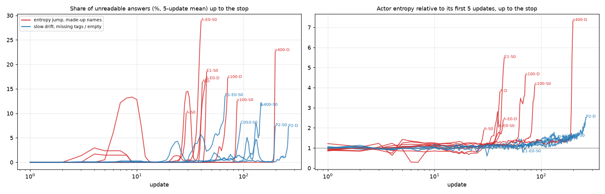
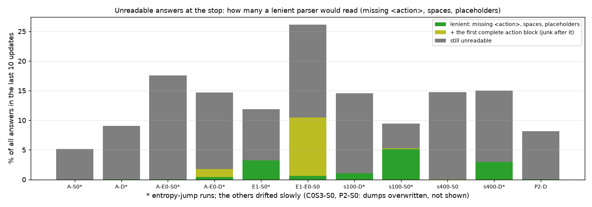

# 格式漂移汇总（第十二轮，2026-10-22，只用已有记录、不用 GPU）

> **10-22 16:40 更正（表 2 和结论 2、3）**：表 2 原来用我自己的写法判断读不出（一个回答必须恰好是一段 `<action>…</action>`），多数了环境本来就能读的回答（第一段合法、后面跟着多余内容）。用环境自己的解析代码重数后，按回合算出的停止线的量和训练日志完全一致。**E1 熵关 S0 读不出的是 1,541 个，不是 2,813 个；"40% 取第一段完整的动作块就能读出"是错的**，宽松解析实际多读出 6.2%。A 组熵关 D 是 2,183 个、3.3%，不是 2,400 个、12%。其余 9 个差 0–15 个回答。表 1 的读不出比例本来就是训练日志里的数，不变。详见 `LENIENT_PARSE_R12.md`。

> 10-22 10:20 补充：A 组熵关那一对（S0 10:10 停在第 40 次，D 10:16 停在第 44 次）也被停下，已加进表和图。一共 13 个，熵跳高类 8 个、慢慢漂移类 5 个。

## 结论

1. **本批被"读不出动作"停止线停下的 RL 一共 13 个，按训练中熵的最高值分成两类，界线很清楚。**
   - 熵是模型输出的随机程度，越高越随机。
   - **熵跳高、编造动作名（8 个）**：A 组两方、A 组熵关两方、E1 的 S0、100 个场景两方、400 个场景的 D。
     - 起点都是"格式没学牢"的模型：原始 7B（没做 SFT）、SFT 第 1 个 epoch，或只训了 6 个 epoch 的数据规模 SFT。
     - 熵从起点的 0.09–0.23 升到最高 0.31–0.88，是起点的 2–7 倍。
     - 关掉熵奖励也一样：A 组熵关两方的熵升到 0.62 / 0.56，读不出的回答还是缩写和编造的名字（`move_back`、`left`、`stop`、`none`）和失控的重复，只比开着熵奖励时多撑了约 10 次（第 40、44 次对第 29、41 次，停止线 10% 对 5%）。
     - 读不出的回答是乱码或编造的名字（`move_back`、`moveight`、`move明<`、`move podcast`）、重复的词（`left|left|left|…`）和空格代替下划线（`turn left`）。
   - **慢慢漂移、丢标签或空动作（5 个）**：E1 熵关的 S0、400 个场景的 S0、C0 第三个种子的 S0、第二对两方。
     - 熵最高只到 0.04–0.21。
     - 读不出的回答是空动作 `<action></action>`、只剩结尾标签 `</action>`、照抄格式示例里的占位名（`action`、`action1`、`action_left`）。
2. **慢慢漂移那一类，是模型真的坏了，不是解析器太严。**
   - （10-22 16:40 更正，按环境自己的解析重数）宽松解析在这一类里读出 0%–6.2%：E1 熵关 6.2%，都是丢了开头标签的回答；400 个场景 S0、第二对 D 是 0。空动作和占位名里本来就没有动作。
   - ~~唯一的例外是 E1 熵关：40% 的读不出回答……只取第一段完整的 `<action>…</action>` 就能读出。~~ 这是错的：环境读第一段、不管后面的内容，那些回答环境本来就读出了，不算在读不出里。
3. **熵跳高那一类，格式本身在崩，放宽解析只能推迟停下。**
   - 空格代替下划线占了相当一部分：按环境的数，100 个场景 S0 读不出的回答有 60% 宽松解析能读出，E1-S0 有 28.5%，400 个场景 D 有 20.4%（10-22 16:40 更正，原来是 54%、27%、20%）。
   - 但熵在暴涨，乱码和编造的名字越来越多。
4. **对冻结期"格式漂移的根治"（第一优先）的含义：**
   - 熵跳高这一类，根子在起点（SFT 不足）。
   - 慢慢漂移这一类，像是模型学会了"不出动作"。空动作只扣 0.1，比一次碰撞的 0.15 还少；在注定失败的回合里，不出动作不比乱走差。这是推测，要在冻结期用"加大无效回答的扣分"来验证。
   - 解析器可以接受空格写法和"第一段完整动作"，但这治不了上面两种根子。

## 先说清楚几个词

- **读不出动作的回答**：环境解析不出任何可执行动作的回答。这一轮按无效处理，扣 0.1。
- **停止线**：最近 10 次更新里，读不出动作的回答平均超过这个比例，RL 就停下。10-21 11:08 以前是 5%，之后是 10%。
- **起点的熵 / 停下时的熵 / 最高熵**：前 5 次更新的平均 / 最后 10 次的平均 / 训练中的最高值。
- **放宽解析（第一级）**：你给的三种写法都算读出：丢了开头的 `<action>`、空格代替下划线、去掉照抄的占位名后还剩真实的动作。
- **放宽解析（第二级）**：在第一级之上，只取第一段完整的 `<action>…</action>`，后面的多余内容不管。

## 表 1：13 个被停下的 RL

按停下的先后排在各自一类里。读不出的比例是停止线用的那个数：最后 10 次更新里，每条轨迹读不出的回合占比的平均。

| 类 | RL | 起点 | SFT epoch | 起点熵 | 停下时熵 | 最高熵 | 停在第几次 | 停止线 | 读不出的比例 | 训练成功率（开始 → 停下） | 读不出的主要形式 |
| --- | --- | --- | --- | --- | --- | --- | --- | --- | --- | --- | --- |
| 熵跳高 | A-S0 | 原始 7B | 0 | 0.162 | 0.168 | 0.307 | 29 | 5% | 5.2% | 0.09 → 0.15 | 编造或缩写的名字 1,061（`move_back`、`go_straigh`） |
| 熵跳高 | A-D | 原始 7B | 0 | 0.232 | 0.424 | 0.879 | 41 | 5% | 8.2% | 0.09 → 0.23 | 编造或缩写 952（`left`、`right`、`move_back`、`roll` 重复） |
| 熵跳高 | A 组熵关 S0 | 原始 7B，熵奖励关 | 0 | 0.221 | 0.394 | 0.621 | 40 | 10% | 16.3%（停止线算的第 30–39 次是 13.2%） | 0.09 → 0.15 | 没有完整标签（失控的重复）1,014，编造或缩写 980（`move_back`、`left`、`right`、`none`），空动作 100 |
| 熵跳高 | A 组熵关 D | 原始 7B，熵奖励关 | 0 | 0.234 | 0.385 | 0.557 | 44 | 10% | 11.2% | 0.09 → 0.13 | 编造或缩写 1,386（`left`、`right`、`move_back`、`stop`），没有完整标签 782（含 `<answer>…</answer>` 包着的），空动作 158，空格 74 |
| 熵跳高 | E1-S0 | SFT 第 1 个 epoch | 1 | 0.147 | 0.369 | 0.805 | 45 | 5% | 9.3% | 0.30 → 0.31 | 乱码名 782（`move折`、`moveight`），空格 314 |
| 熵跳高 | 100 个场景 D | 100 个场景 SFT 第 6 个 epoch | 6 | 0.153 | 0.514 | 0.707 | 71 | 10% | 11.4% | 0.33 → 0.33 | 空动作 1,237，乱码名 794（`move明<`），空格 165 |
| 熵跳高 | 100 个场景 S0 | 同上 | 6 | 0.141 | 0.370 | 0.584 | 87 | 5% | 6.4% | 0.31 → 0.37 | 空格 486，乱码或嵌套标签 292 |
| 熵跳高 | 400 个场景 D | 400 个场景 SFT 第 6 个 epoch | 6 | 0.094 | 0.437 | 0.688 | 198 | 10% | 12.3% | 0.41 → 0.43 | 乱码名 1,582（`movebackward`、`move podcast`），空格 407 |
| 慢慢漂移 | E1 熵关 S0 | SFT 第 1 个 epoch，熵奖励关 | 1 | 0.143 | 0.181 | 0.209 | 67 | 10% | 10.7% | 0.30 → 0.35 | 没有完整标签 1,239，空动作 833，只剩 `</action>` 548，多余的标签 193 |
| 慢慢漂移 | 400 个场景 S0 | 400 个场景 SFT 第 6 个 epoch | 6 | 0.093 | 0.140 | 0.151 | 147 | 10% | 10.2% | 0.42 → 0.36 | 空动作 1,995 |
| 慢慢漂移 | C0 第三个种子 S0 | SFT 第 9 个 epoch | 9 | 0.030 | 0.038 | 0.042 | 94 | 5% | 6.0% | 0.42 → 0.45 | 空动作 1,250 * |
| 慢慢漂移 | 第二对 S0 | SFT 第 9 个 epoch | 9 | 0.029 | 0.044 | 0.048 | 199 | 5% | 5.2% | 0.39 → 0.45 | 照抄占位名 1,749（`action`、`action1`、`action2`），编造 181 * |
| 慢慢漂移 | 第二对 D | SFT 第 9 个 epoch | 9 | 0.029 | 0.067 | 0.073 | 263 | 5% | 5.3% | 0.40 → 0.50 | 照抄占位名 1,635（`action1`、`action`），编造 544（`action_left`），空动作 30 |

\* 这两个在停下后接着训过，它们停下前 10 次的记录被接着训覆盖了。形式用的是 10-21 接着训之前数的结果。

**两点规律：**
- 停下的 13 个，起点时读不出的回答都是 0% 或接近 0%（A 组熵关 D 前几次有一次到 2.6%），格式问题都是 RL 中途长出来的。
- 停下时的训练成功率大多没有掉，甚至在升：格式坏掉和学会做题同时发生。

## 表 2：放宽解析能读出多少（10-22 16:40 已被更正，以 `LENIENT_PARSE_R12.md` 为准）

> 下面是原来的表，读不出的回答是按我自己的写法数的，多数了环境本来就能读的回答，留作对照。
> 按环境自己的解析代码重数：E1 熵关 S0 读不出 1,541 个，宽松多读出 95 个（6.2%）；A 组熵关 D 读不出 2,183 个，多读出 73 个（3.3%）；100 个场景 S0 读不出 829 个，多读出 497 个（60%）。
> 11 个合计读不出 18,248 个，多读出 1,588 个（8.7%）。

读不出的回答取自停下前 10 次更新保存的全部候选轨迹，按回答（回合）计数。一直读不出的轨迹会走满 12 个回合，在这里分量更重，所以这里的比例比表 1 那个按轨迹平均的数高。

| 类 | RL | 读不出的回答 | 第一级能读出 | 第二级能读出 |
| --- | --- | --- | --- | --- |
| 熵跳高 | A-S0 | 1,065 | 0（0%） | 0（0%） |
| 熵跳高 | A-D | 1,039 | 5（0.5%） | 6（0.6%） |
| 熵跳高 | A 组熵关 S0 | 2,102 | 3（0.1%） | 3（0.1%） |
| 熵跳高 | A 组熵关 D | 2,400 | 66（2.8%） | 289（12%） |
| 熵跳高 | E1-S0 | 1,102 | 301（27%） | 301（27%） |
| 熵跳高 | 100 个场景 D | 2,204 | 164（7%） | 164（7%） |
| 熵跳高 | 100 个场景 S0 | 844 | 458（54%） | 470（56%） |
| 熵跳高 | 400 个场景 D | 1,989 | 394（20%） | 394（20%） |
| 慢慢漂移 | E1 熵关 S0 | 2,813 | 66（2.3%） | **1,127（40%）** |
| 慢慢漂移 | 400 个场景 S0 | 2,003 | 0（0%） | 1（0.05%） |
| 慢慢漂移 | C0 第三个种子 S0 | 1,252 * | 约 0（全是空动作） | 约 0 |
| 慢慢漂移 | 第二对 S0 | 1,930 * | 约 0（占位名） | 约 0 |
| 慢慢漂移 | 第二对 D | 2,209 | 6（0.3%） | 6（0.3%） |

\* 按形式推断：空动作和占位名里没有真实的动作。第二对 D 是同一类回答、有完整记录，0.3%。

**放宽解析对停下的影响**（10-22 16:40 按环境自己的解析更正；轨迹保持原样的估计）：
- 11 个里有 3 个会留在停止线以下：100 个场景 S0 6.39% → 2.57%（线 5%），400 个场景 D 12.26% → 9.64%（线 10%），E1 熵关 S0 10.65% → 9.85%（线 10%）。
- 其余 8 个照样会停。

## 图

图 1：横轴是第几次更新（对数），左边是读不出的比例（5 次平均），右边是熵相对前 5 次的倍数，都画到停下为止。红线是熵跳高类，蓝线是慢慢漂移类。熵跳高类在停下前十几次里熵升到 2–7 倍；慢慢漂移类的熵一直在 1–2 倍。

图 2（10-22 16:40：按原来的数画的，已被更正，以 `LENIENT_PARSE_R12.md` 的表为准）：每个 RL 停下前 10 次里读不出的回答占全部回答的比例。绿色是第一级放宽能读出的，橄榄色是第二级多读出的，灰色是仍然读不出的。带 \* 的是熵跳高类。C0 第三个种子 S0 和第二对 S0 的记录被覆盖，没有画。

## 依据和脚本

- 训练记录：每个 RL 的训练日志（每次更新的熵、读不出的比例、训练成功率），接着训过的取停下的那一次尝试；停下前 10 次的候选轨迹记录（`rollout_data/`）。
- 脚本：`exps/vagen_active_spatial/interiorgs_v10_r12_20261019/scripts/format_drift_r12.py`。
- 数字：同目录 `analysis/format_drift/format_drift.json`，其中每个 RL 每种形式有 3 个例子。
