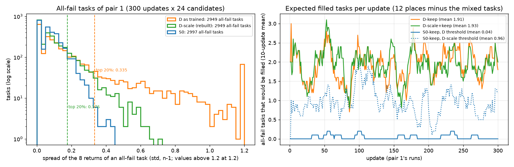

# D-keep 的门槛标定（密集奖励第一批，2026-10-21）

## 结论

- **门槛 0.335**：按现在训练的 D 的回报，取全失败题里回报差别最大的 20%。
  - 全失败的题：同一道题的 8 条轨迹都失败。
  - 回报差别：8 条回报的标准差，和组内比较除的是同一个数。
  - 按这个门槛，每次更新平均补进 **1.9 道**全失败的题。现在每次约有 6 道有成有败的题，名额 12 道。
- **D-scale 的门槛约 0.176**，每次也补约 1.9 道。D-scale 指进度奖励缩到现在 D 的 0.3 倍。它的回报是重建的，见"依据"最后一条。
- **S0-keep 用 D 的门槛几乎补不到题**：每次 0.04 道，等于标准 S0。
  - 原因：S0 全失败的题只靠扣分（碰撞、读不出的回答、每轮 −0.01）拉开差别，只有 0.4% 达到 0.335。
  - 用 S0 自己的"前 20%"门槛（0.134），每次补 2.0 道；用 D-scale 的门槛（0.176），每次补 1.0 道。
- **补进来的题，组内比较时标准差的下限，我提 1.77（= 5 / √8）。**
  - 它是"有成有败的题"可能有的最小标准差：8 条里只有 1 条成功（+5），其余失败。第一对里有成有败的题，标准差的第 5 百分位正是 1.776。
  - 理由：有了这个下限，补进来的题里同样大小的回报差，得到的更新强度不超过最弱的一道有成有败的题。扣分的小差别不会被放大成"成功对失败"那么大。
  - 代价：补进来的题的标准差多在 0.33–0.61，它们的信号约为一道有成有败的题的 1/5–1/3。每次约 2 道，约占一次更新信号的 6%–10%。效果可能要两个种子才看得出。
  - 另一个选择是下限 1.0：信号约为 1/3–3/5，补进来的题会比最弱的有成有败的题更"重"。

## 依据

- **数据**：第一对 D 和 S0 的训练记录，各 300 次更新，每次 24 道候选题 × 8 条轨迹，全部保留。
  - 同一次更新里，按场景、题族、起点分数把轨迹归到题；7,190 道题是 8 条，5 道（两道题碰巧同场景同起点）是 16 条，不计。
- **全失败题的回报标准差（n − 1）**：

| | 全失败的题 | 中位数 | 第 80 百分位（门槛） | 第 90 百分位 | 最大 | 正好为 0 |
| --- | --- | --- | --- | --- | --- | --- |
| D（训练时的实际回报） | 2,949 | 0.111 | **0.335** | 0.609 | 2.13 | 8.1% |
| D-scale（重建） | 2,949 | 0.078 | **0.176** | 0.248 | 0.70 | 7.8% |
| S0（S0 自己的全失败题） | 2,997 | 0.074 | 0.134 | 0.175 | 0.45 | 11.1% |

- **有成有败的题的标准差**：D、D-scale、S0 的第 5 百分位都约 1.776，中位数 2.68 / 2.49 / 2.37。
- **D 全失败题的回报差别，七成来自进度奖励**：
  - 只算扣分部分时，标准差中位数是 0.067；
  - 71% 的全失败题加上进度奖励后差别变大。
- **D-scale 的回报是重建的**：回报 = 扣分部分 + 0.3 × 进度部分。扣分部分按记录逐条重建：碰撞从环境反馈的文字里数，读不出的回答从记录的比例算，加上每轮 −0.01。
  - 在 S0 的记录上核对：91% 的轨迹逐条对上。其余的差一两次碰撞扣分，都在最后一回合，因为最后一回合的反馈不写进记录。
  - 重建的 D-scale 回报因此有小误差：每少算一次碰撞，偏高 0.105。门槛 0.176 是近似值。D 的门槛 0.335 用的是实际回报，没有这个问题。
- **图**：`figs_r12/fig5_keep_threshold.png`
  - 左：全失败题的回报标准差分布，对数纵轴，虚线是门槛。
  - 右：按第一对的记录，每次更新会补进几道题（10 次平均）。

- **脚本**（`exps/vagen_active_spatial/interiorgs_v10_r12_20261019/` 下）：
  - `scripts/calib_keep_r12.py`，数字在 `analysis/keep_threshold/keep_threshold.json`；
  - S0 自己的门槛：`scripts/s0_fill_r12.py`。
