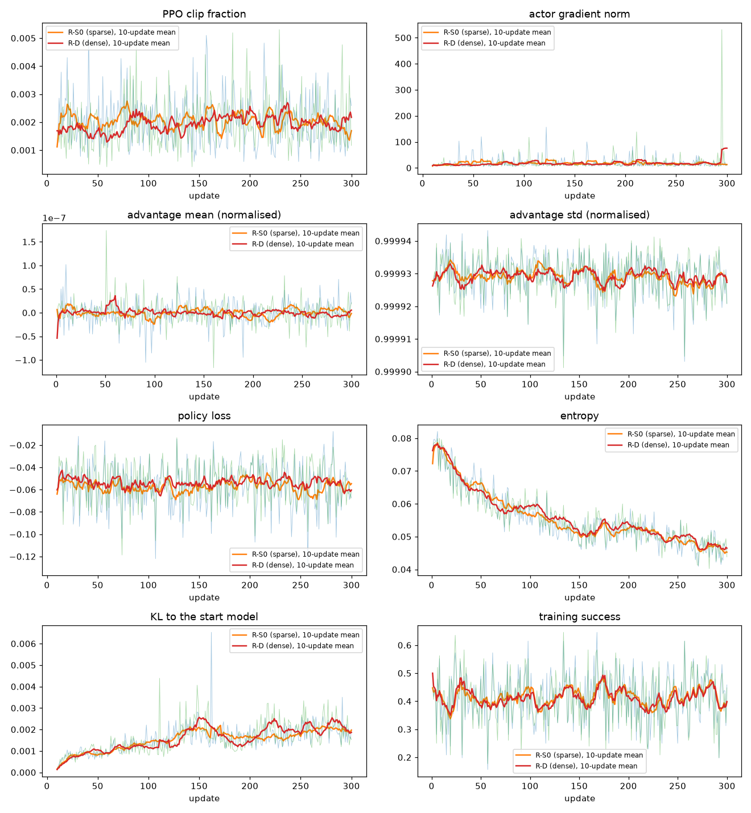

# InteriorGS v10 第十一轮：SFT 训到 10 个 epoch，稀疏奖励和密集奖励的 RL 对照

2026-10-16 到 10-18。所有训练和评测都已结束，任务已清理。

## 结论

- **修正包让 RL 第一次带来了可以确认的提高。** 修正包是在旧 RL 设置上改的四处（见第六节第 5 小节）：用同一道题几条轨迹互相比较代替价值网络，只用"有成有败"的题更新，每道题 8 条轨迹，加大学习率、减小 KL 惩罚。P-S0（修正包 + 稀疏奖励）和 P-D（修正包 + 密集奖励）都从 SFT 第 9 个 epoch 起步、只用后备题，各训 300 次更新。按验证集挑出的检查点和起点比：
  - P-S0 第 300 次：验证集 48.7%、评测集 43.4%；起点 42.0%、39.4%。两集合并 677 道逐题比较，只有 P-S0 做成的题 103 道，只有起点做成的 65 道（p = 0.004）。
  - P-D 第 150 次：验证集 46.5%、评测集 45.5%；逐题 90 对 55（p = 0.005）。
  - 验证集是挑检查点用的，数字会偏高。不参与挑选的评测集上，P-S0 比起点高 4.0 个百分点（p = 0.21），P-D 高 6.1 个百分点（p = 0.03）。两个 RL 第 100 到第 300 次的 10 个检查点，在验证集和评测集上都高于起点（评测集 40.9%–47.0%）。
- **旧设置的 R-S0 / R-D 没有离开起点**：最好的检查点比起点（SFT 第 6 个 epoch）高 1.3 / 1.5 个百分点，p = 0.41 / 0.32。原因是每一步改得太少：模型离起点的距离（KL）一直停在 0.002，而且约七成的题 4 条轨迹结果全一样，组内比不出好坏。修正包把 KL 推到 0.015–0.03，每次只用有成有败的题更新。
- **稀疏奖励和密集奖励仍然没有差别。** P-S0 对 P-D，两集合并成功率 46.5% 对 46.1%，只有一方做成的题 75 对 72（p = 0.87）；R-S0 对 R-D 37 对 38（p = 1.0）。
- **提高主要来自把目标放进画面。** 评测集上失败结束时目标不在画面里的题，从起点的 122 道降到 P-S0 的 81 道、P-D 的 59 道。按族看，P-S0 在等距族上做成的题从 16 道升到 31 道（两集合并共 125 道，p = 0.004），投影关系族 40 → 52 道（p = 0.04）；P-D 在绝对位置、视野包含、投影关系三族上显著提高。遮挡对齐族两者都没有提高（52 道里 20 → 13 / 16 道）。
- **副作用：被挡之后的反应变了。** "被挡住 v2"样本教模型被挡后先退开，起点在被挡后的下一回合有 87% 先退开；P-S0 只剩 32%，P-D 只剩 19%，多数改成换一个方向走。下一回合又被挡的比例从 3%–12% 升到 18%–24%。P-D 的碰撞率（被挡的动作占全部动作）从 10.2% 升到 14.5%（验证集），P-S0 基本不变（10.6%）。
- **SFT 训到 10 个 epoch 没有带来提高**：挑出的第 9 个 epoch 和第十轮最终模型逐题比较没有差别（p = 0.57）；第 5 个 epoch 以后主要在背题（训练题成功率 99.5%，验证集只到 42%）。**"被挡住 v2"样本留下**：被挡后下一回合又被挡 26.2% → 12.3%，碰撞率 12.2% → 9.2%（评测集）。
- 需要你决定的事在第十一节。

- **第 2 节诊断：按训练时的采样方式评测，也没有看到第十轮 RL 带来提高，原来的判断不变。** 398 道验证题，每道题按 RL 训练时的采样方式（温度 0.8）走 4 次：第十轮 SFT 第 5 个 epoch 平均成功率 41.6%，RL 第 150 次 42.6%，差 1.1 个百分点，逐题比较不显著（p = 0.67）。"4 次里至少一次成功"的比例反而从 63.3% 降到 56.8%：只有 SFT 做成的题 40 道，只有 RL 做成的题 14 道（p = 0.0005）。RL 让每道题的结果变得更固定（4 次全成功的题 93 → 120 道，全失败的 146 → 172 道），而没有让更多的题做成。

## 先说清楚几个词

- **验证集**：从 val 场景抽出、只用来挑模型的一组题。本轮扩到 398 道（第十轮 193 道）。**评测集**：从 test 场景抽出的 279 道题，只记录结果，不参与挑选（和第十轮同一套）。
- **成功率**：一道题在 12 个动作以内达到要求就算成功；成功的题数除以题数。
- **不采样（贪心）**：模型每一步都选它认为最可能的回答，同一道题每次结果相同。挑模型和主要的表都用这种方式。**采样**：按 RL 训练时的方式（温度 0.8，只在累计概率前 92% 的词里抽）随机生成，同一道题每次可能不同。
- **"至少一次成功"**：每道题采样走 4 次，至少一次成功的题所占比例。**4 次平均**：4 次的成功率取平均，即每次随机走一遍的期望成功率。
- **"被挡住"样本**：SFT 对话里插入一个会撞上墙或物体的动作，环境回复"这个动作被挡住"，后面接着示范怎么走。
- **稀疏奖励（S0）**：只有完成任务时给 +5，另有每步 −0.01、动作被挡 −0.15、回答格式不对 −0.1 的小扣分。**密集奖励（本轮 R-D）**：在 S0 之上，每一步按离目标近了多少给分、远了多少扣分（"进度"由环境里判定成功的那套条件算出，0 到 1 之间）。
- **一次更新**：RL 用一批题的结果改一次模型（R-S0 / R-D 每次 24 道、每道走 4 次；P-S0 / P-D 每次抽 24 道候选、每道走 8 次，只用其中有成有败的题）。
- **正式题 / 后备题**：每个场景先出的题是正式题，后备题是另外多出的一批，题型和难度一样。本轮 SFT 只用正式题，RL 只用后备题。
- **有成有败**：同一次更新里，同一道题的几条轨迹既有成功又有失败。只有这样的题，同一道题内部比较才分得出哪条轨迹好。
- **KL（对起点）**：同样的输入下，当前模型和起点模型给出的回答概率差多少；0 表示完全没变，越大离起点越远。
- **逐题比较的 p 值**：只看只有一方做成的题，假设两个模型一样好，出现这么不平衡（或更不平衡）的结果的概率（符号检验）；小于 0.05 算显著。
- **检查点**：训练中途存下的模型。
- **sco 任务**：在集群 GPU 池子里跑的一个作业。

## 一、代码改动（每项单独提交，都已推到 main；训练前全套测试 370 项通过、1 项跳过）

| 提交 | 改了什么 |
| --- | --- |
| `c273c2c7` | STATUS 写入本轮的 6 条决定 |
| `ab56e623` | 评测脚本可以按训练时的方式采样：`--samples 4 --temperature 0.8 --top-p 0.92`，每道题、每次、每一步用固定的随机种子，结果可复现；结果表加"至少一次成功"和"4 次平均"；浏览页和逐题比较不收采样的结果 |
| `e803dd52` | 新的"被挡住"样本（见第三节）；在导出 SFT 画面清单时就规划好插入的位置，所以新增的画面跟着一起渲染；被挡的动作超过全部 SFT 动作的 3% 时导出直接报错停止 |
| `a8633c95` | RL 配置：奖励选 S0 或密集；每次更新的题数、每次优化用的题数、存检查点的间隔可设；所有检查点都留，较早的只留可直接加载的权重（每个约 15 GB，完整的约 217 GB）；可以关掉训练中的验证 |
| `8134f102` | 训练链可以同时跑几个 RL（各自一个渲染服务和一个 8 卡训练任务，一个失败不影响另一个）；评测每个 RL 的所有检查点；评测可以加"变体"（例如采样）；按族记录训练成功率，每 25 次更新一个点 |
| `2b883af4` | 失败分析加两项：被挡后的下一回合（重复刚被挡的动作 / 先做相反的动作 / 又被挡）；"只差一个条件"里缺的是不是那三条（目标不在画面里、目标没有一个面看清楚、目标在画面里太小） |
| `2fdc6d53` | 密集奖励的调整（见第四节） |
| `d362ed50` | 渲染服务用的 gsplat 编译结果改放在仓库目录外（见第九节第 1 条） |
| `24dbb03f` | 新"被挡住"样本的来源题目哈希和任务登记表对齐（见第九节第 2 条） |
| `605db690` | 每个 sco 任务可以选 GPU 池（zoetrope 或 H800），训练链的 plan 里设 |
| `42c2ebbd` | RL 配置可以只用后备题（`--task-pool reserve`）；对照 SFT 对话和深度核对清单，RL 训练题里有一道 SFT 训过或被标出的题就拒绝生成配置 |
| `ce7a2730` | 训练链：RL 第 25 次更新时自动检查学习信号，不通过就改从 SFT 第 6 个 epoch 重启；每 25 次更新记录训练成功率（总的、按族）、有成有败的比例、平均奖励、熵、KL |
| `fa651831` | 失败分析：被挡后先退开不再算"来回走" |
| `e86aaf93` | 修正包的训练端：只用有成有败的题更新、按抽取顺序补题的过滤器；组内比较（GRPO）可以用在"一道题一个序列"的方式下；记录每条轨迹里格式错误的回合比例 |
| `cc4100ae` | RL 配置：`--opt-package p1`（修正包的四处改动） |
| `94063ca9` | 训练链：每 25 次更新多记丢题、补题、clip 比例、梯度大小、每次秒数、格式错误率；四条自动停止规则 |
| `04e96185` | 训练结束后：用了过滤时，轨迹记录写全部候选题，每条标明是否用于更新（见第九节第 4 条） |

训练用的代码提交：SFT 数据、SFT 是 `24dbb03f`；R-S0 / R-D 是 `ce7a2730`；P-S0 / P-D 是 `94063ca9`（都记在训练链的 plan 里）；3B 试跑是 `d362ed50`（R-D 的奖励）和 `94063ca9`（修正包）。全套测试在 `94063ca9` 上 381 项通过、1 项跳过。

## 二、诊断：第十轮的模型按训练时的方式采样评测

验证集（第 1 节决定 3）：从 1,358 道 val 正式题里，去掉深度核对标出的 65 道，按族和最少步数（1–3 / 4–6 / 7–8 步）分层抽取，随机种子固定（20261014），共 **398 道**，来自 97 个场景。5 个族各 75 道；遮挡族一共只有 23 道可抽，全部用上（1–3 步 1 道、4–6 步 15 道、7–8 步 7 道）。第十轮的 193 道验证题都在里面。以后都用这一套（`interiorgs_v10_r11_20261016/eval_val400/`）。

在这 398 道题上，第十轮 SFT 第 5 个 epoch 和 RL 第 150 次各评 4 次：

| 模型 | 不采样 | 采样 4 次平均 | 采样至少一次成功 |
| --- | --- | --- | --- |
| 第十轮 SFT 第 5 个 epoch | 43.5% | 41.6% | 63.3% |
| 第十轮 RL 第 150 次 | 41.2% | 42.6% | 56.8% |

逐题比较（RL 对 SFT）：

- 4 次平均：RL 高的 71 道、低的 65 道、相同的 262 道（p = 0.67）；平均差 +1.1 个百分点，95% 区间 −1.1 到 +3.2。
- 不采样：只有 RL 做成的 24 道，只有 SFT 做成的 33 道（p = 0.29）。
- 至少一次成功：只有 RL 的 14 道，只有 SFT 的 40 道（p = 0.0005）。

每道题 4 次里成功几次的分布：

| 模型 | 0 次 | 1 次 | 2 次 | 3 次 | 4 次 |
| --- | --- | --- | --- | --- | --- |
| SFT 第 5 个 epoch | 146 | 74 | 39 | 46 | 93 |
| RL 第 150 次 | 172 | 44 | 31 | 31 | 120 |

各族（不采样 / 4 次平均 / 至少一次成功）：

| 族 | SFT 第 5 个 epoch | RL 第 150 次 |
| --- | --- | --- |
| 绝对位置 | 60.0 / 61.3 / 81.3 | 60.0 / 60.7 / 77.3 |
| 等距 | 16.0 / 14.7 / 40.0 | 13.3 / 15.3 / 26.7 |
| 视野包含 | 50.7 / 44.7 / 66.7 | 46.7 / 47.7 / 62.7 |
| 遮挡对齐（23 道） | 26.1 / 19.6 / 47.8 | 13.0 / 10.9 / 30.4 |
| 投影关系 | 37.3 / 36.7 / 57.3 | 32.0 / 38.0 / 50.7 |
| 画面占比 | 58.7 / 57.3 / 76.0 | 62.7 / 61.3 / 74.7 |

**对 RL 判断的影响：** RL 训练时优化的正是"采样走一次"的成功率，这个数只涨了 1.1 个百分点，在随机波动之内，所以"第十轮 RL 没有带来可确认的提高"不是因为评测时不采样。RL 改变的是结果的分布：原来时成时败的题（1–3 次成功）从 159 道减到 106 道，大多变成了每次都成或每次都败，成的和败的差不多一样多。这说明：

1. 用 4 条轨迹比较"同一道题哪次好"的做法有信号可学：SFT 模型有 159 道题（40%）时成时败。
2. 但第十轮的更新把这些题往两头推，没有净增。本轮把每次更新的题数加倍（更稳的梯度）、并试按进度给分（失败的轨迹之间也有好坏之分），正是针对这一点。

不采样评一遍 398 道约 20 分钟，采样 4 次约 60 分钟（单卡）。

## 三、SFT 数据

### 1. 新的"被挡住"样本

做法（第 1 节决定 5）：

1. 每段对话按固定随机种子（20261016）抽签，抽中的概率 0.5。
2. 在抽中的对话里，找出所有"当前位置有某个动作会被挡、而且碰撞检测能找到一个离开障碍的动作"的回合，随机取一个。
3. 插入：模型做那个会被挡的动作 → 环境回复原样的碰撞提示（例如 "1 of 1 actions executed; blocked: move_backward (blocked by sofa)."）、画面不变 → 模型做离开障碍的动作（碰撞检测选的、不会被挡、且离那个障碍物更远的动作，多个时取离得最远的）→ 从新位置重新算一条最短走法接上，直到完成任务。
4. 加上插入的两步，总动作数仍不能超过 12；离开障碍后的位置如果已经满足任务，就不插入。

结果：

- 11,095 段对话（train 9,802，val 1,293；只用正式题），抽中 5,563 段，其中 **1,169 段（全部对话的 10.5%）插入成功**。另外 4,394 段没有插入：起点和中途的位置离墙和物体都至少 0.5 米，大多数位置根本没有会被挡的动作；或者找不到离开的动作；或者插入后 12 个动作不够。
- **被挡的动作占全部 SFT 动作的 2.16%**（1,169 / 54,135），在 3% 的上限以内。第十轮最终模型用的正式题组是 0.91%（471 / 52,025）。
- 被挡的动作：后退 428、左移 302、右移 286、前进 153；离开的动作：前进 426、右移 323、左移 292、后退 128，其中 942 次（81%）正好是被挡动作的反方向。挡住的是物体 1,058 次、墙 111 次。
- 离开障碍后接的最短走法 1 到 9 步，多数 2–4 步。按族：投影关系 385、画面占比 233、绝对位置 211、视野包含 155、等距 135、遮挡对齐 50。
- 新位置的 3,631 张画面用单卡任务 `pt-efbjor08` 渲染（10 分钟，0 张出错、0 张空白），其余 37,108 张直接复用第十轮已渲染的画面（硬链接，不占新空间）。

**抽中比例为什么是 0.5：** 3% 的上限对应的抽中比例约 0.69（全抽时被挡动作约 4.3%）。取 0.5 的理由：一是插入的数量已经是第十轮的 2.5 倍（471 → 1,169 段），足够让模型学到"被挡后先离开"；二是每个插入都多出一个"故意撞上去"的动作，比例越高，模型越可能学成主动去撞；三是留出余量，评测里"被挡后又被挡"如果仍然高，下一轮还能往上加。

**在环境里回放（全部 1,169 段，加 100 段没有插入的作对照）：** 用 RL 环境（本轮规则、厚墙），每段对话从头按模型回答逐回合喂给环境，比较环境写出的文字和 SFT 里的文字。结果：

| | 插入的对话 | 对照 |
| --- | --- | --- |
| 段数 | 1,169 | 100 |
| 系统提示逐字相同 | 1,169 | 100 |
| 每个回合的文字逐字相同 | 5,868 / 5,868 | 220 / 220 |
| 位姿一行相同 | 5,868 / 5,868 | 220 / 220 |
| 环境里恰好被挡一次、就在插入处 | 1,169 | 0 次被挡：100 |
| 中途提前结束 | 0 | 0 |
| 最后一个回答完成任务 | 1,169 | 100 |
| 最多用的动作数 | 11 | 8 |

回放不渲染画面（文字、位姿、碰撞和成功都不依赖画面），画面本身由渲染任务的记录核对。脚本 `interiorgs_v10_r11_20261016/scripts/escape_replay.py`，结果 `analysis/escape_replay.json`。

### 2. 导出

只用正式题，带完整历史（每段对话一个样本，模型每一步都看到之前所有回合），文字照环境原文（`keep_text`）。LLaMA-Factory 数据在 `interiorgs_v10_train_r11_20261016/lf_formal/`。

## 四、R-D 的奖励：检查和 3B 单卡试跑

**原样的 S5 分支在 v10 题上几乎等于 S0。** 在环境里（不渲染）对 120 道 train 正式题走最短走法：

- 按进度给分这一项，整条最短走法加起来平均只有 +0.014（最多 0.37），不到成功奖励 5 的 1%，和每步 −0.01 的扣分同一个量级，RL 看不出来。原因是失败时进度被封顶、且"进度"要同时满足几项条件才会涨：沿最短走法，进度大于 0 的位置在等距族只占 28%、投影关系 43%、视野包含 52%，在绝对位置和画面占比是 91–92%。
- "接近成功"奖励要求势能（进度的一半）不低于 0.55，成功之前进度被封顶，势能到不了 0.5，所以这一项**从来不会触发**；如果把门槛调低，模型停在目标旁边不完成，每个回合都能领一次，会鼓励"磨蹭"。
- 旧的"可见度"奖励需要单个目标的中心点，v10 题没有，所以**不起作用**。

**调整（`2fdc6d53`）：** 进度那一项放大 10 倍；关掉"接近成功"和"可见度"两项（后两项本来就不起作用，关掉只是让配置如实反映）。调整后同样 120 道题：

| 走法 | 总分平均 | 其中按进度给分 | 说明 |
| --- | --- | --- | --- |
| 最短走法（成功） | 5.13 | +0.14（最多 +3.67） | 最低 4.31 |
| 一直左转 | −0.01 | −0.16 | 原地不动也会慢慢扣分（势能每步打 0.99 折） |
| 走到差最后一步就停、原地左右转到用完 | 1.38 | | 98 道没成功的里，0 道分数高于该题的最短走法 |
| 随机动作 | 0.02 | | |

**3B 单卡试跑**（第十轮以前的 3B SFT 模型；train 正式题；一道题一个序列；每次更新 4 道题、每道 4 条；前 3 次只训练价值网络；15 次更新；同时跑一个 S0 的对照）：

| | 密集 | S0 |
| --- | --- | --- |
| 成功的轨迹总分 | 4.51 到 8.42，中位数 5.0 | 4.03 到 5.00 |
| 失败的轨迹总分 | −3.13 到 2.88，平均 −0.37 | −1.87 到 −0.03，平均 −0.40 |
| 失败的轨迹分数高于最低的成功轨迹 | 0 条 | 0 条 |
| 240 条轨迹里成功 | 44 | 43 |
| 熵（衡量回答的随机程度） | 0.21–0.23，没有塌缩 | 0.21–0.23 |
| 价值网络的解释方差 | −45 → 0.01（在变好） | −29 → −0.1 |
| NaN 或数值溢出 | 无 | 无 |
| 每次更新 | 约 80 秒 | 约 80 秒 |

结论：调整后的密集奖励数值范围合理（失败的轨迹之间有了高低之分，但不会超过成功），训练稳定，**R-D 按这个设置正式跑，没有再调**。15 次更新太少，两种奖励的成功率差别看不出来，这本来也不是试跑的目的。另外，两次运行用同一段系统提示（SFT 时的那段，写着"没有按进度的奖励"），保证两次只有奖励不同；这句话对 R-D 不准确，但模型在 SFT 里一直看到的就是它。

试跑记录：`interiorgs_v10_r11_20261016/pilot_run_{dense,S0}/`（检查点已删），汇总 `analysis/pilot_summary.json`、`analysis/pilot_scores.json`；奖励检查 `analysis/dense_reward_check*.json`、`analysis/progress_check.json`。

## 五、SFT

**结论：按验证集挑出第 9 个 epoch（42.0%），和第十轮最终模型没有可确认的差别；验证集到第 7 个 epoch 以后就不再上升。**

训练：Qwen2.5-VL-7B 全参数（视觉部分不训），8 卡，10 个 epoch，每个 epoch 154 步，用时 104 分钟（`pt-iwba2i0t`，在 zoetrope 排队 2.5 小时）。学习率按 10 个 epoch 的余弦曲线下降，所以本轮第 5 个 epoch 的学习率还在一半的位置，第十轮第 5 个 epoch 已经降到底，同一个 epoch 号两轮不能直接比。

每个 epoch 用评测脚本（单卡、不采样）评一次。"验证集 193 道"是新验证集里第十轮那 193 道题，用来和第十轮对照：

| epoch | 本轮 验证集 398 道 | 本轮 验证集 193 道 | 本轮 评测集 279 道 | 第十轮 验证集 193 道 | 第十轮 评测集 279 道 |
| --- | --- | --- | --- | --- | --- |
| 1 | 32.4% | 31.6% | 31.5% | 36.8% | 37.3% |
| 2 | 37.2% | 41.5% | 36.6% | 38.9% | 31.9% |
| 3 | 35.2% | 35.8% | 34.1% | 38.3% | 40.5% |
| 4 | 38.4% | 38.9% | 36.2% | 43.0% | 40.1% |
| 5 | 36.4% | 36.8% | 38.0% | **47.2%** | 40.1% |
| 6 | 38.7% | 41.5% | 39.4% | | |
| 7 | 41.5% | 43.5% | 39.1% | | |
| 8 | 40.5% | 42.5% | 35.1% | | |
| 9 | **42.0%** | 43.0% | 39.4% | | |
| 10 | 41.5% | 43.0% | 38.4% | | |

- **挑选：** 按验证集 398 道，第 9 个 epoch 最高（42.0%，`lf_formal/model/checkpoint-1386`），两个 RL 都从它开始。第 7、9、10 个 epoch 在 41.5%–42.0% 之间，差别在随机波动之内（398 道在 42% 附近约 ±2.5 个百分点）。**到第 10 个 epoch 验证集没有明显上升**，再多训没有依据。
- **验证损失**（SFT 自带的、val 对话上逐字预测的损失）第 2–3 个 epoch 最低（0.172），之后一路升到 0.555，训练损失降到 0.0008：模型在背训练对话。成功率却到第 7 个 epoch 还在涨，所以挑模型不能看这个损失。
- **和第十轮最终模型（SFT 第 5 个 epoch）逐题比：** 验证集 398 道 43.5% 对 42.0%（只有第十轮做成的 49 道、只有本轮做成的 43 道，p = 0.60）；评测集 40.1% 对 39.4%（32 对 30，p = 0.90）；两集合并 677 道 42.1% 对 40.9%（81 对 73，p = 0.57）。**新的"被挡住"样本和多训的 5 个 epoch 没有改变成功率。** 被挡后的行为有没有变，见第八节。

## 六、RL

### 1. 第一次：用正式题，第 43 次更新时停掉（SFT 已经背下了这些题）

两个 RL（R-S0、R-D）18:08 UTC 在 H800 上启动，起点 SFT 第 9 个 epoch，训练题是 SFT 用过的 9,802 道 train 正式题。前 25 次更新：

| | 本轮 R-S0 | 本轮 R-D | 第十轮 RL（S0） |
| --- | --- | --- | --- |
| 训练成功率（训练时按采样方式走） | 97.3% | 98.1% | 49.3% |
| "有成有败"的题（同一道题的 4 条轨迹里既有成功又有失败）所占比例 | 3.7% | 3.9% | 39.3% |
| 同一道题 4 条轨迹总奖励的平均差别（标准差） | 0.09 | 0.10 | 0.99 |

同一个模型在验证集上只有 42%，在训练题上却 97%：它背下了训练题。SFT 的训练损失（模型对训练对话逐字预测的误差）第十轮第 5 个 epoch 是 0.08，本轮第 9 个 epoch 是 0.003。RL 靠比较同一道题几条轨迹的好坏来学；4 条全成功的题没有可比的东西，所以只有不到 4% 的题能提供信号。你在 19:00 UTC 前后决定改用后备题（第 1 节决定 7），两个 RL 在第 43 次更新时停掉、删除，没有存检查点（每 50 次才存）。记录移到 `interiorgs_v10_train_r11_20261016/rl_attempts/attempt0_formal_*`。

### 2. 第二次：用后备题

**后备题**是生成器为每个场景多出的一批题，和正式题经过同样的检查（回放、深度核对），以前只当备用。核对结果（`rl-config` 生成配置时自动检查，有一项不满足就拒绝生成）：

- train 场景的后备题去掉深度核对标出的题后剩 **10,798 道**，来自 742 个场景：绝对位置 2,294、等距 1,552、视野包含 1,414、遮挡对齐 157、投影关系 3,274、画面占比 2,107；最少步数 1–3 / 4–6 / 7–8 步各 3,524 / 3,496 / 3,778 道。
- **和 SFT 训练数据没有一道重合**（SFT 的 11,095 段对话来自 9,802 道 train 正式题和 1,293 道 val 正式题，全部是正式题）。
- **深度核对标出的题一道不剩**（清单 1,580 道）。
- 需要说明：后备题里 89%（9,621 道）在 SFT 的正式题里有一道"兄弟题"：同一个场景、同一族、同样的目标物体和目标区域，题目文字几乎都一样（9,586 道完全相同），**只有起点不同**（离兄弟题起点的距离中位数 0.94 米，10% 的不到 0.37 米，10% 的超过 2.43 米）。也就是说，后备题主要考"从没走过的起点出发去同一个目标"，对模型不是完全陌生；第 25 次更新的信号检查会说明它们是否难度合适。

设置和第一次完全相同，只有训练题换成后备题：每次更新 24 道题、每道 4 条轨迹，训到 300 次；前 10 次只训练价值网络（`critic_warmup` 10，价值网络是 RL 里估计"这一步之后还能拿多少分"的那部分）；带完整历史、一道题一个序列；每 50 次存一个检查点，训练结束后由训练链用评测脚本在验证集和评测集上评（不采样）。

**第 25 次更新的信号检查**（第 1 节决定 8，训练链自动做）：每个 RL 前 25 次更新的训练成功率要在 40%–60% 之间，"有成有败"的题不低于 30%。

| 次数 | 起点 | R-S0 训练成功率 | R-S0 有成有败 | R-D 训练成功率 | R-D 有成有败 | 结果 |
| --- | --- | --- | --- | --- | --- | --- |
| 1（19:26 UTC 启动） | SFT 第 9 个 epoch | 42.3% | **19.3%** | 43.0% | **20.8%** | 没通过，自动停掉，改从第 6 个 epoch 重启 |
| 2（20:30 / 21:03 UTC 启动） | SFT 第 6 个 epoch | 40.5% | 31.9% | 41.2% | 31.1% | 通过，训到 300 次 |

（每个 RL 每次检查统计 586 道题、2,400 条轨迹。）

- 第一次没通过的原因：第 9 个 epoch 的模型对自己的回答非常确定，**熵**（衡量回答有多随机的量，越小越确定）只有 0.03（3B 试跑时约 0.22），同一道题按温度 0.8 采样 4 次也几乎走成一样，所以虽然成功率合适，有成有败的题只有约 20%。第 6 个 epoch 的熵约 0.075，有成有败的题升到约 31%。
- 两次都刚好在门槛附近（第二次 R-S0 成功率 40.5%，门槛 40%）：后备题对这两个起点都偏难，模型的随机性也偏低。
- 第二次启动时，R-S0 的 8 卡训练任务提交 29 秒后在调度阶段失败（没有启动，可能是上一批任务的卡还没释放完），我在 21:02 UTC 重启了训练链进程，只重新提交 R-S0，R-D 不受影响。所以 R-S0 比 R-D 晚约 40 分钟。
- 第一次的记录在 `rl_attempts/attempt1_*`（检查点没有存，未到第 50 次）。

**按设置，RL 的起点（第 6 个 epoch，验证集 38.7%）和第三节挑出的 SFT 模型（第 9 个 epoch，42.0%）不同。** 比较 RL 有没有带来提高时，两个都要比：和起点比看 RL 本身的作用，和第 9 个 epoch 比看最终有没有更好。

### 3. 第二次的结果：两个 RL 都没有离开起点

两个 RL 都训到 300 次（R-D 07:23 UTC、R-S0 07:53 UTC 结束，每次更新约 2.2 分钟）。验证集 398 道（评测脚本、不采样）：

| 更新次数 | 50 | 100 | 150 | 200 | 250 | 300 |
| --- | --- | --- | --- | --- | --- | --- |
| R-S0 | 38.9% | 37.9% | 38.2% | 39.2% | 38.7% | 39.7% |
| R-D | 37.7% | 38.9% | 37.7% | 37.2% | 40.7% | 38.7% |

起点（SFT 第 6 个 epoch）38.7%，第三节挑出的 SFT 第 9 个 epoch 42.0%。逐题比较（只有一方做成的题数，符号检验）：

- **对起点：** 12 个检查点里，只有起点做成的题和只有 RL 做成的题都在 19–33 道之间、两边差不多，p 值 0.34–1.0。**全程和起点持平。**
- **对 SFT 第 9 个 epoch：** 所有检查点都略低，只有第 9 个 epoch 做成的题 35–47 道，只有 RL 做成的 24–33 道，p 值 0.04–0.62（R-D 第 50、200 次 p < 0.05）。
- **R-S0 对 R-D：** 两条曲线互相交错，没有一种奖励稳定地高。（评测集结果和逐题比较见第七节。）

### 4. 诊断：为什么没动（只读训练日志和轨迹记录）

曲线见 `figures_r11/rl_curves_rs0_rd.png`，按更新次数画了 clip 比例、梯度大小、优势值均值和标准差、策略损失、熵、KL 和训练成功率，细线是每次更新，粗线是 10 次平均。

**结论：模型基本没被推动。奖励进了更新，信号也没有被价值网络抵消；问题是每一步改得太少。**

| 量（是什么） | R-S0 / R-D 的数 | 说明 |
| --- | --- | --- |
| clip 比例（一次更新里，新旧策略的概率比超出 ±20%、被截断的词所占比例） | 全程约 0.002 | 几乎没有词被截断，策略每步只改了一点点 |
| 每次更新的策略变化（新旧策略之间的 KL） | 约 1e-4 | 同上 |
| KL（当前模型对起点模型） | 第 100 次 0.0013，第 150 次 0.002，之后一直约 0.002 | 被 KL 惩罚（系数 0.3）拉在起点附近 |
| 策略梯度的大小 | 15–23（R-D 在第 295 次附近有一次 530 的尖峰） | 不小，但学习率只有 5e-7 |
| 策略损失 | 约 −0.055，全程稳定 | 明显不为 0：奖励确实进了更新 |
| 优势值（每个词"比平均好多少"）的均值 / 标准差 | 0 / 1 | 每批都被缩放成均值 0、标准差 1，这两个数本身说明不了什么 |
| 价值网络能解释回报差别的比例 | 20%–26% | 价值网络（给每一步一个基准分）只解释了约四分之一，起不到抵消信号的作用 |
| 熵 | 0.077 → 0.046 | 模型越来越确定（熵奖励系数 0.005 也没挡住） |
| 训练成功率 | 39%–45% 之间波动，没有上升 | |

**"有成有败"的题按族的变化**（同一道题 4 条轨迹里既有成功又有失败；每格是 有成有败 / 全失败 / 全成功 的比例；R-S0，R-D 类似）：

| 更新 | 绝对位置 | 等距 | 视野包含 | 遮挡对齐 | 投影关系 | 画面占比 |
| --- | --- | --- | --- | --- | --- | --- |
| 1–25 | 0.29 / 0.18 / 0.54 | 0.28 / 0.68 / 0.03 | 0.35 / 0.51 / 0.14 | 0.53 / 0.47 / 0.00 | 0.29 / 0.51 / 0.20 | 0.34 / 0.26 / 0.40 |
| 126–150 | 0.28 / 0.23 / 0.49 | 0.19 / 0.76 / 0.04 | 0.26 / 0.53 / 0.21 | 0.40 / 0.60 / 0.00 | 0.23 / 0.52 / 0.25 | 0.22 / 0.29 / 0.48 |
| 276–300 | 0.22 / 0.23 / 0.55 | 0.28 / 0.71 / 0.01 | 0.10 / 0.64 / 0.26 | 0.12 / 0.88 / 0.00 | 0.25 / 0.54 / 0.21 | 0.21 / 0.25 / 0.54 |

- 信号不是只剩在容易的族里。等距族大多数题 4 条全失败（66%–89%），但始终有约 20%–28% 的题有成有败，并没有变成"全失败、没有信号"。遮挡对齐族每 25 次更新只有 10 道左右，波动很大。
- 绝对位置和画面占比约一半的题 4 条全成功，视野包含的有成有败比例从 35% 降到 10%：模型在这几族上越来越固定。
- 全部题里，有成有败的约占 21%–32%，其余七成左右的题对组内比较没有用。

这两点（推不动、信号被浪费）就是修正包要解决的问题（见下）。

### 5. 修正包（P-S0、P-D）

在 R-S0 的设置上只改四处（`e86aaf93`、`cc4100ae`、`94063ca9`，配置名 `--opt-package p1`）：

| 改动 | 具体做法 | 理由 |
| --- | --- | --- |
| 1. 组内比较代替价值网络 | 同一道题的几条轨迹，用各自的总奖励减去这组的平均、除以这组的标准差，作为每条轨迹的"好坏"（GRPO 的做法）；不再训练价值网络，也不再需要前 10 次只训价值网络 | 价值网络只能解释约四分之一的回报差别；去掉它每次更新还省约 31 秒（算价值 6 秒、更新价值网络 25 秒） |
| 2. 只用有成有败的题更新 | 每次更新抽 24 道候选题；按抽取顺序，前 12 道是这一批，其中全成功或全失败的题丢掉，用后 12 道里有成有败的题依次补上（补抽上限就是这 12 道）；记录每次丢掉、补抽、还缺几道 | 全成功或全失败的题组内比不出好坏，在 R-S0 里占七成左右 |
| 3. 每道题 8 条轨迹 | 每道题从 4 条增加到 8 条 | 同一道题轨迹越多，越容易出现有成有败。按第 9 个 epoch 起点的结果推算（用"每道题成功概率服从一个分布"的模型拟合它 4 条轨迹的成功次数），8 条时约 24% 的题有成有败（4 条时 19%） |
| 4. 学习率、KL 惩罚、熵奖励 | 学习率 5e-7 → 2e-6；KL 惩罚系数 0.3 → 0.05；熵奖励系数 0.005 → 0.01 | 原来每次更新的策略变化约 1e-4，KL 停在 0.002；学习率放大 4 倍、KL 惩罚降到六分之一，目标是第 100 次时 KL 至少 0.01。熵在原来的步长下已从 0.077 降到 0.046，步子变大后需要更强的熵奖励，目标是第 100 次时熵不低于起点的 70% |

**每次更新的轨迹数和时间（估算后的取舍）：** 你给的例子是 12 道题 × 8 条，约 2 分钟一次。按第 9 个 epoch 起点约 24% 有成有败，要凑满 12 道得抽约 50 道候选（400 条轨迹），每次更新 4–5 分钟。我取 24 道候选（192 条轨迹，生成量是原来的两倍）：

- 起步时平均每次能留下约 6 道题（48 条轨迹）。这 48 条全都有信号；原来 96 条里，只有约四分之一的题有成有败，也就是约 24 条有信号的轨迹。
- 估计每次更新约 2.5 分钟：生成约 100 秒，算概率约 28 秒，更新约 16 秒。
- 熵奖励加强后，有成有败的题应会变多，留下的题也会增加。

实际时间见正式训练的记录。

**其余不变：** 起点 SFT 第 9 个 epoch，训练题为后备题，300 次更新，每 50 次存检查点，由训练链评验证集和评测集；两次只有奖励不同（P-S0 稀疏，P-D 密集）。

**自动停止**（你给的条件，训练链做，只停触发的那一个，日志保留，已存的检查点照常评测）：

- 训练的主要指标里出现 NaN（不是数字）；
- KL 超过 0.2；
- 回答格式错误率超过 5%，按最近 10 次更新的平均算，避免单次波动误停；
- 训练成功率连续 50 次比起点（前 5 次更新的平均）低 10 个百分点以上。

格式错误率原来训练日志里没有记录，这次加上了：每条轨迹里环境无法解析的回答占回合数的比例。

**3B 单卡试跑**（第五轮的 3B 模型，后备题，每次 4 道候选、留 2 道、每道 8 条；稀疏和密集各一张卡，`pkg_pilot_run_{S0,dense}`）：第 1 次更新里组内比较、丢题和补抽都按设计工作：4 道候选里前 2 道有 1 道全失败，被丢掉，用后 2 道里的 1 道补上，保留 2 道、不缺；优势值在 −0.54 到 2.47 之间，格式错误率 0，没有 NaN。单卡上每次更新约 8 分钟（3B 模型、生成和训练挤在一张卡上），比 8 卡正式训练慢得多。

试跑到第 30 次的结论：

- **正常工作的部分：** 组内比较、丢题和补抽都正常，每次保留 0–2 道题。有 2 次更新一道有成有败的题都没有，这时按设计只施加熵和 KL 两项，梯度只有 0.08–0.13。没有 NaN，格式错误率为 0。第 1 次之后，每次更新约 1 分钟。
- **KL 在试跑里没有上升**（全程约 1e-4）：
  - 单卡试跑为了省显存，把策略模型的权重存成 bf16（一种只有约 3 位有效数字的格式），学习率 2e-6 的改动比 bf16 能表示的最小变化还小，被舍掉了；8 卡正式训练用 fp32 存权重，没有这个问题。
  - 我又用 fp32 权重补跑了一次（`pt-n3emu4g2`），第一次更新策略时显存不够（3B 模型的 fp32 权重和梯度，加上推理引擎、渲染服务，一张卡放不下），失败。
  - 按规定，其他 GPU 任务只能用单卡，所以**"KL 会上升"没能在试跑里验证**，改在正式训练的头几次更新里看（结果见下）。

**正式训练：启动时的问题。** P-S0、P-D 一共重提了几次才跑起来：

- 11:58 第一次提交，两个 8 卡训练都在 Ray（训练框架用来启动和调度各进程的组件）启动时超时失败。
- 12:06 重提，P-D 又超时；P-S0 启动 Ray 后 35 分钟没有任何输出，判断卡死，12:46 重提。
- 失败都发生在训练代码开始之前，同一时段 H800 节点上进程启动明显变慢（P-D 从启动 Ray 到推理引擎就绪用了 23 分钟）。原因没有查清；我没有删任何别人的任务。

最终 P-D 12:12 起、P-S0 12:46 起在训练。

**正式训练的过程**：P-S0 2026-10-17 12:46 到 23:40 UTC，P-D 12:12 到 10-18 00:18 UTC，都训满 300 次，没有触发自动停止。每 25 次更新一段，数字来自训练日志，按每次全部 24 道候选题算（clip 比例全程是 0，原因见表后）：

P-S0（修正包 + 稀疏奖励）：

| 更新 | 训练成功率 | 有成有败的题 | 每次：保留 / 丢掉全成功 / 丢掉全失败 / 补进 | 格式错误率 | 熵 | KL | 梯度大小 | 秒/次 |
| --- | --- | --- | --- | --- | --- | --- | --- | --- |
| 1–25 | 41.5% | 25.8% | 6.2 / 3.7 / 5.2 / 3.0 | 0.04% | 0.032 | 0.012 | 15.1 | 129 |
| 26–50 | 45.5% | 23.3% | 5.6 / 4.0 / 4.8 / 2.5 | 0.01% | 0.035 | 0.017 | 11.0 | 113 |
| 51–75 | 46.0% | 22.0% | 5.3 / 4.7 / 5.1 / 3.1 | 0.04% | 0.035 | 0.014 | 9.2 | 125 |
| 76–100 | 49.0% | 27.5% | 6.6 / 4.3 / 4.6 / 3.5 | 0.05% | 0.038 | 0.019 | 11.6 | 136 |
| 101–125 | 43.4% | 25.3% | 6.1 / 4.1 / 4.6 / 2.8 | 0.16% | 0.038 | 0.026 | 14.5 | 148 |
| 126–150 | 48.4% | 25.0% | 6.0 / 4.4 / 4.5 / 2.9 | 0.05% | 0.042 | 0.025 | 15.0 | 132 |
| 151–175 | 45.5% | 27.2% | 6.5 / 4.0 / 4.8 / 3.3 | 0.01% | 0.043 | 0.024 | 12.4 | 131 |
| 176–200 | 44.8% | 24.0% | 5.8 / 3.8 / 5.1 / 2.7 | 0.03% | 0.041 | 0.026 | 28.0 | 118 |
| 201–225 | 43.4% | 29.3% | 7.0 / 3.2 / 5.2 / 3.5 | 0.03% | 0.046 | 0.027 | 14.5 | 123 |
| 226–250 | 44.8% | 25.0% | 6.0 / 3.6 / 5.0 / 2.6 | 0.09% | 0.045 | 0.023 | 15.7 | 126 |
| 251–275 | 48.3% | 26.3% | 6.3 / 4.2 / 4.7 / 3.2 | 0.02% | 0.045 | 0.026 | 21.2 | 121 |
| 276–300 | 48.9% | 25.3% | 6.1 / 4.7 / 4.5 / 3.3 | 0.01% | 0.044 | 0.023 | 9.3 | 123 |

P-D（修正包 + 密集奖励）：

| 更新 | 训练成功率 | 有成有败的题 | 每次：保留 / 丢掉全成功 / 丢掉全失败 / 补进 | 格式错误率 | 熵 | KL | 梯度大小 | 秒/次 |
| --- | --- | --- | --- | --- | --- | --- | --- | --- |
| 1–25 | 42.6% | 24.7% | 5.9 / 3.8 / 5.3 / 3.0 | 0.08% | 0.030 | 0.011 | 10.3 | 137 |
| 26–50 | 43.6% | 23.7% | 5.7 / 3.9 / 5.1 / 2.6 | 0.02% | 0.029 | 0.017 | 16.7 | 121 |
| 51–75 | 42.2% | 17.5% | 4.2 / 4.0 / 5.8 / 2.0 | 0.10% | 0.025 | 0.013 | 11.1 | 122 |
| 76–100 | 45.7% | 24.8% | 6.0 / 4.2 / 5.0 / 3.1 | 0.46% | 0.031 | 0.017 | 14.2 | 136 |
| 101–125 | 40.8% | 27.3% | 6.6 / 3.4 / 5.3 / 3.2 | **2.23%** | 0.034 | 0.021 | 17.9 | 148 |
| 126–150 | 47.3% | 21.0% | 5.0 / 4.2 / 5.0 / 2.2 | 1.21% | 0.031 | 0.020 | 11.7 | 129 |
| 151–175 | 45.0% | 23.5% | 5.6 / 4.4 / 4.8 / 2.8 | 0.43% | 0.030 | 0.021 | 16.7 | 138 |
| 176–200 | 44.1% | 25.2% | 6.0 / 3.7 / 5.4 / 3.1 | 0.29% | 0.032 | 0.027 | 10.1 | 154 |
| 201–225 | 43.5% | 28.7% | 6.9 / 3.4 / 5.0 / 3.3 | 0.11% | 0.034 | 0.023 | 10.8 | 153 |
| 226–250 | 43.5% | 23.0% | 5.5 / 3.7 / 5.6 / 2.8 | 0.18% | 0.036 | 0.021 | 13.3 | 143 |
| 251–275 | 47.9% | 26.5% | 6.4 / 4.4 / 4.8 / 3.6 | 0.24% | 0.039 | 0.024 | 14.2 | 147 |
| 276–300 | 49.3% | 24.3% | 5.8 / 4.7 / 4.6 / 3.2 | 0.14% | 0.036 | 0.021 | 8.9 | 128 |

（"训练成功率"是训练题上按采样方式走的成功率；"保留"是每次实际用来更新的题数，目标 12 道，差的部分没有补满；格式错误率是环境无法解析的回答占回合数的比例；梯度大小是裁剪前的梯度范数。）

- **KL 达到了目标**：第 100 次 P-S0 0.018、P-D 0.019，都超过 0.01（两个都在第 20 次左右就过了 0.01；旧 RL 第 150 次才 0.002）。之后在 0.015–0.03 之间，最高一次 0.037，离自动停止的 0.2 很远。
- **熵没有降**：起点 0.030–0.031；第 100 次 P-S0 0.035、P-D 0.032，第 300 次 0.044 / 0.037，一直高于"起点的 70%"。
- **训练成功率只升了一点**：前 5 次平均 41% 左右，最后 25 次 P-S0 48.9%、P-D 49.3%，中间在 41%–49% 之间来回。验证集的提高（第 6 小节）比训练成功率的变化更清楚。
- **每次实际只用约 6 道题**：每次平均丢掉约 4 道全成功、5 道全失败，补进约 3 道，离 12 道还差约 6 道；全程没有出现"一道有成有败的题都没有"的情况。
- **P-D 的格式错误率一度升高**：第 101–110 次的 10 次平均 4.0%，离自动停止的 5% 只差 1 个百分点；之后回落到 0.1%–0.4%。P-S0 最高的 10 次平均 0.3%。
- **训练成功率从没比起点低 10 个百分点**：最低的连续 50 次平均 P-S0 43.0%、P-D 42.1%，都高于起点（40.8% / 41.1%）。没有出现 NaN。
- **clip 比例一直是 0，这是设置的结果，不是"推不动"**：每次更新只用一批（≤ 12 道题）做一次优化步，这一步用的就是生成轨迹时的模型，新旧概率比恒等于 1，不会触发截断。判断推没推动看 KL。
- **每次更新平均 P-S0 127 秒、P-D 138 秒**（第 1 次 4–9 分钟，含加载和预热）。

**一个记录问题（训练后已修）**：修正包训练每次更新的轨迹记录（rollout_data）里只剩保留下来的那些轨迹的分数，没有"成功与否、族、场景"。原因是记录函数只写条数和批次一致的附加信息，过滤后批次变小，附加信息就整个丢了。所以：

- 训练链进度页上每 25 次的统计表是空的。上面的表是我从训练日志里算的：日志里的指标在过滤之前、按全部候选题计算，不受影响。
- **按族的训练成功率这次拿不到**，只靠保留下来的题去算有偏差，因为它们按定义都是有成有败的。
- 自动停止规则用的是日志里的指标，不受影响。
- 训练结束后已修（见第九节第 4 条）：以后过滤时轨迹记录写全部候选题，每条标明是否用于更新。

### 6. 修正包的结果：验证集和评测集都高于起点

验证集 398 道 / 评测集 279 道（评测脚本、单卡、不采样）：

| 更新次数 | 50 | 100 | 150 | 200 | 250 | 300 |
| --- | --- | --- | --- | --- | --- | --- |
| P-S0 | 46.2 / 40.5 | 46.2 / 43.4 | 46.0 / **47.0** | 44.5 / 44.4 | 42.5 / 44.8 | **48.7** / 43.4 |
| P-D | 39.7 / 38.0 | 45.7 / **46.6** | **46.5** / 45.5 | 46.0 / 40.9 | 43.0 / 41.2 | 45.5 / 45.2 |

起点 SFT 第 9 个 epoch 42.0 / 39.4。按验证集挑出 P-S0 第 300 次、P-D 第 150 次。

- **每个检查点对起点**（两集合并 677 道，只有 RL 做成 / 只有起点做成的题数）：

  | 更新次数 | 50 | 100 | 150 | 200 | 250 | 300 |
  | --- | --- | --- | --- | --- | --- | --- |
  | P-S0 | 68 / 48（p 0.08） | 90 / 62（0.03） | 93 / 56（0.003） | 91 / 67（0.07） | 87 / 70（0.20） | 103 / 65（0.004） |
  | P-D | 60 / 73（0.30） | 94 / 59（0.006） | 90 / 55（0.005） | 81 / 61（0.11） | 78 / 69（0.51） | 91 / 61（0.02） |

- **第 100 次以后的 10 个检查点全部高于起点**，验证集 42.5%–48.7%（平均 P-S0 45.6%、P-D 45.3%），评测集 40.9%–47.0%（平均 44.6% / 43.9%），其中 6 个逐题比较 p < 0.05。只有 P-D 第 50 次低于起点。
- 曲线在第 100 次以后基本平，没有一直上升；P-S0 第 300 次的验证集 48.7% 比第 250 次高 6 个百分点，有一部分是挑选带来的偏高。不参与挑选的评测集上，P-S0 第 300 次 43.4%（比起点高 4.0 个百分点，p = 0.21），P-D 第 150 次 45.5%（高 6.1 个百分点，p = 0.03）。
- 两个都比旧设置的 RL 最好的检查点高（第七节），但起点不同（第 9 个对第 6 个 epoch），这个差别里也包括起点的差别。

## 七、评测表

评测脚本、单卡、不采样（"采样 4 次"一列除外）。完整表格（含每个检查点、按最少步数分段、步数/d\*、用满上限的题数）在 `interiorgs_v10_r11_20261016/eval_val400/table.md` 和 `eval_test/table.md`。

**主要模型：**

| 模型 | 验证集 398 道 | 评测集 279 道 | 采样 4 次的平均（验证集） | 采样 4 次至少一次成功（验证集） | 碰撞率（验证集 / 评测集） |
| --- | --- | --- | --- | --- | --- |
| 原始 Qwen2.5-VL-7B | 5.8% | 9.0% | | | 13.2% / 12.0% |
| R1 最终模型（自己的提示格式、不带历史） | 9.8% | 7.2% | | | 7.4% / 6.2% |
| 第十轮最终模型（SFT 第 5 个 epoch） | 43.5% | 40.1% | 41.6% | 63.3% | 13.9% / 12.2% |
| 本轮 SFT 第 6 个 epoch（R-S0 / R-D 起点） | 38.7% | 39.4% | 39.6% | 60.6% | 11.8% / 9.6% |
| **本轮 SFT 第 9 个 epoch（按验证集挑出，P-S0 / P-D 起点）** | **42.0%** | 39.4% | 40.8% | 50.8% | 10.2% / 9.2% |
| R-S0 第 300 次（R-S0 里验证集最高） | 39.7% | 41.2% | 40.3% | 54.3% | 11.4% / 9.8% |
| R-D 第 250 次（R-D 里验证集最高） | 40.7% | 40.1% | 40.3% | 55.8% | 12.3% / 9.7% |
| **P-S0 第 300 次（P-S0 里验证集最高）** | **48.7%** | 43.4% | | | 10.6% / 10.3% |
| **P-D 第 150 次（P-D 里验证集最高）** | 46.5% | **45.5%** | | | 14.5% / 12.3% |

（第十轮最终模型的采样两列来自第二节。碰撞率是被挡的动作占全部动作的比例。P-S0 / P-D 没有做采样评测：训练链的 plan 里只排了不采样的评测。）

**各检查点（验证集 / 评测集）：**

| 更新次数 | 50 | 100 | 150 | 200 | 250 | 300 |
| --- | --- | --- | --- | --- | --- | --- |
| R-S0 | 38.9 / 40.5 | 37.9 / 41.9 | 38.2 / 39.1 | 39.2 / 41.6 | 38.7 / 41.9 | 39.7 / 41.2 |
| R-D | 37.7 / 41.9 | 38.9 / 40.5 | 37.7 / 38.7 | 37.2 / 40.1 | 40.7 / 40.1 | 38.7 / 44.1 |
| P-S0 | 46.2 / 40.5 | 46.2 / 43.4 | 46.0 / 47.0 | 44.5 / 44.4 | 42.5 / 44.8 | 48.7 / 43.4 |
| P-D | 39.7 / 38.0 | 45.7 / 46.6 | 46.5 / 45.5 | 46.0 / 40.9 | 43.0 / 41.2 | 45.5 / 45.2 |
| R-S0 采样 4 次的平均 / 至少一次（验证集） | 38.4 / 55.8 | 39.5 / 56.3 | 40.2 / 54.3 | 41.3 / 56.3 | 39.6 / 54.0 | 40.3 / 54.3 |
| R-D 采样 4 次的平均 / 至少一次（验证集） | 40.0 / 57.3 | 39.8 / 55.3 | 38.0 / 53.3 | 40.1 / 53.8 | 40.3 / 55.8 | 39.0 / 52.3 |

**按族（验证集；括号里是评测集）：**

| 模型 | 绝对位置 | 等距 | 视野包含 | 遮挡对齐（23 / 29 道） | 投影关系 | 画面占比 |
| --- | --- | --- | --- | --- | --- | --- |
| 第十轮最终模型 | 60.0 (66.0) | 16.0 (16.0) | 50.7 (40.0) | 26.1 (20.7) | 37.3 (32.0) | 58.7 (58.0) |
| 本轮 SFT 第 6 个 epoch | 54.7 (54.0) | 14.7 (18.0) | 41.3 (40.0) | 26.1 (31.0) | 37.3 (30.0) | 49.3 (60.0) |
| 本轮 SFT 第 9 个 epoch | 60.0 (52.0) | 14.7 (10.0) | 49.3 (40.0) | 39.1 (37.9) | 26.7 (40.0) | 60.0 (56.0) |
| R-S0 第 300 次 | 57.3 (54.0) | 13.3 (20.0) | 45.3 (44.0) | 26.1 (20.7) | 36.0 (36.0) | 50.7 (64.0) |
| R-D 第 250 次 | 57.3 (54.0) | 17.3 (18.0) | 46.7 (44.0) | 30.4 (31.0) | 34.7 (34.0) | 50.7 (56.0) |
| P-S0 第 300 次 | 61.3 (64.0) | 22.7 (28.0) | 54.7 (42.0) | 30.4 (20.7) | 44.0 (38.0) | 66.7 (58.0) |
| P-D 第 150 次 | 65.3 (70.0) | 16.0 (16.0) | 58.7 (54.0) | 39.1 (24.1) | 45.3 (40.0) | 49.3 (60.0) |

**修正包按族对起点**（两集合并；做成的题数 起点 → RL，只有 RL 做成 / 只有起点做成，p）：

| 族（题数） | P-S0 第 300 次 | P-D 第 150 次 |
| --- | --- | --- |
| 绝对位置（125） | 71 → 78，19 / 12，0.28 | 71 → 84，18 / 5，**0.01** |
| 等距（125） | 16 → 31，20 / 5，**0.004** | 16 → 20，10 / 6，0.45 |
| 视野包含（125） | 57 → 62，19 / 14，0.49 | 57 → 71，24 / 10，**0.02** |
| 遮挡对齐（52） | 20 → 13，5 / 12，0.14 | 20 → 16，7 / 11，0.48 |
| 投影关系（125） | 40 → 52，20 / 8，**0.04** | 40 → 54，20 / 6，**0.009** |
| 画面占比（125） | 73 → 79，20 / 14，0.39 | 73 → 67，11 / 17，0.35 |

两种奖励提高的族不一样（P-S0 在等距，P-D 在绝对位置和视野包含），但每族的题数少，族之间的差别不能下结论；遮挡对齐两者都往下走，题太少（52 道），不显著。

**逐题比较**（两集合并 677 道；"只有甲 / 只有乙"是只有一方做成的题数，符号检验）：

| 比较 | 成功率 | 只有前者 / 只有后者 | p |
| --- | --- | --- | --- |
| 本轮 SFT 第 9 个 epoch 对 第十轮最终模型 | 40.9% 对 42.1% | 73 / 81 | 0.57 |
| R-S0 第 300 次 对 起点（SFT 第 6 个 epoch） | 40.3% 对 39.0% | 51 / 42 | 0.41 |
| R-D 第 250 次 对 起点 | 40.5% 对 39.0% | 46 / 36 | 0.32 |
| R-S0 第 300 次 对 SFT 第 9 个 epoch | 40.3% 对 40.9% | 60 / 64 | 0.79 |
| R-D 第 250 次 对 SFT 第 9 个 epoch | 40.5% 对 40.9% | 59 / 62 | 0.86 |
| R-S0 第 300 次 对 R-D 第 250 次 | 40.3% 对 40.5% | 37 / 38 | 1.0 |
| **P-S0 第 300 次 对 SFT 第 9 个 epoch（起点）** | 46.5% 对 40.9% | 103 / 65 | **0.004** |
| **P-D 第 150 次 对 SFT 第 9 个 epoch（起点）** | 46.1% 对 40.9% | 90 / 55 | **0.005** |
| P-S0 第 300 次 对 R-S0 第 300 次（起点不同） | 46.5% 对 40.3% | 102 / 60 | 0.001 |
| P-D 第 150 次 对 R-D 第 250 次（起点不同） | 46.1% 对 40.5% | 89 / 51 | 0.002 |
| P-S0 第 300 次 对 P-D 第 150 次 | 46.5% 对 46.1% | 75 / 72 | 0.87 |

分开看两个集合（只有前者 / 只有后者，p）：P-S0 对起点，验证集 65 / 38（0.01）、评测集 38 / 27（0.21）；P-D 对起点，验证集 53 / 35（0.07）、评测集 37 / 20（0.03）。

**结论：**

- **修正包的两个 RL 都比起点好**，两集合并约高 5 个百分点，p ≈ 0.005。这是 v10 以来第一次 RL 带来可以确认的提高。
- **旧设置的 R-S0 / R-D 和起点的差别都在随机波动之内**（平均高约 1.4 个百分点，不显著）。按采样方式看，它们让"4 次里至少一次成功"从起点的 60.6% 降到 52%–56%，"4 次平均"不变，和第十轮的 RL 一样：结果更固定了，但没有更会做题。
- **稀疏和密集奖励在两种设置下都没有差别。**
- 修正包对旧 RL 的比较里，起点也不同（SFT 第 9 个对第 6 个 epoch，两集合并起点本身差 1.9 个百分点，62 对 49，p = 0.25），所以干净的结论是"各自对自己的起点"：旧设置约 +1.4、不显著，修正包约 +5、显著。

**SFT 在训练题上的成功率**（198 道 SFT 训练过的正式题，按族抽，不采样），和验证集放在一起：

| SFT epoch | 1 | 3 | 5 | 7 | 9 |
| --- | --- | --- | --- | --- | --- |
| 训练题 | 27.3% | 41.9% | 65.7% | 90.4% | **99.5%** |
| 验证集 | 32.4% | 35.2% | 36.4% | 41.5% | 42.0% |
| 评测集 | 31.5% | 34.1% | 38.0% | 39.1% | 39.4% |

训练题上的成功率从 27% 涨到几乎 100%，验证集只从 32% 涨到 42%：第 5 个 epoch 以后，多出来的训练主要是在背题。这也是 RL 在正式题上一开始就 97% 成功的原因（第六节第 1 小节）。

## 八、失败分析

### 1. "被挡住 v2"样本的效果（评测集 279 道，不采样）

**结论：留下。** 被挡之后先离开障碍的比例从 0.9% 升到 79%，下一回合又被挡的比例从 26.2% 降到 12.3%，碰撞率和撞墙失败都下降，成功率没有变化（第五节）。

"有动作被挡的回合"指一个回合里至少一个动作被挡、且后面还有回合；"下一回合先做……"看下一回合的第一个动作；碰撞率是被挡的动作占全部动作的比例；撞墙失败是一道题里至少 3 个动作被挡的失败题占全部题的比例。

| 模型 | 有动作被挡的回合 | 下一回合先做刚被挡的动作 | 下一回合先做相反的动作 | 下一回合又被挡 | 碰撞率 | 撞墙失败 |
| --- | --- | --- | --- | --- | --- | --- |
| 第八轮 SFT 第 3 个 epoch（没见过被挡的反馈） | 240 | 2.1% | 0% | 3.8% | — | 20.1% |
| 第十轮 SFT 第 5 个 epoch（被挡 → 接着走最短走法） | 218 | 0% | 0.9% | 26.2% | 12.2% | 17.6% |
| 第十轮 RL 第 150 次 | 211 | 0% | 0.9% | 24.6% | — | 14.3% |
| **本轮 SFT 第 9 个 epoch（被挡 → 先离开 → 再走最短走法）** | 179 | 0% | **79.3%** | **12.3%** | **9.2%** | **12.2%** |

验证集 398 道上碰撞率同样下降：第十轮 SFT 第 5 个 epoch 13.9%，本轮 SFT 第 9 个 epoch 10.2%。（第十轮报告写的 26.1% 和这里的 26.2% 是同一个数 57 / 218 的不同取舍。）

一个副作用：失败题里"来回走"（相邻回合的动作互相抵消至少 2 次）从 0 道升到 18 道（6.5%）。这 18 道里共有 41 次"下一回合的第一个动作抵消上一回合的最后一个动作"，其中 23 次紧跟在被挡的回合之后，就是样本教的"离开障碍"那一步，本身是对的；另外 18 次是真的来回走。下一轮的失败分析应把被挡后的离开动作排除在"来回走"之外。

**失败分类的修正**（第 1 节诊断第 4 条，`fa651831`）：被挡之后下一回合先做被挡动作的反方向（"退开"），不再算作"来回走"的一次来回。修正前后（失败题里"来回走"的题数）：

| 模型 | 评测集 修正前 → 修正后 | 验证集 修正前 → 修正后 |
| --- | --- | --- |
| 第十轮最终模型 | 0 → 0 | 0 → 0 |
| 本轮 SFT 第 6 个 epoch | 17 → 2 | 24 → 6 |
| 本轮 SFT 第 9 个 epoch | 18 → 1 | 30 → 6 |
| R-S0 第 300 次 | 16 → 2 | 26 → 2 |
| R-D 第 250 次 | 8 → 2 | 15 → 3 |
| P-S0 第 300 次 | 2 → 0 | 4 → 0 |
| P-D 第 150 次 | 2 → 0 | 4 → 1 |

修正后少掉的这些题，几乎都归入了"丢物体"（离目标越来越远或一直没靠近）。以下都按修正后的分类。

### 2. 失败分类（修正后）

| 模型 | 失败题数（评测集 / 验证集） | 撞墙 | 来回走 | 丢物体 | 差一个条件 |
| --- | --- | --- | --- | --- | --- |
| 第十轮最终模型 | 167 / 225 | 17.6% / 19.4% | 0% / 0% | 18.6% / 16.3% | 23.3% / 20.8% |
| 本轮 SFT 第 6 个 epoch | 169 / 244 | 11.5% / 17.1% | 0.7% / 1.5% | 21.9% / 19.9% | 26.5% / 22.9% |
| 本轮 SFT 第 9 个 epoch | 169 / 231 | 12.2% / 13.8% | 0.4% / 1.5% | 19.7% / 20.3% | 28.3% / 22.4% |
| R-S0 第 300 次 | 164 / 240 | 12.2% / 16.3% | 0.7% / 0.5% | 18.6% / 20.3% | 27.2% / 23.1% |
| R-D 第 250 次 | 167 / 236 | 12.2% / 19.9% | 0.7% / 0.8% | 17.6% / 17.8% | 29.4% / 20.8% |
| P-S0 第 300 次 | 158 / 204 | 12.9% / 14.3% | 0% / 0% | 17.6% / 17.8% | 26.2% / 19.1% |
| P-D 第 150 次 | 152 / 213 | 16.5% / 19.1% | 0% / 0.2% | 15.8% / 14.8% | 21.9% / 19.4% |

（百分比是占全部题的比例；"撞墙"是一道题里至少 3 个动作被挡；"差一个条件"是某个回合只差一项成功条件、但从没全满足。）

- 撞墙减少（评测集 17.6% → 约 12%）来自本轮的 SFT 数据，RL 没有再降。
- 最大的一类仍是"差一个条件"（约 21%–29%），其次是"丢物体"（约 18%–22%）。

### 3. 被挡之后（加上 RL 模型）

| 模型 | 评测集：先退开 / 又被挡 | 验证集：先退开 / 又被挡 |
| --- | --- | --- |
| 第十轮最终模型 | 0.9% / 26.2% | 0.8% / 22.7% |
| 本轮 SFT 第 9 个 epoch | 79.3% / 12.3% | 92.5% / 3.0% |
| R-S0 第 300 次 | 86.6% / 3.7% | 82.7% / 5.0% |
| R-D 第 250 次 | 66.5% / 15.0% | 70.2% / 6.2% |
| P-S0 第 300 次 | 33.5% / 18.4% | 30.1% / 17.9% |
| P-D 第 150 次 | 21.1% / 23.5% | 18.5% / 20.8% |

**修正包改掉了"先退开"。** 把两集合并，看被挡之后下一回合的第一个动作：

| 模型 | 有动作被挡的回合（有下一回合） | 先退开（被挡动作的反方向） | 换一个方向走（不是重复、也不是反方向） | 转向 | 重复被挡的动作 |
| --- | --- | --- | --- | --- | --- |
| 本轮 SFT 第 9 个 epoch | 447 | 87% | 9% | 4% | 0% |
| R-S0 第 300 次 | 447 | 84% | 13% | 3% | 0% |
| P-S0 第 300 次 | 431 | 32% | 66% | 2% | 0% |
| P-D 第 150 次 | 637 | 19% | 72% | 5% | 0%（另有 3% 下一回合没有动作） |

- 旧设置的 RL 几乎没改模型，所以保留了 SFT 教的"先退开"；修正包的 RL 把它大部分改成了"换一个方向走"，下一回合又被挡的比例随之升高（评测集 12.3% → 18.4% / 23.5%）。
- 这不一定是坏事：成功率提高了，P-S0 的碰撞率也没变（验证集 10.2% → 10.6%）。但 P-D 被挡的回合多了四成（447 → 637），碰撞率 10.2% → 14.5%，撞墙失败（一道题里至少 3 个动作被挡）验证集 13.8% → 19.1%。
- 可能的原因：稀疏奖励下碰撞只扣 0.15，远小于成功的 +5；退开一步不会让目标更近，在只比"成没成"的组内比较里拿不到好处。密集奖励还会对"离目标远了"扣分，退开正好是远离，所以 P-D 退开最少。这是推测，没有单独验证。

### 4. "只差一个条件"里缺的是哪一条

第十轮报告说失败时最后仍未满足的条件，最多的是目标不在画面里、目标没有一个面清楚可见、目标在画面里太小。这里把两件事分开数：

1. 失败时**最后**仍未满足的条件（一道失败题常常同时缺好几条）；
2. "差一个条件"的失败题里，**最接近成功的那一回合唯一缺的**是哪一条。

| 模型（评测集） | 失败 | 最后：不在画面里 / 没有一个面看清楚 / 太小 | 差一个条件的题 | 其中唯一缺：不在画面里 / 没看清楚 / 太小 |
| --- | --- | --- | --- | --- |
| 第十轮最终模型 | 167 | 122 / 135 / 96 | 65 | 4 / 17 / 0 |
| 本轮 SFT 第 9 个 epoch | 169 | 122 / 131 / 91 | 79 | 9 / 17 / 0 |
| R-S0 第 300 次 | 164 | 106 / 117 / 80 | 76 | 8 / 20 / 0 |
| R-D 第 250 次 | 167 | 114 / 130 / 86 | 82 | 6 / 18 / 0 |
| P-S0 第 300 次 | 158 | 81 / 105 / 54 | 73 | 5 / 19 / 0 |
| P-D 第 150 次 | 152 | 59 / 104 / 35 | 61 | 3 / 16 / 0 |

- 失败结束时这三条大多同时没满足。旧设置的 RL 和起点差不多（R-S0 略少）；**修正包明显少**：评测集失败题里最后目标不在画面里的，起点 122 道，P-S0 81 道、P-D 59 道；最后目标太小的 91 → 54 / 35 道。修正包多做成的题，主要是把目标放进画面、放够大的题。
- 但"差一个条件"的题里，唯一缺的那一条只有约三分之一是这三条之一："没有一个面看清楚"17–20 道，"不在画面里"4–9 道，"太小"0 道。其余约三分之二缺的是族特有的条件，例如等距族的"两个物体一样远"、遮挡对齐族的"目标被挡住"、投影关系的方位关系。
- 也就是说，模型常常已经把目标放进了画面，差的是题目要求的那个空间关系。

### 5. 等距和遮挡对齐两族有没有动

**旧设置的 RL 都没有动；修正包让等距族明显提高（P-S0），遮挡对齐族没有提高。**

- **等距族**（验证集 75 道、评测集 50 道）：SFT 和旧设置的 RL 在 13%–20% 之间，第十轮 16%。P-S0 第 300 次验证集 22.7%、评测集 28.0%，两集合并做成的题 16 → 31 道（只有 P-S0 做成 20 道，只有起点做成 5 道，p = 0.004）；P-D 16 → 20 道，不显著。失败以"丢物体"为主（验证集约 30–38 道），最后仍未满足的最多是"在画面里"和"两个物体一样远"。
- **遮挡对齐族**（23 道 / 29 道）：本轮 SFT 第 9 个 epoch 最高（验证集 39.1%、评测集 37.9%，第十轮 26.1% / 20.7%），但题太少，差 3 道题就是 13 个百分点。旧设置的 RL 之后回到 26%–31%；修正包两集合并 20 → 13 道（P-S0）、20 → 16 道（P-D），都往下走但不显著（p = 0.14 / 0.48）。这一族的失败多是"差一个条件"，缺的是"目标被遮挡物挡住"。

## 九、本轮遇到的问题

1. **代码整理任务把训练依赖的目录移走了。** 今天 06:44 UTC，另一个任务（代码目录整理）把仓库里 515 个旧的实验目录和文件移进了 `archive/`（清单 `archive/cluster/MANIFEST_moves_20261016.tsv`）。其中：
   - `exps/vagen_active_spatial/dense_score_reward_only_pilot_20261007/` 里有每个 RL 和评测任务启动渲染服务时要复制的 gsplat 编译结果。照原来的脚本，本轮所有 RL 和评测任务都会在启动时失败。处理：把编译结果复制到仓库外 `/mnt/umm/users/yinbaiqiao/gsplat_cuda_validated_20261007`，脚本改指向那里（`d362ed50`，带测试）。还有两个旧脚本（`sco_active_spatial_renderer_microbenchmark.sh`、`sco_dense_score_reward_only_parallel.sh`）仍指向原路径，不是本任务的，没有改。
   - 一个被 git 跟踪的文件 `docs/diagnosis/active_spatial_dense_score_20260906/SNAPSHOT_CAPTURE_COMMAND_DRAFT.sh` 被移走，工作区不干净，训练链拒绝启动。处理：从 HEAD 恢复这个文件（`archive/` 里的副本没动）。整理任务如果要删它，需要用 git 正式删除并提交。
   - 训练要用、但放在旧实验目录里的模型和配置模板（原始 7B、R1 最终模型、第十轮 SFT 第 5 个 epoch、3B 试跑模型、PPO 配置模板）都用硬链接放到了本轮目录 `interiorgs_v10_r11_20261016/inputs/`（不占新空间，原目录被移走或删除也不受影响）；SFT 数据放在 `interiorgs_v10_r11_20261016/sft/`。
2. **新样本的来源哈希对不上，训练链第一次在 SFT 数据这一步停下。** SFT 数据准备脚本要求每段对话记录的"来源题目哈希"和任务登记表一致；插入了被挡回合的 1,169 段在计算哈希时去掉了规划字段，而登记表是带着它算的。改成都按 rows.jsonl 里发布的原样计算（`24dbb03f`，测试里加了"每段对话都能对上登记表"）。重新导出的对话和改之前相比只有这 1,169 段的哈希一个字段不同，回放结论不变。8 卡任务这时还没提交，没有浪费 GPU。
3. **H800 上的 8 卡训练几次在启动时失败。** P-S0、P-D 一共提交了 4 轮才跑起来：Ray（训练框架用来启动和调度各进程的组件）启动超时 3 次，启动后 35 分钟没有任何输出 1 次（详见第六节第 5 小节）。都发生在训练代码开始之前，原因没有查清；每次我删掉失败的任务、重启训练链让它重新提交，前后耽误约 50 分钟。
4. **修正包训练的轨迹记录丢了每条轨迹的结果**（第六节第 5 小节）：过滤之后批次变小，记录函数把条数对不上的附加信息（成功与否、族、场景）整个丢了，所以这次拿不到按族的训练成功率。训练结束后已修（`04e96185`）：用了过滤时，轨迹记录写全部候选题，每条加上"是否用于更新"（`kept_for_update`），训练链每 25 次的统计（包括按族）就能照常算；加了测试。修正后全套测试 382 项通过、1 项跳过（集群训练环境，`data_gen/interiorgs_v10/tests` 和 `tests/active_spatial`；跳过的一项要本地的 Qwen 模型，和以前一样）。
5. **P-D 的格式错误率一度接近自动停止线**：第 101–110 次的 10 次平均 4.0%（停止线 5%），之后回落到 0.1%–0.4%，没有停。P-S0 最高 0.3%。

## 十、本轮的 sco 任务

| 任务 | 用途 | 结果 |
| --- | --- | --- |
| pt-nl2qiogv、pt-172uoe9t、pt-rt565zgy、pt-zmiuaej1 | 第 2 节诊断（单卡，各一个） | 成功，已删除 |
| pt-efbjor08 | 渲染新增的 3,631 张 SFT 画面（单卡） | 成功，已删除 |
| pt-3u8gg2ou、pt-tdwu3dti | 3B 单卡试跑（密集、S0） | 成功，已删除 |
| pt-iwba2i0t | SFT 8 卡（zoetrope，排队 2.5 小时） | 成功，已删除 |
| SFT 各 epoch 评测 20 个（第一批 10 个在 zoetrope 排队 31 分钟后删除，改投 H800） | 单卡 | 成功，已删除 |
| pt-pwshcfd6、pt-a2qjs12x、pt-yvvvj4t6、pt-dlvkj3sp | 第一次 RL（正式题，H800） | 第 43 次更新时停掉、删除 |
| pt-ivnudnp9、pt-9b8fvu5p、pt-tt2ml27u、pt-173s7o0n | 第二次 RL 第一次尝试（后备题、起点第 9 个 epoch） | 信号检查没通过，训练链自动删除 |
| pt-oxmjr9r3、pt-d80i1bn4（调度失败）、pt-qphthbpk、pt-22xzkj53、pt-diqd9d7d、pt-h5g0hkcm | R-S0、R-D（起点第 6 个 epoch） | 训到 300 次，已删除 |
| 评测 42 个 | R-S0、R-D 各检查点（含采样）和 SFT（单卡，H800） | 成功，已删除 |
| pt-kyxi74gr、pt-u7vddhz4、pt-n3emu4g2（fp32，显存不够） | 修正包 3B 单卡试跑 | 已删除 |
| pt-yb9oumoj、pt-36eysk79、pt-r0xp3kf4、pt-kg1ht8k7；pt-ujj5p8nw、pt-24uy8v23；pt-5s33sx37、pt-hhes7gng | P-S0、P-D 的前几次提交（Ray 启动超时或卡住） | 已删除 |
| pt-5n0cye5y、pt-6zic5m93（P-S0），pt-7qosr6b7、pt-yt07zs3w（P-D） | 修正包 RL（H800，各 1 卡渲染 + 8 卡训练） | 训到 300 次，训练链删除 |
| 评测 24 个（pt-27qglmud 等，清单在 `interiorgs_v10_train_r11p_20261017/eval_runs/*/job/`） | P-S0、P-D 各 6 个检查点 × 验证集和评测集（单卡，H800，2026-10-18 00:19–01:31 UTC） | 成功，训练链删除 |

本轮提交的任务都已结束并删除（集群上现在没有本轮的任务在跑或排队）。

评测轨迹浏览页：本机双击 `exps/interiorgs_v10_eval_browser_r11_20261017/index.html`（279 道评测题 × 9 个模型，默认左边本轮 SFT 第 9 个 epoch、右边 P-S0 第 300 次；P-D 第 150 次、R-S0、R-D、第十轮最终模型等可以在上方切换）；集群 `interiorgs_v10_r11_20261016/browser/`。

## 十一、需要你决定的事

按影响大小排序；每项的第一个选项是推荐。

1. **本轮的最终模型**
   - (a) **推荐：P-S0 第 300 次**（`interiorgs_v10_train_r11p_20261017/rl_run_ps0/checkpoints/global_step_300`）。按规则（只看验证集）它最高（48.7%），评测集 43.4%；碰撞率和起点一样。代价：无。
   - (b) P-D 第 150 次：评测集最高（45.5%），验证集 46.5%。选它等于用评测集挑模型；碰撞率也更高（14.5%）。
2. **补做修正包的采样评测**（按训练时的采样方式每题走 4 次，看"至少一次成功"有没有像旧 RL 那样下降）
   - (a) **推荐：做**，P-S0 第 300 次和 P-D 第 150 次在验证集上各一个单卡任务，每个约 85 分钟。
   - (b) 不做：不影响上面的结论，但不知道修正包是不是也让结果变"窄"了。
3. **下一次 RL 怎么改**（第 100 次以后验证集基本平，每次实际只用约 6 道题更新）
   - (a) **推荐：每次多抽候选题，凑满 12 道有成有败的题**（例如 48 道候选、每道 8 条），其余不变。代价：生成量翻倍，每次更新估计约 4 分钟，300 次约 20 小时（1 + 8 卡）。
   - (b) 从 P-S0 第 300 次按同样设置接着训到 600 次：约 11 小时（1 + 8 卡）；曲线已经平，收益可能不大。
   - (c) RL 先停，回到数据和 SFT（例如等距、遮挡对齐两族）：不用 GPU 做 RL，但放弃已经起作用的方向。
4. **稀疏还是密集奖励**
   - (a) **推荐：以后只用稀疏奖励（S0）**：两种设置下两者都没有差别（p = 0.87 / 1.0）；密集奖励的碰撞更多，格式错误率还一度到 4%。代价：无，省一半 GPU。
   - (b) 继续两个都跑：每次实验多一份 1 + 8 卡。
5. **被挡后"先退开"被 RL 改掉了**（第八节第 3 小节）
   - (a) **推荐：先不改**：P-S0 的成功率提高、碰撞率不变；下一轮继续看被挡后的反应和碰撞率。代价：无。
   - (b) RL 里加重碰撞扣分（例如 −0.15 → −0.5），保住"先退开"：要多跑一次 RL（约 11 小时 1 + 8 卡），可能影响成功率。
   - (c) 去掉"被挡住 v2"样本：不推荐，它让 SFT 的碰撞率从 12.2% 降到 9.2%。
6. **H800 上训练启动失败的处理**（第九节第 3 条）
   - (a) **推荐：训练链自动处理**：Ray 启动超时或启动后长时间没有输出时，删掉这个任务并重新提交（最多 2 次）。开发约半天，加测试。
   - (b) 保持手动：每次失败我手动重启训练链，耽误几十分钟。
7. **SFT 的 epoch 数**
   - (a) **推荐：保持 10 个 epoch、按验证集挑**：第 7 到第 10 个 epoch 验证集 40.5%–42.0%，差别不大；规则清楚。代价：8 卡约 4.3 小时，加每个 epoch 的单卡评测。
   - (b) 减到 7 个 epoch：省约 1.3 小时 8 卡，验证集可能低 0.5 个百分点左右（第 7 个 epoch 41.5% 对第 9 个 42.0%）。
