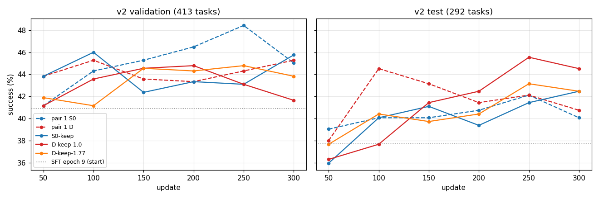
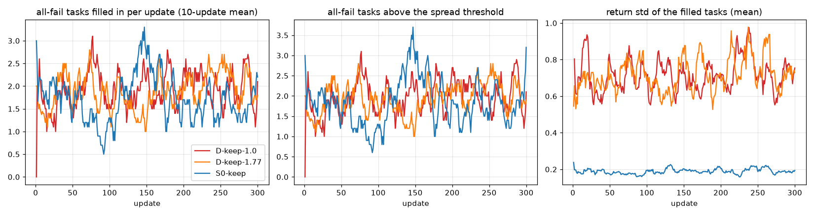

# 第十二轮批次报告（2026-10-19 至 10-22）

本报告覆盖第十二轮批次和密集奖励第一批。前半轮（复现对照、标准做法）的细节见 `REPORT_R12_20261019.md`。所有成功率都是 v2 评测集上的：验证集 413 道题、评测集 292 道题。每个 RL 按验证集挑检查点，再报它的评测集。"两集合并"指 705 道题合在一起的成功率；p 值用的是逐题配对的符号检验，只看两方结果不同的题。

## 结论

1. **修正包复现了，稀疏和密集在任何一组里都没有显著差别。**
   - 修正包：GRPO，只用有成有败的题。
   - 两个新种子（20261019、20261021）都比 SFT 起点（验证集 40.9%、评测集 37.7%）高：
     - S0：验证集 +7.0 到 +7.5 个点，评测集 +4.4 到 +5.5 个点；
     - D：验证集 +4.4 到 +4.6 个点，评测集 +6.5 到 +6.8 个点。
   - 同一做法换种子，两集合并只差 0.2 个点（S0：46.0% 对 45.8%）或 0 个点（D：45.0% 对 45.0%），p = 1.0。
   - 本批每一组的 S0 对 D，两集合并的差都在 3.1 个点以内，p 都 ≥ 0.08。
2. **第二对（48 道候选）、先易后难都和第一对没有差别。**
   - 第二对：S0 46.0% 对 45.8%，D 45.7% 对 45.0%，都比的是第一对。
   - 先易后难已经从矩阵去掉。
3. **数据规模：SFT 从 50 个场景到 745 个场景一路上升，400 个以后几乎持平；RL 在每个规模上都比它的 SFT 起点高。**
   - SFT 验证集 19.1% → 29.1% → 35.4% → 39.2% → 40.9%，分别是 50、100、200、400、745 个场景。
   - 题数相同时，分散到 745 个场景（每个约 4 道题）和集中在 200 个场景差不多：验证集 34.6% 对 35.4%。
   - 100 个和 400 个场景的 RL 都被格式漂移停在早期，最好的点不能和第一对的第 250 次直接比。
4. **格式漂移是本批最大的问题：13 个 RL 被"读不出动作"的停止线停下。**
   - 按熵分成两类：
     - 熵跳高、编造动作名（8 个）：起点是 SFT 不足的模型；
     - 慢慢漂移、空动作或照抄占位名（5 个）。
   - 宽松解析在 11 个有完整记录的 RL 里，只多读出 8.7% 的读不出回答。
   - A 组从原始 7B 直接 RL，开不开熵奖励都在第 29–44 次崩掉，没有一个检查点。
   - 所以按你的决定，冻结期先给原始 7B 做格式 SFT，再做 A 组。
5. **密集奖励第一批：把全失败的题补进训练，对成功率没有可测的影响。**
   - 三个变体：D-keep-1.0、D-keep-1.77、S0-keep。
   - 各自对它的第一对对照，两集合并差 −0.9 到 −2.3 个点，p = 0.23–0.67。
   - 变体之间：p = 0.93。
   - 每次更新只补进约 1–2.6 道全失败题；它们的回报标准差约 0.64–0.82（D）、约 0.19（S0），都低于下限，组内比较的信号被压到原来的 0.07–0.63 倍。
   - 一个附带的观察：D-keep-1.0 的碰撞率 8.3%，第一对 D 是 14.7%。
6. **工程上：**
   - 渲染服务开 32 个进程，同样的题每次更新从 165 秒降到 70 秒；第一批每次更新约 75–88 秒。
   - 10-20 夜里用户目录写满 22 TB 配额，训练链停了 8.6 小时。之后 3,260 GB 的检查点归档到 AOSS，各链只留最好和最后的检查点。
   - 冻结期的主线改动已全部进 main（第九节）。

## 要你决定的事（每项推荐放第一个）

1. **第二批要不要打开宽松解析**（`lenient_parse`，默认关）。
   - 甲（推荐）：不开。代价：A 组如果再出现 `turn left` 这种写法，照样算读不出。它救回的主要是这种写法，而这种写法本身就是格式在松动；打开后也会和所有对照的严格解析不成对。
   - 乙：只在 A 组打开，A 组的 S0、D 都开。代价：A 组的结果不能和本批 A 组、第一对的读不出比例直接比。
2. **要不要试加大读不出回答的扣分**（`invalid_penalty`，现在是 −0.1）。
   - 甲（推荐）：第二批不改，等格式 SFT 起点的 A 组结果出来再定。代价：如果 A 组还是慢慢漂移，要再排一批。
   - 乙：在 A 组上加一对 −0.5（S0、D 各一个）。代价：约 2 × 300 次 × 80 秒 × 9 张卡 ≈ 120 卡·小时，加上排队。
   - 系统提示里写的扣分保持 −0.1（SFT 对话里的文字），环境实际扣 −0.5。这和密集奖励的做法一样：提示里也没写进度奖励。
3. **D-cond + keep 还跑不跑。** 第四节已安排；第一批说明，在现在的 D 下补题没有用。
   - 甲（推荐）：照第四节跑。理由：D-cond 下失败的题也有分级的进度，全失败题的回报会散开得多，门槛要按 D_cond 的回报重标，补进来的题和第一批不是一回事。
   - 乙：去掉 C0 上的 D-cond + keep，只留 A 组的。代价：省约 60 卡·小时，但 C0 上就不知道 D-cond 下补题有没有用。
4. **格式监督要不要混进 RL 的每次更新**（3.1.5，只估算，没有实现）。
   - 甲（推荐）：先不做。格式 SFT 如果通过验收，A 组的崩溃可能已经解决。
   - 乙：实现。代价见第十节：约 1–2 天代码和测试，每次更新多 3%–5% 的时间。

## 先说清楚几个词

- **S0 / D**：稀疏奖励（只在成功时给 +5，另有每步、碰撞、读不出的扣分）/ 密集奖励（S0 之外，每个回合按进度的变化给分：5 ×（0.99 × 新进度 − 旧进度））。
- **进度**：环境算的"离满足全部成功条件还有多远"，0 到 1，没成功时略低于 1。现在的版本是所有条件得分的乘积。
- **有成有败的题**：一道题的 8 次尝试里既有成功也有失败。修正包只拿这种题训练，因为全成功、全失败的题组内比较没有信号。
- **补题（keep_by_return_std）**：有成有败的题不够填满一次更新时，把 8 次回报的标准差不低于门槛的全失败题补进来；组内比较时除的标准差至少取下限。
- **读不出的回答**：环境读不出任何可执行动作的回答。停止线是最后 10 次更新里每条轨迹读不出的回合占比的平均：10-21 11:08 以前 5%，之后 10%。
- **终点进度分、终点满足的条件**：评测时最后一个姿态的进度（只算失败的题）/ 题族的成功条件在终点满足了几成。

## 一、复现对（修正包的 3 个种子）

| 种子 | 评测集 | S0 挑出的检查点：验证集 / 评测集 | D 挑出的检查点：验证集 / 评测集 | 说明 |
| --- | --- | --- | --- | --- |
| 20260930（第十一轮） | **v1**（398 / 279 道） | 第 300 次：48.7% / 43.4% | 第 150 次：46.5% / 45.5% | 题集不同，只作参考 |
| 20261019（第一对） | v2 | 第 250 次：48.4% / 42.1% | 第 100 次：45.3% / 44.5% | 各对照的基准 |
| 20261021（C0 第三个种子） | v2 | 第 150 次：47.9% / 43.2% | 第 300 次：45.5% / 44.2% | |
| SFT 第 9 个 epoch（起点） | v2 | 40.9% / 37.7% | 同左 | |

- **两个 v2 种子之间**：S0 两集合并 46.0% 对 45.8%（只有一方做成的题 62 对 61，p = 1.0）；D 45.0% 对 45.0%（79 对 79，p = 1.0）。
- **同一种子里 S0 对 D**：第一对 45.8% 对 45.0%，第三个种子 46.0% 对 45.0%（p = 0.61）。
- **规律**：S0 在验证集上高 2.4–3.1 个点，D 在评测集上高 1.0–2.4 个点。两个种子方向一致，但都不显著。
- **终点的样子**（两集合并，挑出的检查点）：
  - 失败的题终点进度分 S0 0.087 / 0.081、D 0.093 / 0.091（第一对 / 第三个种子）。
  - 碰撞率 S0 10.0% / 13.4%、D 14.7% / 10.3%：两个种子方向相反，这一项种子之间的波动比 S0 / D 之间的大。

## 二、第二对：48 道候选（更新效率消融）

| | 挑出的检查点 | 验证集 / 评测集 | 对第一对（两集合并） |
| --- | --- | --- | --- |
| S0 | 第 250 次 | 48.4% / 42.5% | 46.0% 对 45.8%，70 对 69，p = 1.0 |
| D | 第 200 次 | 47.5% / 43.2% | 45.7% 对 45.0%，73 对 68，p = 0.74 |

- **D 对 S0**：45.7% 对 46.0%，p = 0.93。
- **没有成对训满**：D 在第 263 次被 5% 线停下（照抄占位名），两方在第 250 次及以前比较；S0 第 300 次不成对。
- **更新效率**：48 道候选让每次更新多抽一倍的题，但第二对当时渲染服务只有 12 个进程，渲染拖慢了更新（见第八节）。所以"每次更新更慢"主要是渲染的原因，不能算作这个做法的代价。

## 三、先易后难

| | 挑出的检查点 | 验证集 / 评测集 | 对第一对（两集合并） |
| --- | --- | --- | --- |
| S0 | 第 200 次 | 47.2% / 42.5% | 45.2% 对 45.8%，63 对 67，p = 0.79 |
| D | 第 250 次 | 46.2% / 42.5% | 44.7% 对 45.0%，87 对 89，p = 0.94 |

- 先易后难：前 50 次只用最少步数 1–3 的题，之后用全部的题。
- **D 对 S0**：44.7% 对 45.2%，p = 0.79。
- **D 的误停已撤销**：起点只抽简单题，第 51 次起换成全部题，成功率自然从约 70% 降到约 40%，触发了"成功率下降"停止线；按你的决定，这一组关掉了下降线。
- **结论：没有差别**，已从矩阵去掉，不再安排种子。

## 四、数据规模曲线（SFT 和 RL）

详见 `SCALE_CURVE_R12.md`（图 `figs_r12/fig8_scale_curve.png`）。

| 训练场景数 | SFT（挑出的 epoch）：验证集 / 评测集 | RL S0：验证集 / 评测集 | RL D：验证集 / 评测集 |
| --- | --- | --- | --- |
| 50 | 第 6 个：19.1% / 21.9% | — | — |
| 100 | 第 6 个：29.1% / 26.7% | 第 50 次：32.9% / 34.6% | 第 50 次：31.0% / 29.8% |
| 200 | 第 6 个：35.4% / 32.9% | — | — |
| 400 | 第 6 个：39.2% / 37.0% | 第 50 次：43.1% / 38.7% | 第 100 次：43.3% / 44.9% |
| 745（全部） | 第 9 个：40.9% / 37.7% | 第 250 次：48.4% / 42.1% | 第 100 次：45.3% / 44.5% |
| 745 个场景、每个约 4 道（题数同 200） | 第 8 个：34.6% / 31.5% | — | — |

- **SFT**：从 50 到 400 个场景单调上升，400 以后几乎持平（验证集 39.2% 对 40.9%；两集合并 38.3% 对 39.6%，p = 0.54）。题数相同时，集中在 200 个场景和分散到 745 个场景差不多（验证集 35.4% 对 34.6%，评测集 32.9% 对 31.5%；没有做逐题检验）。
- **RL**：每个规模都比它的 SFT 起点高。但 100 和 400 个场景的 RL 都在早期被格式漂移停下（第 71–198 次），最好的检查点只到第 50–100 次。
- **同在第 50 次比**：RL 比 SFT 高的幅度在 100、400 个场景约 2–4 个点（验证集），全部场景是 0–3 个点。
- **S0 对 D**：100 个场景 33.6% 对 30.5%（p = 0.08），400 个场景 41.3% 对 44.0%（p = 0.12），方向不一致。

## 五、格式漂移

详见 `FORMAT_DRIFT_R12.md`（10-22 已更正表 2）和 `LENIENT_PARSE_R12.md`。

- **13 个 RL 被停下，按训练中熵的最高值分成两类：**
  - **熵跳高、编造动作名（8 个）**：A 组两方、A 组熵关两方、E1-S0、100 个场景两方、400 个场景 D。
    - 起点都是格式没学牢的模型：原始 7B、SFT 第 1 个 epoch、或只训了 6 个 epoch 的数据规模 SFT。
    - 熵升到起点的 2–7 倍。
  - **慢慢漂移（5 个）**：E1 熵关 S0、400 个场景 S0、C0 第三个种子 S0、第二对两方。
    - 熵最高只到 0.04–0.21。
    - 读不出的回答是空动作 `<action></action>`、丢了开头标签、照抄格式示例里的占位名（`action1`）。
- **宽松解析**：接受空格代替下划线、第一个完整的动作块、丢了开头标签。
  - 在 11 个有完整记录的 RL 停下前 10 次更新里，多读出 18,248 个读不出回答中的 1,588 个（8.7%）。
  - 其中 92% 是空格写法。
  - 按停下那一刻算，3 个会留在线下（100 个场景 S0、400 个场景 D、E1 熵关 S0），8 个照样会停。
  - 慢慢漂移那一类读出 0%–6.2%。
- **更正**：`FORMAT_DRIFT_R12.md` 表 2 原来用我自己的写法判断读不出，多数了环境本来就能读的回答（第一段合法、后面多出内容）。
  - 用环境自己的解析代码重数，和训练日志记的停止线的量每次更新都一致。
  - E1 熵关 S0 读不出的是 1,541 个，不是 2,813 个；"40% 取第一段完整动作块就能读出"是错的，实际是 6.2%。
- **训练中读不出比例的起点都是 0%**：格式问题都是 RL 中途长出来的，而且停下时训练成功率大多没掉。
- **冻结期的应对（都已进 main，见第九节）**：
  - 提示的格式示例改用真实动作名（已设为以后数据和训练的默认）；
  - 宽松解析和读不出扣分两个开关（默认不变）；
  - 原始 7B 的格式 SFT 工具。

## 六、A 组和 E1 熵关

| 实验 | 起点 | S0 | D | 说明 |
| --- | --- | --- | --- | --- |
| A 组 | 原始 7B | 第 29 次被 5% 线停下 | 第 41 次被 5% 线停下 | 编造或缩写的名字（`move_back`、`left`），熵升到 0.31 / 0.88；没有检查点 |
| A 组熵关（变体） | 原始 7B，熵奖励 0 | 第 40 次被 10% 线停下 | 第 44 次被 10% 线停下 | 熵 0.22 → 0.62 / 0.23 → 0.56，形式和开着熵奖励时一样；没有检查点 |
| E1 | SFT 第 1 个 epoch | 第 45 次被 5% 线停下 | 按你的决定取消 | 乱码名、空格写法，熵升到 0.81 |
| E1 熵关（变体） | SFT 第 1 个 epoch，熵奖励 0 | 第 67 次被 10% 线停下；第 50 次检查点：验证集 35.6%、评测集 34.9% | 10-22 按你的决定取消 | **不成对**；S0 读不出的是空动作和丢开头标签，熵没有暴涨 |

- **原始 7B 的格式没有学牢**：开不开熵奖励都在第 30–45 次崩，关掉熵奖励只多撑了约 10 次。
- **训练成功率在崩之前确实在涨**：A 组从约 9% 涨到 13%–23%。
- **所以 A 组改为先做格式 SFT 再 RL**（你的决定 1）。
  - 格式 SFT：从现有 SFT 数据里抽几百条一到两轮的短对话，显示真实动作名，训 1–2 个 epoch，学习率小。
  - 验收：200 道训练题 × 4 次、温度 0.8，读不出 ≤ 1%，成功率接近原始模型的 5%–9%，并报告熵。

## 七、密集奖励：诊断和第一批

### 7.1 诊断（`DENSE_DIAG_R12_20261021.md`，10-21 已更正）

- **失败的题进度几乎是 0**。进度是所有条件得分的乘积，只要一个条件差得远就接近 0。v2 验证集 413 道题的起点：平均进度 0.048，超过 0.1 的只有 14%。
- **D 在成功时付的是和 S0 一样的 +5**，只在之前的回合多付 5 ×（0.99 × 新进度 − 旧进度），每条成功的轨迹约多 0.7。
  - 原因：环境在成功的那个动作结束这一回合，不付那一回合的进度分。
  - 一回合就成功的轨迹，两者都是 5.0。
- **约 41% 的候选题因为全失败被丢掉**；这是补题（第一批）和 D-cond（第二批）的出发点。

### 7.2 第一批的结果

起点是 SFT 第 9 个 epoch，种子 20261019，后备题，训满 300 次，每 50 次评测；对照是第一对。门槛取第一对训练记录里全失败题回报离散度最大的 20%（D 0.335，S0 0.134，`KEEP_THRESHOLD_R12_20261021.md`）。

| | 挑出的检查点 | 验证集 / 评测集 | 失败的题终点进度分 | 终点满足的条件 | 碰撞率 | 读不出的回合 |
| --- | --- | --- | --- | --- | --- | --- |
| 第一对 S0（对照） | 第 250 次 | 48.4% / 42.1% | 0.087 | 75.9% | 10.0% | 0.07%（照抄占位名 3 个） |
| 第一对 D（对照） | 第 100 次 | 45.3% / 44.5% | 0.093 | 77.4% | 14.7% | 0.02% |
| S0-keep（门槛 0.134，下限 1.77） | 第 100 次 | 46.0% / 40.1% | 0.079 | 75.8% | 8.7% | 0.07%（占位名 2 个、编造 1 个） |
| D-keep-1.77（门槛 0.335，下限 1.77） | 第 250 次 | 44.8% / 43.2% | 0.099 | 76.7% | 11.5% | 0% |
| D-keep-1.0（门槛 0.335，下限 1.0） | 第 200 次 | 44.8% / 42.5% | 0.095 | 77.7% | 8.3% | 0.02% |

后四列是两集合并、挑出的检查点上的数：终点进度分只算失败的题；终点满足的条件是题族的成功条件在终点满足了几成；碰撞率是被挡住的动作占全部动作的比例。

**五个逐题对比**（两集合并，705 道题）：

| 对比 | 成功率 | 只有前者做成 / 只有后者做成 | p | 按题族的差（个点，前者减后者） |
| --- | --- | --- | --- | --- |
| D-keep-1.0 对第一对 D | 43.8% 对 45.0% | 81 / 89 | 0.59 | 绝对位置 +3.2，等距 −1.6，视野包含 −4.0，遮挡 −5.0，投影 +4.8，占比 −5.6 |
| D-keep-1.77 对第一对 D | 44.1% 对 45.0% | 66 / 72 | 0.67 | +2.4，−3.2，−3.2，0，−0.8，0 |
| S0-keep 对第一对 S0 | 43.5% 对 45.8% | 71 / 87 | 0.23 | −2.4，+3.2，−6.4，0，+1.6，−8.8 |
| D-keep-1.0 对 S0-keep | 43.8% 对 43.5% | 68 / 66 | 0.93 | +1.6，−3.2，+1.6，−2.5，+2.4，+0.8 |
| D-keep-1.0 对 D-keep-1.77 | 43.8% 对 44.1% | 69 / 71 | 0.93 | +0.8，+1.6，−0.8，−5.0，+5.6，−5.6 |

每个题族约 125 道题（遮挡 80 道），一个题族差 5 个点大约是 6 道题，都在随机波动之内。

图 1：横轴是第几次更新，纵轴是成功率。虚线是第一对，实线是第一批，灰色点线是 SFT 起点。验证集上第一对 S0 第 250 次最高；评测集上 D-keep-1.0 第 250 次最高（45.5%），但它在验证集上不是最好的，按规则不挑它。

**补进了多少题、信号多大**（训练记录，每 25 次一段）：

- **每次更新补进约 1.0–2.6 道全失败题**（25 次一段的平均；三个变体都是）。一次更新有 12 个位置，加上补进来的，实际用上约 7–10 个。
  - 过门槛的全失败题几乎都补进去了，所以补得少是因为过门槛的少，不是位置不够。
- **补进来的题的回报标准差**：D 两个变体平均约 0.64–0.82，S0-keep 约 0.18–0.20。
  - 都低于下限（1.0 或 1.77），组内比较的信号被压小：训练记录里补进来的题的平均缩放是 0.47–0.63 倍（D-keep-1.0）、0.31–0.45 倍（D-keep-1.77）、0.07–0.11 倍（S0-keep）。
- **S0-keep 后段读不出的回合在慢慢升**：第 126–150 次 1.0%，第 251–275 次 1.7%，第 276–300 次 2.5%。还在 10% 线以下，和其他从第 9 个 epoch 出发的 S0 的慢慢漂移一样。D 两个变体一直在 0.1% 以下。

图 2：左边是每次更新补进来的全失败题数，中间是回报离散度过门槛的全失败题数，右边是补进来的题的回报标准差（都是 10 次平均）。红、橙是 D 两个变体，蓝是 S0-keep。

**第一批的结论**：
- 在现在的 D（进度是乘积）下，全失败题的回报几乎没有分级（标准差约 0.7，有成有败的题至少 1.77），补进来的少、信号也小，对成功率没有可测的影响。
- 唯一看得到的变化是 D-keep-1.0 碰撞率低（8.3% 对 14.7%）。但第一对和第三个种子的 D 碰撞率本身就差 4 个点（14.7% 对 10.3%），不能算作补题的效果。
- 这说明 D 需要失败的题也有分级的进度，也就是 D-cond（第二批）。

### 7.3 D-cond（第二批要用的进度版本，已实现）

- **做法**（你的决定 2）：进度 = 0.25 × 画面组 + 0.25 × 看清组 + 0.5 × 关系组。
  - 组内各条件得分相乘。
  - 关系组只在目标在画面里时计入（硬门槛）。
  - 画面组保持现有的连续分。
- **在 v2 验证集起点上**：平均进度从 0.048 升到 0.22，超过 0.1 的题从 14% 升到 55%（`docs/dense_reward_dcond.md`）。
- **代码**：环境配置 `progress_version: grouped_gated`，奖励预设 `D_cond`，标准配置 `v10_p1_Dcond`；默认不变，旧输出逐位相同（测试核对了 360 个姿态）。

## 八、渲染提速、排队、磁盘和归档

- **渲染提速**：
  - 渲染服务原来 12 个进程、每个只装一个场景，一次更新 24 个场景，场景被反复换出再从共用盘读回。
  - 改成 32 个进程（同一张卡，画面不变，显存约 45 GB）。同样的题，一次更新从 165 秒降到 70 秒，其中采样从 121 秒降到 23 秒。
  - 第一批每次更新约 75–88 秒。已设为标准配置的默认值。
- **排队**：
  - 本批每个训练任务等一台 8 卡机器，最长等了 5.5–21.3 小时（A 组熵关 21.3 小时）。前面多是用户其他项目的任务。
  - 第一批的两个 D 改投 h800 后 50 分钟就开始训练。训练和渲染不在一个池也能通（访问 5 毫秒）。
- **渲染服务搬家**（另一个会话的开关，你已同意）：渲染服务在训练任务排队时独占一台机器，就搬到忙的机器上。已设为标准配置的默认值。
- **配额事故**：
  - 用户目录配额 22 TB。10-20 20:30 写满后所有写入失败，训练链从 21:02 停到 10-21 05:40（8.6 小时）。
  - 处理：
    - 删了不评测的奇数 epoch 705 GB；
    - 删了接着训才用的部分 540 GB；
    - 3,260 GB 检查点传到 AOSS（`fj:s3://baiqiao/vagen_lite_archive/`，清单在 `/mnt/umm/users/yinbaiqiao/aoss_archive_manifests/`）后删除。
  - 之后用量 18 TB。批次各链按 `retain: best_and_last` 只留验证集最好和最后的检查点。守护进程每 30 分钟查一次配额，超过 19 TB 记录。

## 九、冻结期的主线改动（已进 main，按提交顺序）

每项都是新开关、单独提交、带测试，默认不改正在跑的任务所依赖的行为；全部测试通过（最后一次全量 455 项通过、1 项跳过）。

| 提交 | 改动 | 默认 |
| --- | --- | --- |
| `1b09a5cb` | 提示的格式示例：`<action>move_forward\|turn_left\|</action>` 代替 `action1\|action2\|...`（3.1.1）；rl-config 核对 RL 的文字和起点模型的 SFT 对话一致；评测和训练链按模型训练时的文字评测 | 代码默认旧文字 |
| `ea59b987`、`b0c24cdf` | **新文字设为以后数据和训练的默认**（SFT 导出策略 `format_example: action_names`）；从旧数据训的模型做 RL 要写明 `--format-example placeholder`，rl-config 会核对 | 以后的数据用新文字 |
| `accc7aee` | 宽松解析开关 `lenient_parse`（3.1.2）：空格代替下划线、第一个完整的动作块、丢了开头标签 | 关 |
| `2207a920` | 读不出回答的扣分开关 `invalid_penalty`（3.1.3），提示里的文字不变 | −0.1 |
| `28f195a4` | D-cond 进度版本 `progress_version: grouped_gated`、预设 `D_cond`、标准 `v10_p1_Dcond`（3.2.1）；plan 里的补题门槛可以直接传给 rl-config | 乘积版本，逐位不变 |
| `2d46d971` | 标准配置的链默认值（决定 3）：32 个渲染进程、渲染先、渲染服务搬家、10% 停止线（和本批其余停止条件）、启动重提 5 次 | 只对写了标准配置的 plan 生效，plan 里写明的值优先 |
| `7d90ae6c` | `VAGEN_LITE_WORKTREE`：sco 任务从别的副本启动（第二批用） | 不设时和以前一样 |
| `3d4307b8` | 格式 SFT 工具（3.1.4）：`training_prep format-sft`、SFT 学习率选项、评测记录熵 `--entropy` 和按轨迹平均的读不出比例 | — |
| `8383ce74` | 矩阵登记 `configs/matrix_r12.json`（3.3）：A–E 计划中、C0 已完成，每组一对 S0 / D；P0、P1 路径留空 | — |
| `16762525` | `docs/TRAINING_LINE_DEPENDENCIES.md` 更新到第十二轮结束（3.4） | — |
| `d7035fd6` | 宽松解析的收益报告和格式漂移表 2 的更正 | — |

## 十、把格式监督混进 RL 更新的成本（3.1.5，只估算）

- **做法**：每次 RL 更新时，从格式 SFT 的对话里抽 K 条，算它们助手回合的交叉熵，以系数 λ 加进策略的损失。要 S0、D 两方都加（成对原则）。
- **算力**：每次更新训练约 96 条轨迹（12 道题 × 8 次），每条十几个回合、约 6,000 个 token。K = 16 条两回合的短对话约 32,000 个 token，是它的 5% 左右。按一次更新 70–80 秒、其中训练约 45 秒算，每次多约 2–4 秒（3%–5%）。300 次的一个 RL 多约 2 卡·小时（8 卡 × 15 分钟）。
- **工程**：
  - verl 的 actor 更新要接第二个数据流和损失项（`verl/` 子模块和 `vagen/ray_trainer.py`），加开关和 λ。
  - 测试：损失可复现、梯度只在助手 token 上。
  - 约 1–2 天。
- **风险**：λ 要调；和 KL、熵奖励一起作用；会把模型往 SFT 的分布上拉，可能抵消一部分 RL 的提升。
- **建议**：先看格式 SFT 起点的 A 组结果（第二批），不行再做。

## 十一、接下来（GPU，冻结期内，按顺序）

1. **格式 SFT**：用 `format-sft` 从第十一轮 SFT 数据抽 400 + 40 条短对话；在原始 7B 上训 2 个 epoch，学习率 5e-6（标准 SFT 的一半；440 条对话在有效批量 64 下每个 epoch 只有约 7 步，2e-6 几乎不动模型），单个 8 卡任务约 20 分钟。数据已生成（`interiorgs_v10_r12_20261019/format_sft`，400 + 40 条，一轮 188 条、两轮 252 条，全部按原文替换，没有跳过的），验收集也已生成（`eval_accept_reserve200`，200 道后备训练题、172 个场景）。每个 epoch 用 200 道后备训练题 × 4 次、温度 0.8 做验收，原始 7B 同样评一次作对照。
2. **D-cond 的曲线（3.2.2，CPU）**：把已有评测轨迹按新进度重算，画成功 / 失败轨迹的进度随回合的曲线和失败轨迹的终点分布。
3. **D_cond 下补题的门槛**：用第一对 D 的训练记录按新进度重算回报，取全失败题离散度最大的 20%。
4. **密集奖励第二批**（从副本 `/mnt/umm/users/yinbaiqiao/VAGEN-Lite-r12dense` 跑）：
   - C0：D-cond、D-cond + keep。C0 的模型是用旧文字训的，plan 里写明 `format_example: placeholder`，和对照一致。
   - A 组（格式 SFT 起点）：S0、D、D-cond + keep。
   - 提交后报告任务名、池和预计完成时间。

## 依据

- 看板：`cluster_runs/BATCH_R12.md`（集群上每半小时更新，结果一节有每组挑出的检查点和对比）。
- 第一批：脚本 `exps/vagen_active_spatial/interiorgs_v10_r12_20261019/scripts/dense_batch1_results_r12.py`，数字在同目录 `analysis/dense_batch1/results.json`（每个检查点的成功率、挑出的检查点的终点指标和按题族的条件、五个对比、每次更新的补题记录）。
- 分报告：`DENSE_DIAG_R12_20261021.md`、`KEEP_THRESHOLD_R12_20261021.md`、`FORMAT_DRIFT_R12.md`、`LENIENT_PARSE_R12.md`、`SCALE_CURVE_R12.md`、`docs/dense_reward_dcond.md`。
