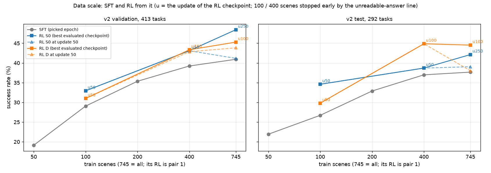

# 数据规模曲线（第十二轮，2026-10-22，用现有的检查点）

## 结论

- **SFT 随场景数稳定上升，400 个场景以后变平。**
  - SFT 是只训练格式和走法的监督学习。
  - 50 → 745 个场景（745 是全部训练场景）：验证集 19.1% → 40.9%，评测集 21.9% → 37.7%。
  - 400 和 745 个场景只差 1.7（验证集）和 0.7（评测集）个百分点。
- **RL 在每个规模上都高于它的 SFT 起点**：
  - 100 个场景高 2–8 个百分点；
  - 400 个场景高 2–8 个百分点；
  - 全量（第一对）高 4–8 个百分点。
- **但 100 和 400 个场景的 RL 只有很早的检查点**（第 50–150 次更新）：它们被"读不出动作"的停止线提前停下（见 `FORMAT_DRIFT_R12.md`）。和训到第 250 次的全量最好检查点（第一对）不能直接比。
- **同样只训 50 次（虚线）**：
  - 验证集上 RL 比 SFT 高出的部分，100 和 400 个场景（约 2–4 个百分点）不比全量少（0–3 个百分点）。
  - 也就是说，数据少时 RL 早期的提高并不小。
  - 这 2–4 个百分点和单个模型在验证集上的随机波动（约 ±2.4 个百分点）差不多大，要谨慎看。
- **S0 和 D 在各规模上没有一致的差别。**
  - S0 是稀疏奖励，只在成功时给奖励；D 是密集奖励，每一步按离成功的进度给奖励。
  - 验证集上 S0 在 100 个场景和全量略高，400 个场景持平；评测集上 D 在 400 个场景和全量略高，100 个场景略低。
  - 差别都在随机波动的范围里。

## 表：每个规模的 SFT 和 RL

验证集 413 道、评测集 292 道，都是 v2；成功率是做成的题占全部题的比例。RL 检查点按验证集挑最好的（并列取较早的），括号里是第几次更新。

| 场景数 | SFT 挑出的 epoch | SFT（验证 / 评测） | RL S0 最好（验证 / 评测） | RL D 最好（验证 / 评测） | RL 第 50 次（S0；D） | RL 到第几次停下 |
| --- | --- | --- | --- | --- | --- | --- |
| 50 | 第 6 个 | 19.1% / 21.9% | 没有 RL | 没有 RL | — | — |
| 100 | 第 6 个 | 29.1% / 26.7% | 32.9% / 34.6%（第 50 次） | 31.0% / 29.8%（第 50 次） | 32.9% / 34.6%；31.0% / 29.8% | S0 第 87 次、D 第 71 次（只用第 50 次的检查点） |
| 200 | 第 6 个 | 35.4% / 32.9% | 没有 RL | 没有 RL | — | — |
| 400 | 第 6 个 | 39.2% / 37.0% | 43.1% / 38.7%（第 50 次） | 43.3% / 44.9%（第 100 次） | 43.1% / 38.7%；42.9% / 44.9% | S0 第 147 次、D 第 198 次 |
| 745（全部） | 第 9 个（第十一轮） | 40.9% / 37.7% | 48.4% / 42.1%（第 250 次） | 45.3% / 44.5%（第 100 次） | 41.2% / 39.0%；43.8% / 38.0% | 都训满 300 次（第一对） |

- 400 个场景其余的检查点：S0 第 100 次 42.4% / 41.1%；D 第 50 次 42.9% / 44.9%，第 150 次 40.9% / 43.8%。
- 数据规模那几组的 SFT 都挑在第 6 个 epoch（按验证集）。全量用的是第十一轮挑出的第 9 个 epoch，起点不完全一样。
- 745 个场景、题数和 200 个场景相同的那一组（只有 SFT）另外比较，不在这条曲线上。

## 图

- 横轴是训练场景数（对数），纵轴是成功率；左边验证集、右边评测集。
- 灰线是 SFT，蓝线是 RL S0，橙线是 RL D。实线是各自最好的已评测检查点（标着第几次更新），虚线是第 50 次更新，各规模训练长度相同。
- 50 和 200 个场景没有做 RL。

## 依据和脚本

- 评测结果：`exps/vagen_active_spatial/interiorgs_v10_r12_20261019/eval_{val,test}_v2/`。全量 SFT 第 9 个 epoch 的 v2 结果，按看板的做法由 v1 和遮挡 v2 重评合并。
- 脚本：同目录 `scripts/scale_curve_r12.py`；数字：`analysis/scale_curve/scale_curve.json`。
