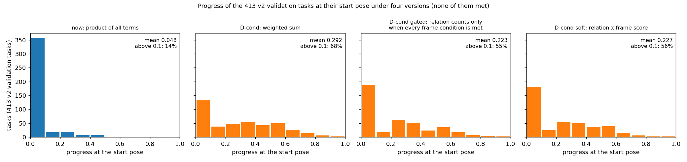

# D-cond：进度分按三组条件加权相加（供决定，2026-10-21）

## 结论

- **做法**：进度分 = 0.25 × 画面组 + 0.25 × 看清组 + 0.5 × 关系组。
  - 每组的得分是组内各条件得分的乘积；没成功时上限仍略低于 1。
  - 密集奖励的公式不变（势能差，系数 0.99），只是 φ 换成这个进度分。
  - 现在的进度分是所有条件得分的乘积，只要一个条件差得远，整体就接近 0。
- **按真实的题算**（v2 验证集 413 道题的起点，环境自己的成功判定）：
  - 平均进度分从 0.048 升到 0.29；
  - 进度分超过 0.1 的题从 14% 升到 68%。
  - 失败的题也有了分级的进度。
- **最大的风险**：只满足"关系"、两样东西都不在画面里，也能拿到将近一半的进度分（下面算例 4：0.48）。
  - 模型可能学会先凑关系、不去看目标，也就是"假进步"。
- **带门槛的版本**（10-21 补充，你提的）：关系那一组的分只在目标在画面里（画面组的条件全部满足）时才计入，其余两组照常相加。
  - 平均进度分 0.22，进度分超过 0.1 的题 55%；
  - "只满足关系、目标不在画面里"的状态从 0.56 降到 0.12；
  - 只差关系的状态不受影响（算例 1 仍是 0.54）。
- 起点状态的统计（413 道题，起点都没成功）：

| 起点缺的条件组 | 题数 | 占比 |
| --- | --- | --- |
| 三组都缺 | 192 | 46% |
| 画面 + 关系 | 85 | 21% |
| 只缺关系 | 73 | 18% |
| 画面 + 看清 | 23 | 6% |
| 看清 + 关系 | 19 | 5% |
| 只缺看清 | 11 | 3% |
| 只缺画面 | 10 | 2% |

## 三组条件

- **画面组**（目标在画面里）：物体在相机前方、没有被画面边缘切掉一半以上、在画面上不至于太小。条件名：`objects_present`、`in_front`、`visible`、`min_area`、`inside_frame`。遮挡对齐族还有遮挡物的同名四项（`occluder_*`）和 `target_in_front`、`target_in_view_direction`。
- **看清组**：题目要求的每个目标，以及描述里用来指认它的参照物，都至少有一个面看得清楚（`face_visible_v3` 规则）。条件名 `a_clearly_visible`、`b_clearly_visible`（报告里前缀 `target_` / `reference_`）、`required_targets_found`。
- **关系组**：题目本身要求的那个关系。

| 题族 | 关系组的条件 | 看清组要看清的 |
| --- | --- | --- |
| 绝对位置 | `distance`（离物体的距离在要求的 ±max(0.25 米, 10%) 内） | 目标 a |
| 等距 | `equidistant`（离两个物体的距离差在容差内） | a、b |
| 视野包含 | `fully_in_frame`（两个物体整个在画面里） | a、b |
| 遮挡对齐 | `target_hidden`（目标被遮挡物挡住至少 85%） | 遮挡物 b |
| 投影关系 | `relation`、`margin`（左右 / 前后关系成立且留出 12 像素余量）、`lateral_within_45deg` | a、b |
| 画面占比 | `occupancy`（物体占画面高度的比例在容差内）、`vertical_contained`（上下没出画面） | a |

- **两项归属要你确认**：`fully_in_frame`（视野包含）和 `vertical_contained`（画面占比）放在关系组，因为它们就是这两族题目本身要求的东西。第一轮诊断里它们按名字归进了画面组。
- **条件得分的形状**：
  - `in_front`、`visible`、`objects_present` 是 0 或 1；
  - `min_area`、`inside_frame` 是连续的比例；
  - 关系组的条件多数（距离、等距、占比、整个在画面里）用 1 /（1 +（误差 / 容差）²），正好在容差边上是 0.5，离得越远越小但不为 0；投影关系的余量用 S 形曲线，遮挡对齐的 `target_hidden` 是遮挡比例和对齐程度各半。

## 算例（真实的题，起点状态）

| 算例 | 题 | 画面组 | 看清组 | 关系组 | 现在的进度分 | D-cond |
| --- | --- | --- | --- | --- | --- | --- |
| 1. 只差关系 | 画面占比 `v10_09a4431a6666ab15a1acc8aa`：物体在画面里、看清了，占比差得远（`occupancy` 0.074） | 1 | 1 | 0.074 | 0.074 | 0.25 + 0.25 + 0.5 × 0.074 = **0.54** |
| 2. 只差画面 | 视野包含 `v10_2cbe1bcd149f3ee8a6f1a68d`：两个物体都在画面里、看清了，但一个物体有角落在相机后面（`in_front` 0） | 0 | 1 | 1 | 0 | 0 + 0.25 + 0.5 = **0.75** |
| 3. 全差 | 等距 `v10_66418b362686b9fd94e3aa8e`：目标在背后，距离差也大（`equidistant` 0.031） | 0 | 0 | 0.031 | 0 | 0.5 × 0.031 = **0.016** |
| 4. （风险）只满足关系 | 等距 `v10_3ed00fd109a57b53b14d0049`：差不多等距（`equidistant` 0.95），但目标不在画面里 | 0 | 0 | 0.95 | 0 | 0.5 × 0.95 = **0.48** |

**怎么读：**
- 算例 1 是 D-cond 想解决的情况："只差最后一步"现在只值 0.07，改后值 0.54，进度奖励能把模型往目标拉。
- 算例 2、4 是代价：
  - 画面组里有 0/1 的条件，一项不满足整组就是 0；
  - 其余两组照样给分，所以"差得不少"的状态也能拿到 0.5–0.75。
- 算例 3 不变，全差时 D-cond 也接近 0。

**按题族看起点的平均进度分**（现在 → D-cond）：

| 题族 | 现在 | D-cond |
| --- | --- | --- |
| 绝对位置 | 0.053 | 0.40 |
| 等距 | 0.026 | 0.23 |
| 视野包含 | 0.031 | 0.12 |
| 遮挡对齐 | 0.096 | 0.39 |
| 投影关系 | 0.059 | 0.28 |
| 画面占比 | 0.047 | 0.38 |

## 带门槛的版本（10-21 补充）

- **定义**：进度分 = 0.25 × 画面组 + 0.25 × 看清组 + 0.5 × 关系组 ×（画面组的条件全部满足时为 1，否则为 0）。
- **另一个写法（软门槛）**：关系组乘上画面组的得分，而不是 0 或 1。画面组里多数条件本来就是 0/1，两者结果接近。
- **同样的 413 道验证题起点**（起点都没成功）：

| 版本 | 平均进度分 | 中位数 | 第 90 百分位 | 进度分超过 0.1 的题 | 只满足关系、目标不在画面里（33 道）的平均 |
| --- | --- | --- | --- | --- | --- |
| 现在（所有条件相乘） | 0.048 | 0 | 0.165 | 14% | 0.053 |
| D-cond（三组相加） | 0.29 | 0.28 | 0.63 | 68% | 0.56 |
| **D-cond 带门槛** | **0.22** | **0.20** | **0.56** | **55%** | **0.12** |
| D-cond 软门槛 | 0.23 | 0.20 | 0.55 | 56% | 0.17 |

- **"只满足关系、目标不在画面里"**：关系组的条件全部满足、画面组没有全部满足。起点有 33 道题是这样。
  - 带门槛后平均还有 0.12：来自看清组和画面组里已满足的那部分，关系组不再计分。
  - 关系组得分至少 0.5、画面组没满足的题有 48 道：四个版本依次是 0.059 / 0.54 / 0.15 / 0.19。
- **上面四个算例在各版本下的得分**：

| 算例 | 现在 | 相加 | 带门槛 | 软门槛 |
| --- | --- | --- | --- | --- |
| 1. 只差关系（画面占比，占比差得远） | 0.074 | 0.54 | 0.54 | 0.54 |
| 2. 只差画面（视野包含，一个物体有角落在相机后面） | 0 | 0.75 | 0.25 | 0.25 |
| 3. 全差（等距） | 0 | 0.016 | 0 | 0 |
| 4. 只满足关系（等距，差不多等距但目标不在画面里） | 0 | 0.48 | 0 | 0 |

- **分布**：`figs_dcond/dcond_versions.png`。和相加的版本比，带门槛后进度分低于 0.1 的题从 132 道增加到 188 道。多出来的约 56 道主要来自 0.1–0.2 和 0.4–0.8 两段，就是画面组没满足、靠关系组拿分的那些。

- **代价**：目标进入画面之前，关系组没有任何梯度。模型先要把目标放进画面，才开始被拉向关系。本批的诊断里，提高主要也来自"把目标放进画面"，所以这个顺序和现在模型学会的顺序一致。

## 需要你决定

1. **权重。**
   - 甲（推荐）：0.25 / 0.25 / 0.5。关系最难、最能区分会不会做题，给一半；画面和看清各四分之一。
   - 乙：三组各 1/3。看清和画面的分量更大，模型会更早学会"把目标放进画面"，但关系组的拉力小。
   - 代价：两者都是改一行配置，测试相同。
2. **防"只凑关系、不看目标"**（和上一节的带门槛版本放在一起）。
   - 甲（推荐）：带门槛，关系组只在画面组的条件全部满足时计入（你提的版本）。只满足关系的状态 0.56 → 0.12，平均进度分 0.22，超过 0.1 的题 55%；说起来最简单（"目标在画面里，关系才算分"）。
   - 乙：软门槛，关系组乘上画面组的得分。和甲几乎一样（0.17、0.23、56%），画面组部分满足时关系也给一点分。
   - 丙：不加门槛，原样相加。进度信号最多（0.29、68%），但只满足关系的状态能拿 0.56，学偏的风险最大，要多一对 RL 才能发现。
   - 代价：甲、乙各多一行代码和一个测试；丙没有额外代码。
3. **画面组里 0/1 的条件要不要改成连续的**（比如 `in_front` 按物体在相机前方的比例给分）。
   - 甲（推荐）：先不改。它们只影响少数状态，起点 2% 的题只缺画面组。
   - 乙：改。画面组的梯度更平滑，但要动成功判定之外的打分代码，并核对旧版本完全复现。
   - 代价：乙约半天代码和测试。
4. **在哪个起点上做对照**（D-cond 的价值在失败多的地方）。
   - 甲（推荐）：先在 C0（SFT 第 9 个 epoch）上做 D-cond + D-keep 和 S0 一对，确认没有学偏；再上 A 组（原始 7B，约九成题全失败）。
   - 乙：直接在 A 组上做。
   - 代价：每对约 125 卡·小时；A 组要先看"熵奖励关掉"的重跑能不能避免格式崩溃。

## 实现位置（决定后做）

- `vagen/envs/active_spatial/target_visibility.py` 的 `apply_visibility`：现在把规范判定的进度和"看清"的进度相乘。
  - 加一个新开关，按上面的分组算加权和，默认仍是乘积。
  - 分组表放在 `canonical_task_metrics_v2.py` 旁边，用条件名分组，每族一行，加测试核对六个族的分组和上面四个算例。
- 环境配置加 `progress_mode: grouped`，奖励预设 `D_cond`，成功判定不变。
- 数字来源：
  - 脚本：`exps/vagen_active_spatial/interiorgs_v10_r12_20261019/scripts/dcond_examples_r12.py`
  - 结果：同目录 `analysis/dcond/dcond_examples.json`
