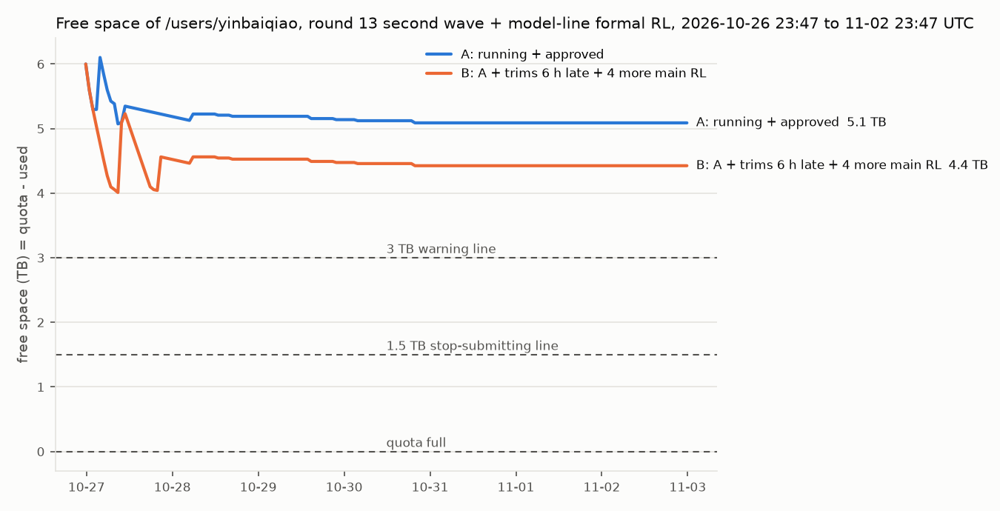

# 磁盘配额线状态（唯一的状态文档）

最后更新：2026-10-27 20:15 UTC（第二轮四批 b4–b7 已上传 AOSS 并删除，共 3,517.9 GB；配额表 14 TB）。

这条线管 `/mnt/umm/users/yinbaiqiao`（个人目录，配额 22 TB）：量、预测、提方案、按批准的清单执行，默认只读。

- 报告：[reports/](reports/)。第一步报告是 [reports/DISK_INVENTORY_20261026.md](reports/DISK_INVENTORY_20261026.md)；第一到三批的执行记录是 [reports/CLEANUP_20261026.md](reports/CLEANUP_20261026.md)。
- 保留规则：[RETENTION_POLICY.md](RETENTION_POLICY.md)；"磁盘紧张就不提交"约定：[STOP_FLAG_PROPOSAL.md](STOP_FLAG_PROPOSAL.md)（都已批）；给各线的转告：[RELAY_20261026.md](RELAY_20261026.md)。
- 脚本：仓库根目录 `disk/`，说明见 [README.md](README.md)。批次说明（批准了删什么）：[batches/](batches/)。
- worktree：`/mnt/umm/users/yinbaiqiao/VAGEN-Lite-disk`，本地分支 `disk`，从 `origin/main` `00363333` 开出，不跟踪远端，不推送。
- 原始结果和记录：`/mnt/umm/users/yinbaiqiao/disk_runs/`（批次记录在 `disk_runs/batches/<批次>/`，核查记录在 `disk_runs/audit/<批次>/`）。

## 1. 现在在哪一步

- 第一步（盘点与预测）：完成，你 10-26 已答复。
- 第二步（按批准的清单清理、保留规则、标志文件方案）：
  - 第一、二、三批已执行，共腾出 3,864.0 GB（第三批是 SenseNova-U1 冒烟检查点，root 任务 `pt-1r0uuww1` 删除）。
  - 保留规则和标志约定你已批，转告的话在 [RELAY_20261026.md](RELAY_20261026.md)。
  - 你批了但核查没过的 0.54 TB 交回下游线，0.06 TB 等主线确认。
- 第 6 项（probe_spatial、SenseNova-U1、Consistency 纳入这条线）：盘点完成，报告 [reports/SCOPE6_INVENTORY_20261026.md](reports/SCOPE6_INVENTORY_20261026.md)。
  - 3.6 TB 里约 1.81 TB 是公开下载（决定 3 不删），约 1.68 TB 是 probe_spatial 发布要用的，约 0.26 TB 是 root 属主的派生特征。
  - 唯一候选是 SenseNova-U1 的冒烟检查点 292.1 GB（root 属主），你批了，已作为第三批删除。
- 第三步（常驻监控）：10-26 07:37 起在跑；09:19 起带停止提交标志（`--stop-flag`）。
- 第二轮清理（10-27，你说"继续管理配额，Qwen2.5 已舍弃，只留必要的"）：报告 [reports/RECLAIM_20261027.md](reports/RECLAIM_20261027.md)，你四项都选甲，19:27–20:03 做完（执行记录在报告第 5 节）。
  - 模型线交来的清单 1,236.4 GB 已核对、核查通过，分 b4（模型线自己的 634.0 GB）、b5（Qwen3-VL 的 602.4 GB，归主线）。
  - Qwen2.5-VL 推荐删 2,154 GB（续训状态、最后但不是最好的、第十轮以前的旧权重、3B 试跑），每个实验的最好检查点和下游起点都留。
  - b4–b7 共 1,150 个文件、3,517.9 GB，都先上传 AOSS（0 个不符）、核查通过后删除；转告的话在 [RELAY_20261027.md](RELAY_20261027.md)。

## 2. 汇报表

以后每次汇报都用这张表，行列不变，只改数字和时间；没有变化不汇报。剩余 = 22 TB − 配额表读数（你的决定 4）。

| 项 | 数值 | 时间（UTC） | 说明 |
| --- | --- | --- | --- |
| 配额 | 22 TB | — | 按你的决定 4 |
| 已用（配额表） | 14 TB | 10-27 20:04 | 两位有效数字，±0.5 TB；17:03 到过 17 TB，第二轮删后回落；更新有延迟 |
| 剩余 | 8 TB | 10-27 20:04 | 22 − 配额表读数 |
| 已用（文件系统统计） | 10.54 TB | 10-27 20:04 | 只看变化趋势；删前 19:09 是 13.99 TB |
| 本步已腾出 | 7.38 TB | 10-27 20:03 | 第一轮 b1–b3 3,864.0 GB（10-26）；第二轮 b4–b7 3,517.9 GB（10-27） |
| 7 天内最低剩余（情形 A / B） | 5.07 / 4.01 TB | 预测于 10-27 00:00 | 第二轮删除之前的预测；删了 3.52 TB 后最低剩余相应上移，不会碰 3 TB 线 |
| 监控 | 在跑，PID 3214666，带停止提交标志 | 10-26 09:19 起 | 见第 6 节 |

## 3. 你的决定（10-26）

| 编号 | 决定 | 执行 |
| --- | --- | --- |
| 1 | 甲：批第一批清理清单 | 5.2.1、5.2.4、5.2.5 在第一批；5.2.6 在第二批；5.2.3（E0 检查点）因下游看板会读，交给下游线处理 |
| 2 | 甲："满 7 天即可删"提前删 | 主线组合链续训状态在第一批；RL-SPEED-1/2 在第二批；`evals_src` 因下游看板每轮都会读、RLINF-SMOKE-1 是下游导出测试脚本的默认输入，交给下游线处理 |
| 3 | 公开下载的模型和数据集不删 | "立刻可删"清单（0.15 TB）作废；RoboCasa365 的 `pretrain` 数据同样不删 |
| 4 | 不问管理员，按 22 TB 用 | 剩余按 22 − 配额表读数算；文件系统统计只看趋势 |
| 5 | 甲：现在开监控 | 07:37 已开（第 6 节）；停止提交标志在第二轮批了以后 09:19 加上 |
| 6 | probe_spatial、SenseNova-U1、Consistency 纳入这条线 | 盘点完成（`reports/SCOPE6_INVENTORY_20261026.md`）；其中两项在第二轮定了 |
| 7 | （10-22 报错）没有答复 | 待你告诉在哪看到的 |

10-26 第二轮（清理报告和第 6 项盘点之后），六项都选甲：

| 编号 | 决定 | 执行 |
| --- | --- | --- |
| 保留规则 | 批，转给主线、模型线、下游 | 转告的话写在 `RELAY_20261026.md`，由你转达 |
| 标志约定 | 批：1.5 TB 写、3 TB 删，评测不拦 | 监控 09:19 起带 `--stop-flag`；各线接入由你转达 |
| 交回下游的 0.54 TB | 转告下游，改好代码后它自己删或叫磁盘线删 | 写在 `RELAY_20261026.md` |
| 主线 3B 试跑 | 问主线，不要就由磁盘线归档后删 | 写在 `RELAY_20261026.md` |
| SenseNova-U1 冒烟检查点 | 先上传 AOSS 核对，再用 1 卡 root sco 任务删 | 已完成：第三批，root 任务 `pt-1r0uuww1`，09:24 删完 292.1 GB |
| InsScene-15K 的 root 本地特征镜像 | 不动 | — |

另外：下游线 07:14–07:16 按你在那边给的决定，自己删了 11 份已训完实验的全状态（1,296.8 GB，记录 `downstream_runs/logs/delete_full_states_20261026.txt`，没有上传 AOSS），也就是我清单里的 5.2.2，从清单划掉。

## 4. 清理批次

| 批次 | 内容 | 文件数 | 大小 | 上传 AOSS | 核查 | 删除 | 腾出 |
| --- | --- | ---: | ---: | --- | --- | --- | ---: |
| b1_20261026 | pilot r3 分片 1,692.0 GB；主线 9 个组合运行的续训状态 895.5 GB；R1 taskfix 第 50–200 步 165.9 GB；整理归档区 6 个子目录 223.5 GB | 10,583 | 2,976.9 GB | 08:20 完成，0 个不符 | 通过（`disk_runs/audit/b1/CONCLUSION.md`） | 08:24 完成 | 2,976.9 GB |
| b2_20261026 | RL-SPEED-1、RL-SPEED-2 的检查点 471.8 GB；StarVLA NavigateKitchen 检查点 123.3 GB | 105 | 595.0 GB | 08:27 完成，0 个不符 | 通过（`disk_runs/audit/b2/CONCLUSION.md`） | 08:28 完成 | 595.0 GB |
| 交给下游 | E1 权重副本 134.8 GB、E0 检查点 269.6 GB、RLINF-SMOKE-1 检查点 134.8 GB | — | 539.2 GB | — | 下游代码会读，未通过 | — | — |
| 两次 3B 试跑 | 62.6 GB，已并入 b6_20261027（第二轮决定 3） | — | — | — | — | — | — |
| b3_20261026 | SenseNova-U1 冒烟检查点 `SenseNova-U1/training/RUN/sensenovau1_8b_it2i_smoke3/`（root 属主） | 87 | 292.1 GB | 09:23 完成，0 个不符 | 通过（`disk_runs/audit/b3/CONCLUSION.md`） | 09:24 由 1 卡 root 任务 `pt-1r0uuww1` 删除（`disk/submit_root_delete.sh`） | 292.1 GB |
| AOSS 测速对象 | `disk_line_speedtest_20261026/base7b_shard1.safetensors` | 1 | 3.9 GB | — | — | 08:30 已删（记录 `disk_runs/logs/aoss_speedtest_object_deleted.txt`） | 不占配额 |
| b4_20261027 | 模型线清单里模型线自己的：Cambrian SFT 没选中的 epoch、冒烟 SFT、Cambrian RL 续训状态、下游冒烟 | 265 | 634.0 GB | 10-27 19:27 完成，0 个不符 | 通过（`disk_runs/audit/b45/CONCLUSION.md`） | 19:29 | 634.0 GB |
| b5_20261027 | 模型线清单里 Qwen3-VL 的（归主线，你直接批）：SFT 没选中的 epoch、冒烟、RL 续训状态、下游冒烟 | 261 | 602.4 GB | 19:35 完成，0 个不符 | 通过（同上） | 19:36 | 602.4 GB |
| b6_20261027 | Qwen2.5-VL：第十三轮 12 个续训状态 1,194.1；13 个最后但不是最好的权重 431.4；两次 3B 试跑 62.6 | 444 | 1,688.1 GB | 19:55 完成，0 个不符 | 通过（`disk_runs/audit/b67/CONCLUSION.md`） | 19:56 | 1,688.1 GB |
| b7_20261027 | 第十轮以前的 Qwen2.5-VL 旧权重 464.6（含登记区条目）；四个八月的旧 Cambrian 128.8 | 180 | 593.4 GB | 20:03 完成，0 个不符 | 通过（同上） | 20:03 | 593.4 GB |

## 5. 预测

10-27 00:00 按主线第 13 轮第二批和模型线正式 RL 重算（输入 `reports/forecast_plan_20261026d.json`，起点 10-26 23:47 配额表 16 TB）。重算命令：`python disk/forecast.py docs/disk/reports/forecast_plan_20261026d.json --out docs/disk/reports/forecast_20261026d`。



- 主线：
  - 第一批 r13d、r13c1、r13c2 的 10 个 RL 已跑完 7 个，剩下 3 个凌晨 1–2 点跑完，都还没按 `retain` 删。现在 2.86 TB，评测完共删约 1.33 TB。
  - r13c3sft 的 SFT 已删到 32 GB。
  - 第二批新开 r13c3（2 个 RL）、r13b（2 个 RL），每个到第 300 次约 298.7 GB，评完各删 132.8 GB。
- 模型线：Qwen3-VL、Cambrian-S 的正式 RL 已在跑（4 个运行），plan 没设 `retain`，跑完中间检查点都留着，四个合计约 1.2 TB。
- 情形 A：最低剩余 5.07 TB，在 10-27 08:47 左右（第二批都写满、还没评测删减），之后约 5.1 TB。
- 情形 B（A 加上主线评测和删减晚 6 小时，再加 10-27 一批 4 个 RL）：最低 4.01 TB。
- 都不会碰 3 TB 线。

上一版（10-26 14:00，`forecast_plan_20261026c.json`，起点 13 TB）：

- 主线第 13 轮 11:28–11:44 开跑（`exps/vagen_active_spatial/interiorgs_v10_train_r13{d,c1,c2,c3sft}_20261026`）：
  - 10 个 8 卡 RL，每个跑到第 300 次更新，每 50 次存一个检查点，跑完每个约 298.7 GB；评测完按 `retain` 每个删 132.8 GB；
  - 另有 1 个 7B SFT。
- 情形 A（在跑的和已批的）：最低剩余 5.63 TB，在今晚 22:00 左右，也就是 RL 都跑完、还没评测删减的时候；之后回到约 6.5 TB。
- 情形 B（再加 Qwen3 的 RL、r13c3sft 之后可能的 RL）：最低 5.61 TB。
- 如果评测拖延、`retain` 没按时删，最低点再低约 1.3 TB，仍在 3 TB 以上。
- 第 13 轮结束后，10 个运行最后一个检查点的续训状态约 1 TB 仍会留着（保留规则 R1 要主线自动删，见转告）。
- 上一版（`forecast_plan_20261026b.json`，起点 08:44 的 12 TB）没算第 13 轮，最低是 8.33 / 7.36 TB。

## 6. 监控

在登录节点后台跑，每 30 分钟一次：

- 读配额表和文件系统统计，追加到 `docs/disk/usage.csv`；
- 剩余低于 3 TB 写 `disk_runs/WARN_DISK_LOW` 并记事件，低于 1.5 TB 再记一次，回到 3 TB 以上时删掉这个警告文件；
- 每天一次按一级目录记大小，写 `docs/disk/daily_top.csv` 和 `docs/disk/daily_growth.md`（哪条线涨得最快）；
- 事件记在 `disk_runs/monitor_events.jsonl`。

10-26 09:19 起带 `--stop-flag`：剩余低于 1.5 TB 写 `disk_runs/flags/STOP_SUBMIT_DISK_LOW`，回到 3 TB 以上删掉（你已批的约定，见 `STOP_FLAG_PROPOSAL.md`）。本机的监看（每 5 分钟读一次事件、有变化就报你）按你 10-27 的话已停；集群上的监控照常运行，事件和读数仍记在 `disk_runs/monitor_events.jsonl` 和 `docs/disk/usage.csv`。

断了用下面的命令重启（在 worktree 里执行）：

```bash
bash disk/monitor.sh start --stop-flag
```

```bash
bash disk/monitor.sh status
```

```bash
bash disk/monitor.sh stop
```

## 7. 要转告的事（不改其他线的文件）

给各线的完整转告（可以直接转发）：第一轮在 [RELAY_20261026.md](RELAY_20261026.md)，第二轮在 [RELAY_20261027.md](RELAY_20261027.md)，下面是第一轮的要点。

- 下游线：
  - 磁盘线已删 RL-SPEED-1、RL-SPEED-2 的检查点（先传了 AOSS，目录里留了说明文件）。
  - `evals_src`（134.8 GB）、E0 检查点（269.6 GB）、RLINF-SMOKE-1 检查点（134.8 GB）你也批了，但下游代码会读，所以磁盘线没动：
    - 看板 `copy_weights` 只看 `evals_src/…/source.json` 在不在，不看评测是否完成，副本删了会把这个点显示成"等全状态"；
    - 看板 `stage0_row` 按 `run_stopped_20261022/checkpoints` 里的文件列阶段 0 那几行；
    - `downstream/rlinf/export_test.sh` 的默认输入是 RLINF-SMOKE-1 第 2 步的权重。
  - 请下游线改好这几处后自己删，或者告诉磁盘线可以删。
- 主线：
  - 9 个组合运行最后一个检查点的续训状态已上传 AOSS 后删除，每个目录里写了 `RESUME_STATE_DELETED`，做法和你 10-25 的清理相同。
  - pilot r3 的分片、R1 taskfix 第 50–200 步也已上传后删除。
  - 两次 3B 试跑（62.6 GB）要不要删，等主线确认。
- 整理窗口：
  - `archive/cluster/` 下 6 个子目录（`interiorgs_v10_rounds`、`dense_score_pilot`、`r1`、`logs`、`data_intermediate`、`diagnostics_d0_u1`）已上传 AOSS 后删除，`archive/cluster/DELETED_TO_AOSS_20261026.txt` 写了去向，请更新 `archive/README.md`。
  - `VAGEN-Lite/models/` 下 8 个登记链接已断（10-25 主线清理删了目标）。
- 模型线：保留规则 R1、R2（见 `RETENTION_POLICY.md`）：正式 RL 的 plan 设 `"retain": "best_and_last"`；SFT 选完 epoch 后删没选中的，`model/` 下的最终模型只留一份。

## 8. 本线的规则和教训

- 默认只读。删除只按你批过的清单做，清单外一个文件都不删。
- 删除的流程：
  1. 先上传 AOSS 并逐文件核对大小，清单本地和 AOSS 各一份（`disk/archive_delete.py archive`）；
  2. 用整理窗口的 `scripts/cluster/audit_archived_paths.sh` 加补查，确认没人读；
  3. 删前再核对文件没变，打印完整列表和总大小再删，留逐文件记录（`disk/archive_delete.py delete --yes`）。
- 不碰的：依赖清单和各线 STATUS 里标为在用的目录、root 属主的、别人名下的、在跑的任务。不移动目录。代码会读的，即使在批准的清单里也先不删，交回那条线。
- 不用 GPU，不提交 sco 任务；例外是你批过的 root 属主目录删除，用 1 卡 root 任务（`disk/submit_root_delete.sh`，先查 `PAUSE_SUBMISSIONS`），删完删掉任务记录。
- 递归扩展属性由服务器现算：一次只发一个查询；绝不对 `/mnt/umm` 或 `/mnt/umm/users` 求和。
- AOSS 的 `list_objects_v2` 翻页不可靠，列对象一律用 v1 的 `Marker` / `NextMarker`。
- 通过 ssh 传给集群的命令里不能有英文撇号（会截断单引号）；带文字的文件先在本地写好再传。
