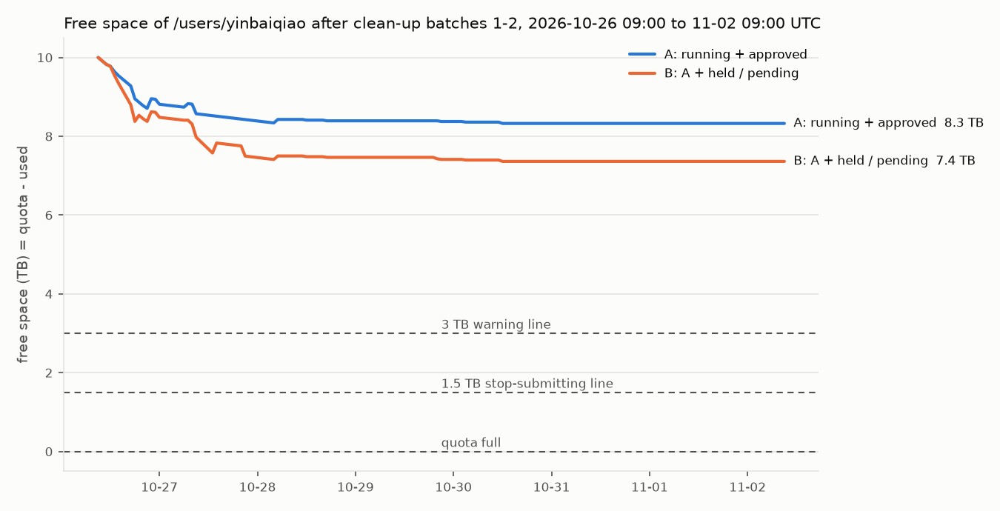

# 第二步执行记录：第一、二批清理（2026-10-26）

按你 10-26 的决定 1、2（选甲）执行。所有时间是 UTC。

**补记（09:30）**：第 5 节四项和第 6 项盘点里的两项你都选了甲。SenseNova-U1 冒烟检查点作为第三批已删（292.1 GB，见第 6 节），三批合计 3,864.0 GB；保留规则和标志约定已批，监控 09:19 起带标志；要转告各线的话在 [RELAY_20261026.md](../RELAY_20261026.md)。

## 结论

1. **两批共删除 10,688 个文件、3,571.9 GB**。每个文件都先上传到 AOSS 并核对大小；清单本地和 AOSS 各存一份；写死路径核查通过后才删，删前又核对一遍文件没有变化。
2. **配额表从清理前的 15 TB 降到 12 TB，剩余从 7 TB 升到 10 TB**（10-26 08:44 监控读数；文件系统统计从 13.20 TB 降到 9.73 TB）。
   - 早上 06:00 配额表是 16 TB；07:14 下游线按你在那边的决定，自己删了 11 份全状态（1.30 TB）。
   - 两次删除合计 4.87 TB。
3. **和第一步的预测对得上**：第一步预测在 08:44 的已用是 16.92 TB，减去这 4.87 TB 得 12.05 TB，配额表读 12 TB。
4. **新的 7 天预测**（按各线最新计划）：
   - 只算在跑和已批的：最低剩余 8.3 TB；
   - 再加上暂缓和待批的（Qwen3 的 RL、主线可能的 2 个 RL）：最低 7.4 TB。
   - 两种情形都不会碰 3 TB 警告线。
   - 但过去 4 天平均每天涨 2.3 TB。如果新开一轮实验，按这个速度从 10 TB 剩余降到 3 TB 约 3 天。
5. **你批了、但我没删的 0.60 TB**：
   - 下游的 E1 权重副本 0.13 TB、E0 检查点 0.27 TB、RLINF-SMOKE-1 检查点 0.13 TB：核查发现下游看板和测试脚本会读它们，交回下游线处理。
   - 主线两次 3B 试跑 0.06 TB：等主线确认。
6. 监控 07:37 起在跑，第三步的其余部分（标志文件）等你批 [STOP_FLAG_PROPOSAL.md](../STOP_FLAG_PROPOSAL.md)。保留规则写在 [RETENTION_POLICY.md](../RETENTION_POLICY.md)，也等你批了再转达各线。

## 1. 两批的内容和结果

| 批次 | 清单项 | 内容 | 文件数 | 删除量 |
| --- | --- | --- | ---: | ---: |
| b1 | 5.2.1 | dense-score pilot r3（整理 D7b）三个分支的检查点：除第 100、150 步的 `actor/huggingface/` 和 1 MB 以下的元数据外全部 | 321 | 1,692.0 GB |
| b1 | 5.1b | 主线组合链 r12zd 7 个、r12ze 2 个运行最后一个检查点的续训状态（FSDP 分片、优化器、extra state） | 216 | 895.5 GB |
| b1 | 5.2.4 | R1 taskfix 正式运行第 50–200 步、冒烟第 1 步的权重 | 130 | 165.9 GB |
| b1 | 5.2.5 | 整理归档区 `archive/cluster/` 的 `interiorgs_v10_rounds`、`dense_score_pilot`、`r1`、`logs`、`data_intermediate`、`diagnostics_d0_u1` | 9,916 | 223.5 GB |
| b2 | 5.1b | 下游 RL 测速 RL-SPEED-1、RL-SPEED-2 的检查点 | 70 | 471.8 GB |
| b2 | 5.2.6 | StarVLA NavigateKitchen 检查点（整理 D9）：`third_party/starVLA/playground/Checkpoints`、`playground/Checkpoints` | 35 | 123.3 GB |
| 合计 | | | **10,688** | **3,571.9 GB** |

另外删了 AOSS 上第一步留下的测速对象 `disk_line_speedtest_20261026/base7b_shard1.safetensors`（3.9 GB，不占个人目录配额）。

| 时间 | 配额表已用 | 剩余 | 文件系统统计 | 发生了什么 |
| --- | ---: | ---: | ---: | --- |
| 06:00 | 16 TB | 6 TB | 13.92 TB（06:06） | 第一步盘点 |
| 07:38 | 15 TB | 7 TB | 13.07 TB | 下游线 07:14–07:16 自己删了 11 份全状态（1,296.8 GB）；模型线在写 |
| 08:13 | 15 TB | 7 TB | 13.20 TB | 两批在上传，还没删 |
| 08:24 | — | — | — | 第一批删完 |
| 08:28 | 13 TB | 9 TB | — | 第二批删完 |
| 08:44 | 12 TB | 10 TB | 9.73 TB | 监控读数。08:13 以来模型线又写了约 0.10 TB |

## 2. 怎么做的

1. **列计划**（`disk/archive_delete.py plan`）：按批次说明文件 `docs/disk/batches/b{1,2}_20261026.json` 列出每个文件，打印完整列表和总大小（`disk_runs/logs/b{1,2}_plan.log`）。两批都没有硬链接，没有 root 或别人属主的文件。
2. **上传 AOSS**（`archive`）：
   - 每个文件传到 `fj:s3://baiqiao/vagen_lite_archive/<个人目录下的相对路径>`，和主线 10-21 的归档同一处。
   - 8 个文件并行，每个文件 8 线程，实测约 1.45 GB/s；第一批 34 分钟，第二批 7 分钟。
   - 每个对象传完都核对大小，两批 0 个不符。
   - 清单 `manifest.jsonl` 和计划存在 `disk_runs/batches/<批次>/`，同时上传到 `vagen_lite_archive/disk_line_manifests/<批次>/`。
3. **写死路径核查**：用整理窗口的 `scripts/cluster/audit_archived_paths.sh`，它搜三处：main 上被跟踪的文件、最近 3 天的主线实验目录、主 checkout 里没被跟踪的文件。再补查其他 worktree 的代码和配置、`models_runs` 和 `downstream_runs` 的 plan 和队列、主线各训练链的 plan 和进度文件、crontab。另外列出了所有指向这些目标的符号链接。结论在 `disk_runs/audit/b{1,2}/CONCLUSION.md`。
   - 第一批：直接指向这批目标的引用都是保留下来的 `actor/huggingface`（评测记录），或者是 PPO 模板里会被每次训练覆盖的默认输出目录（核对了 18 个展开后的配置）。10-16 搬进归档区之前的原路径有 130 个已经不在，3 个是独立的真实目录（10-16 还原的 `interiorgs_v10_gen_20261014` 等），都不受影响。指向这批的符号链接只有 `models/historical/` 的 7 个，都指向保留的权重。
   - 第二批：RL 测速检查点没有任何引用；下游看板的队列按 `job/submission.json` 判断，那个文件不动。NavigateKitchen 检查点只被 `examples/` 下的 NavigateKitchen 示例脚本和三份旧文档提到，你批的时候已经知道。
4. **删除**（`delete --yes`）：
   - 删前核对每个文件都已上传、大小和修改时间与计划一致。
   - 再打印一遍完整列表和总大小（`disk_runs/logs/b{1,2}_delete.log`），然后删除。
   - 逐文件记录在 `disk_runs/batches/<批次>/deleted.tsv`，AOSS 上也有一份。
   - 删空的目录一并去掉，但不去掉各项的根目录。
5. **说明文件**：每个改动过的位置都写了一个说明文件，写明删了什么、为什么、AOSS 上在哪：
   - 组合运行：`RESUME_STATE_DELETED`，和主线 10-25 的做法相同；
   - pilot r3、R1、RL 测速、NavigateKitchen：`DELETED_TO_AOSS.txt`；
   - 归档区：`archive/cluster/DELETED_TO_AOSS_20261026.txt`。
6. **删后核对**：
   - `VAGEN-Lite/models/historical/` 下 9 个链接都能打开；
   - 组合运行的 `actor/huggingface`、pilot r3 第 100、150 步、R1 第 250 步都在；
   - RL 测速目录的日志、配置和测量数据都在。

留下的零碎（没删，也不需要删）：

- `archive/cluster/interiorgs_v10_rounds/` 里剩 1 个符号链接和 4 个空目录（16 KB）；脚本只删普通文件，不删链接。
- pilot r3 每个分支的 `global_step_50/` 里剩 1 MB 以下的元数据文件；`playground/Checkpoints` 下剩几个空目录。

## 3. 没删的（你批了，但核查没过或要等别人）

| 项 | 大小 | 为什么没删 | 交给谁 |
| --- | ---: | --- | --- |
| 下游 E1 权重副本 `DS-*-100-s1/evals_src/` | 134.8 GB | 看板每轮对 E1 第 15 万、17.5 万步调用 `copy_weights`，它只看 `evals_src/…/source.json` 在不在、不看评测是否已完成。副本删掉、全状态又已删，这两个点就会显示成"等全状态"。不会重提任务，但看板显示错 | 下游线：改好这处后自己删，或告诉磁盘线可以删 |
| 下游 E0 检查点 `DS-*-100-s1/run_stopped_20261022/checkpoints/` | 269.6 GB | 看板开着 `--stage0`，阶段 0 那几行按这些检查点文件列出；报告代码 `downstream/report/collect.py` 读同一个运行目录 | 下游线 |
| 下游 `RLINF-SMOKE-1` 的检查点 | 134.8 GB | `downstream/rlinf/export_test.sh` 的默认输入是它第 2 步的权重 | 下游线 |
| 主线两次 3B 试跑 `E/interiorgs_v10_r12_20261019/pilot_{invalid_turn,v8}_3b_run/` | 62.6 GB | 清单里本来就写了"等主线确认" | 主线 |
| 下游 11 份全状态（清单 5.2.2） | 1,296.8 GB | 下游线 07:14–07:16 已按你在那边的决定自己删了（没有上传 AOSS） | 已完成 |

## 4. 新的 7 天预测

- 输入：`forecast_plan_20261026b.json`，起点是 08:44 的配额表读数 12 TB，配额 22 TB。
- 和第一步相比，计划的变化：
  - 下游 E3 是 4 个 RL（B、RS、S、RD），同时 2 个，已排队；E4 取消；
  - 模型线 Qwen3 的 RL 暂缓，Cambrian 的 RL 先跑；Qwen3 的 SFT 08:15 已结束。

| 情形 | 第一天净增 | 7 天内最低剩余 | 跌破 3 TB | 跌破 1.5 TB |
| --- | ---: | ---: | --- | --- |
| A：在跑的和已批的 | 1.43 TB | 8.33 TB | 不会 | 不会 |
| B：A 加上暂缓和待批的 | 2.02 TB | 7.36 TB | 不会 | 不会 |

两点提醒：

- 模型线的 RL plan 现在没有设"结束时只留最好和最后"（`retain`）。不设的话，每个 RL 结束时多留约 130 GB，情形 A 的最低值约低 0.3 TB。
- 曲线在第二天以后变平，是因为没有已知的新计划，不是不再写盘。

## 5. 需要你决定的事

1. **保留规则 [RETENTION_POLICY.md](../RETENTION_POLICY.md) 批不批、怎么转达**。
   - 甲（推荐）：批，转给主线、模型线、下游。各线按规则改自己的训练链：
     - RL 结束删最后一个的续训状态；
     - SFT 选完 epoch 删没选中的；
     - 模型线 RL 设 `retain`；
     - 下游看板评完删全状态和副本。
     - 代价：每条线改一两处代码。好处：每个 RL 少留约 230 GB，每个 SFT 少留约 300 GB。
   - 乙：只批其中几条。代价：没批的那几类继续靠人工清理。
2. **"磁盘紧张就不提交"约定 [STOP_FLAG_PROPOSAL.md](../STOP_FLAG_PROPOSAL.md) 批不批**。
   - 甲（推荐）：批，剩余低于 1.5 TB 写标志、回到 3 TB 以上删，评测不拦。代价：各线各改一处提交入口。
   - 乙：门槛改成 2 TB。
   - 丙：不批。
3. **第 3 节交回下游线的三项（0.54 TB）**。
   - 甲（推荐）：转告下游线，请它改看板和测试脚本后自己删，或改好后告诉磁盘线来删。代价：你转一次话。
   - 乙：先不动，等下游线以后自己清。
4. **主线两次 3B 试跑（62.6 GB）**。
   - 甲（推荐）：问主线是否还要；不要就由磁盘线上传 AOSS 后删。
   - 乙：留着。代价：占 0.06 TB，很小。

你 10-26 的答复：四项都选甲。执行情况见 [STATUS.md](../STATUS.md) 第 3 节，转告的话在 [RELAY_20261026.md](../RELAY_20261026.md)。

## 6. 第三批：SenseNova-U1 冒烟检查点（第二轮决定后）

按你对第 6 项盘点（[SCOPE6_INVENTORY_20261026.md](SCOPE6_INVENTORY_20261026.md)）的答复执行：先上传 AOSS 核对，再用 1 卡 root sco 任务删。

| 项 | 内容 |
| --- | --- |
| 删了什么 | `SenseNova-U1/training/RUN/sensenovau1_8b_it2i_smoke3/` 下 87 个文件（检查点和 ping 文件），292.1 GB（292,148,623,373 字节）。属主是 root，批次说明 `docs/disk/batches/b3_20261026.json` |
| 上传 AOSS | 09:23 完成，87 个对象逐个核对大小，0 个不符；清单本地 `disk_runs/batches/b3_20261026/` 和 AOSS `vagen_lite_archive/disk_line_manifests/b3_20261026/` 各一份 |
| 写死路径核查 | 通过，没有代码、plan 或任务读这个目录（`disk_runs/audit/b3/CONCLUSION.md`） |
| 删除 | 文件属主是 root，登录节点上的普通账号删不了，所以提交了 1 卡 root sco 任务 `pt-1r0uuww1`（`disk/submit_root_delete.sh`，提交前查过 `PAUSE_SUBMISSIONS` 不在）。任务里运行同一个 `archive_delete.py delete --yes`：删前核对、打印完整列表和总大小、逐文件记录。09:24 结束（SUCCEEDED），删除 87 个文件、292.1 GB，之后删掉了任务记录 |
| 记录 | 逐文件记录 `disk_runs/batches/b3_20261026/deleted.tsv`（AOSS 上也有一份）；目录里写了 `DELETED_TO_AOSS.txt`；记录和说明文件的属主改回了 yinbaiqiao |

三批合计删除 10,775 个文件、3,864.0 GB。
