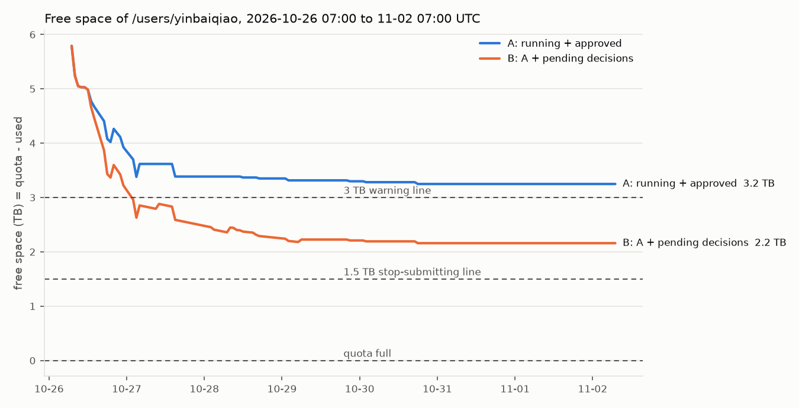

# 个人目录磁盘盘点与 7 天预测（第一步，2026-10-26）

只读盘点。除了这条线自己的 worktree、`disk_runs/` 下的扫描结果和 AOSS 上一个测速对象（第 6 节），没有写、移动或删除任何东西。所有时间是 UTC。

## 结论

1. **现在的三个数（10-26 07:00）：配额 21.99 TB，已用约 16.2 TB（15.8–16.5 TB），剩余约 5.8 TB（5.5–6.2 TB）。**
   - 配额：配额表显示"22 TB"。整卷所有目录的配额都显示成 1.1 / 5.5 / 11 / 22 TB，正好是 1 / 5 / 10 / 20 TiB，所以按 20 TiB = 21.99 TB 算（推断，待管理员确认）。
   - 已用：配额表只给两位有效数字，显示"16 TB"，即 15.5–16.5 TB。文件系统自己统计的目录字节数是 14.23 TB（06:57），**比配额表少 1.6–2.3 TB**，原因没查清（第 1 节）。在查清之前，报警一律按配额表的上限（16.5 TB）算。
2. **现在在往盘上写的是模型线和下游**（第 2 节）。
   - 模型线写得最快：两个正式 SFT 每 12–17 分钟存一个 31–34 GB 的检查点；07:03 又起了 Cambrian 下游，07:04 起了两条小测试链。06:06–06:57 个人目录多了 0.31 TB，全部来自模型线。
   - 下游：2 个训练、3 个评测在跑。
   - 主线：此刻没有任务。
   - probe_spatial 项目：34 个任务今早跑完。它不在你列的线里，但用的是同一个配额，占 3.13 TB。
   - 数据线、评测线、整理窗口：现在不写。
3. **预测（第 4 节）**：
   - 只算在跑和已批的（情形 A）：7 天内最低剩余约 3.2 TB，不会写满。但第一天就要写 2.7 TB，主要是模型线的 SFT、两个模型的 RL 和 8 个下游起点。
   - 再加上待你决定的（情形 B：下游 E3 的 5 个 RL、E4 种子 2，主线可能再提的 2 个 RL）：**10-27 02:00 左右跌破 3 TB 警告线，最低约 2.2 TB**。
   - 如果起点按上限 16.5 TB 算，两个情形都再低 0.3 TB。
   - 参照：10-21 11:09 到 10-25 07:24，配额表从 12 TB 涨到 21 TB，平均每天 2.3 TB。按这个速度，现在的剩余不到 3 天就用完。
4. **三类清单（第 5 节，按删除后真正腾出的字节算，硬链接已扣除）**：

   | 清单 | 大小 | 内容 |
   | --- | ---: | --- |
   | 立刻可删 | 0.15 TB | 评测线已用完的公开模型和数据集下载 |
   | 满 7 天即可删 | 1.64 TB | 主线已结束组合链的续训状态 0.90 TB、下游 RL 测速和冒烟检查点 0.61 TB、下游已评完的权重副本 0.13 TB；最后修改不满 7 天，最早 10-29 可删 |
   | 归档后可删 | 3.84 TB | dense-score pilot r3 的分片 1.69 TB、下游已训完实验的全状态 1.30 TB、E0 检查点 0.27 TB、整理归档区无引用部分 0.22 TB、R1 检查点 0.17 TB、StarVLA NavigateKitchen 检查点 0.12 TB、主线两次 3B 试跑 0.06 TB |
   | 先查清再报告 | 约 4.2 TB | 不属于你列的线或归属不明：probe_spatial 项目 3.13 TB、RoboCasa365 的 `pretrain` 数据 0.44 TB、SenseNova-U1 0.29 TB、Consistency 0.18 TB 等，不进清单 |
   | 必须留着 | 约 4.4 TB | 见 5.4 节 |

   三份清单全做完可腾出约 5.6 TB，已用从约 16.2 TB 降到约 10.6 TB。
5. **10-21 那 6 TB 已查清**：
   - 是 probe_spatial 项目在 10-21 07:31–09:06 做的清理，你在那个会话里批准过（原话"ABC全做，批准删除"）。
   - 有完整台账：`probe_spatial/artifacts/storage_reclaim_20261021/`。
   - 删了：InsScene-15K 的 Wan 特征本地副本 3.98 TB（AOSS 上本来就有）、检查点 1.71 TB 和 wandb 0.40 TB（先传 AOSS 再删）、可视化约 0.24 TB、缓存约 0.06 TB，共 6.40 TB。
   - 我逐个核对了 AOSS：台账里 165,460 个对象全在，大小全对。
6. **整理窗口移交的删除项**：
   - 已做：D5、D6、D7a、D7c、D10、冒烟残留（D8 是移动，也已做）。
   - 还没做：D7b（dense-score pilot r3，1.89 TB）、D9（StarVLA NavigateKitchen 检查点，0.12 TB）。两项都放进了"归档后可删"。
   - 另发现：整理窗口的固定位置 `VAGEN-Lite/models/` 下 8 个链接已经断了。它们指向第六到九轮的 RL 检查点和 r6b SFT 模型，这些目标在 10-25 主线清理时被删掉了，而且没有归档。
7. **AOSS（第 6 节）**：
   - 桶 `baiqiao` 已用 103.18 TB、486 万个对象；容量上限从 S3 接口查不到，要问管理员。
   - 10-21 的两次归档都完整。
   - 速度（登录节点，单个文件）：下载 1.4–2.6 GB/s，上传 0.24–0.51 GB/s；多文件并行上传约 0.84 GB/s。
8. **怎么量**：
   - 一次 du 全目录：服务器空闲时约 0.7–2 小时，忙时 9 小时以上，不适合做监控。
   - 文件系统自带的递归字节数：整个个人目录约 2 分钟。
   - 配额表：6 秒，但只有两位有效数字。
   - 脚本 `disk/quota.py` 输出三个数（第 1 节）。

## 需要你决定的事

每项选项里第一个是推荐项。

1. **第一批清理清单批不批**（第 5 节；每批都先归档到 AOSS、逐文件核对大小，再用写死路径核查脚本确认没人读，再删）。
   - 甲（推荐）：批"立刻可删"（0.15 TB）和"归档后可删"里 5.2.1、5.2.3–5.2.6（2.48 TB），共 2.6 TB。5.2.2 下游全状态要等下游线确认 E2 不再续训；5.2.7 要等主线确认。
   - 乙：只批"立刻可删"，0.15 TB。剩余仍约 5.6 TB，情形 B 下 10-27 跌破 3 TB。
   - 丙：全部不批。代价同乙，而且情形 B 下 10-27 以后剩余在 2–3 TB 之间，再起任何新实验都可能顶到配额。
2. **"满 7 天即可删"要不要提前删**（1.64 TB，都是续训状态或测试产物，没有保留价值）。
   - 甲（推荐）：提前删。主线组合链的续训状态和你 10-25 批准的同一类；下游的两类是下游线自己提过的。代价：这几个组合不能再从第 300 次接着训（主线已定下一轮用 DCK，用不上）；下游测速不能拿这些检查点重测（结果已写进报告）。
   - 乙：等满 7 天（10-29 到 11-02 陆续到期）再删。代价：这几天多占 1.64 TB。只看这一项，情形 B 的最低剩余提前删是约 3.8 TB，等到期是约 2.2 TB。
3. **公开下载的东西删前要不要也上传 AOSS**（评测线的 7 个公开模型和数据集，0.15 TB）。
   - 甲（推荐）：不上传。它们能从 hf-mirror 原样再下载，版本和哈希已记录在 `eval_external_assets/model_hashes/`；只把清单存到 AOSS。代价：重新下载约 1 小时。
   - 乙：照铁律上传（约 5 分钟，占 AOSS 0.15 TB）。
4. **配额表和文件系统统计差约 2 TB，要不要问管理员**。
   - 甲（推荐）：你去问管理员三件事：配额是不是正好 20 TiB；"已用"怎么算，为什么比目录字节数多约 2 TB（被打开着的已删除文件？服务器侧的预留？）；有没有能查到精确字节的接口。在那之前，监控和报警按配额表读数 + 0.5 TB 算（偏保守）。代价：你要找一次管理员。
   - 乙：不问，一直按保守值算。代价：最多会提前 2 TB 报警；而且如果差额是"删了但还开着的文件"，删文件可能不能立即腾出空间，我们也看不出来。
5. **现在就把只读监控开起来**（原定第三步）。每 30 分钟记一次配额表读数和文件系统统计，写 `docs/disk/usage.csv`；剩余低于 3 TB 写警告文件并报你。
   - 甲（推荐）：现在开。只读，每次占服务器约 2 分钟。按预测，情形 B 一天内就会碰到 3 TB 线。在你批第 3 节第 3 条之前，不写停止提交的标志文件。
   - 乙：按原顺序等第二步做完再开。代价：这期间涨到警告线没人报。
6. **不属于任何列出的线的 3.6 TB 怎么办**（probe_spatial 项目 3.13 TB、SenseNova-U1 0.29 TB、Consistency 0.18 TB；后两个含 root 属主文件，我们删不了）。
   - 甲（推荐）：你转给 probe_spatial 的会话自查，这条线只记账和报警，不出它们的清单。代价：这部分占了个人目录用量的四分之一，能不能腾出来取决于那边。
   - 乙：纳入这条线，下一份报告给出它们的清单。代价：要读那个项目的状态文档、问它在用什么，可能和它正在做的发布审核冲突。
7. **10-22 前后那次"存检查点时报磁盘没有空间"**：
   - 我在 10-20 以后主线、下游、模型线、评测线、数据线和 probe_spatial 的日志里，只找到 10-20 20:30 配额事故那一条。
   - 10-22 全天配额表读数是 13–14 TB，离配额很远。所以那次多半不是这个配额，可能是任务所在机器的本地盘，或整卷用满。
   - 请告诉我是哪个任务、在哪看到的，我再查。

另有三件事，只要你转告，不用决定：

- 整理窗口：`VAGEN-Lite/models/` 下 8 个断链要更新登记（第 3 节）。
- 模型线：SFT 每个 run 会多存一份最终模型（和最后一个 epoch 相同，每个 31–34 GB）；正式 SFT 选完 epoch 后，9 个没选中的 epoch 和这份副本约 0.65 TB 可以清（第 5.4 节）。
- AOSS 上那个 3.9 GB 测速对象，列进第一批清理。

---

## 1. 配额怎么量

### 1.1 文件系统是什么，有没有配额命令

- `/mnt/umm` 是 `quarkfs_client`，一个 FUSE 文件系统（SenseCore AFS）。`lfs`、`beegfs-ctl`、`quota`、`repquota`、`getfattr` 都没有。
- `df` 看到的是整卷（100 TiB，已用 76.6 TiB），不是个人配额。
- 个人配额只能从 sco 查：`sco afs dir-quota list -i 019ec9f9-6d12-7d49-aad4-864b15c9eb06`，读整张表里 `/users/yinbaiqiao` 那一行。用 `-d` 查单个目录会返回错误的记录，不能用。
  - 这一行有四列：文件数上限（0，即不限）；已用文件数，是精确整数，数的是文件加目录；容量上限；已用容量。
  - 后两列只给两位有效数字（"22 TB""16 TB"），所以 10 TB 以上的误差是 ±0.5 TB。
  - 用 `--debug` 也看不到原始字节数。
- **文件系统自己的递归统计**：每个目录都带几个扩展属性。
  - `quarkfs.dir.rfbytes` 是目录下所有文件的字节数，`quarkfs.dir.rfiles` 是文件数。另有不递归的 `fbytes`、`files` 和递归的 `rsubdirs`、`rentries`。
  - 递归的几个由服务器现算，耗时和子树里的目录数成正比：
    - 空闲时整个个人目录约 2 分钟（1,380 万个条目）；
    - 忙时会慢几十倍，而且查询进程会卡在不可中断状态，直到算完。
  - 这次我误对整个 `/mnt/umm` 卷发过一次（约 1.8 亿个条目），拖慢了文件服务器约 40 分钟，经你同意已停。以后一次只发一个查询，绝不对 `/mnt/umm` 或 `/mnt/umm/users` 求和。

### 1.2 两种统计对不上

| 时间 | 配额表已用 | 配额表文件数 | 文件系统 rfbytes | rfiles |
| --- | --- | ---: | ---: | ---: |
| 06:06 | 16 TB（15.5–16.5） | 13,764,393 | 13.920 TB | 12,801,177 |
| 06:10 | 16 TB | 13,785,252 | 13.921 TB | 12,817,275 |
| 06:57 | 16 TB | 13,807,537 | 14.231 TB | — |

用两个共享目录验证了两种统计的口径：

| 目录 | 配额表已用 | rfbytes | 配额表文件数 | rfiles + rsubdirs |
| --- | --- | ---: | ---: | ---: |
| `/mnt/umm/shared_model`（大文件为主） | 887 GB | 887.30 GB | 20,653 | 17,129 + 3,528 = 20,657 |
| `/mnt/umm/shared_env`（74.6 万个小文件） | 109 GB | 108.09 GB | 746,117 | 667,084 + 79,033 = 746,117 |

由此可知：

- 配额表的文件数就是"文件 + 目录"。
- 配额表的已用基本等于逻辑字节数，小文件按 4 KiB 取整，多出约 1%。
- 两个共享目录上两种统计吻合，个人目录上却差 1.6–2.3 TB。这个差额不是取整：1,280 万个文件按 4 KiB 取整最多多出约 26 GB。
- 硬链接只会让 rfbytes 偏大，不会偏小。主线 `inputs/` 里的基座权重和多个检查点都是硬链接，也就是说真实差额比 2 TB 还略大。
- 还没查清的可能原因：
  - **删了但还开着的文件**：它们占配额，但目录统计看不到。登录节点上的 Cursor 编辑器后台进程（10-22 起）开着 67 个这样的文件。它们的大小读不到，FUSE 对它们返回"不存在"。sco 任务的容器里看不到。
  - 服务器侧的其他记账，比如正在写的文件的预分配。
- 在查清之前（"需要你决定的事"第 4 项）：
  - 剩余（保守）= 21.99 − （配额表读数 + 0.5），现在 5.49 TB；
  - 剩余（估计）= 21.99 − （rfbytes + 差额），差额现在在 1.58–2.27 TB 之间，现在 5.49–6.18 TB。
  - 配额表读数每跳一个整数，那一刻的真实用量就是 x.5 TB。监控会在每次跳变时用这个点把差额重新标定一次。

### 1.3 脚本

`disk/quota.py`（只读）输出三个数：

```
配额 quota    : 21.99 TB (20.00 TiB)   [quota table '22 TB', read as whole TiB]
已用 used     : 14.23 TB (12.94 TiB)   [xattr_rfbytes; quota table says '16 TB', 13807537 files]
剩余 remaining: 7.76 TB (7.06 TiB)
```

用法：

- `--fast`：只读配额表，6 秒；已用取表里的取整值。
- `--csv`：输出一行，给监控用。

第一行"已用"是 rfbytes，比配额表少了上面那约 2 TB，所以这里的"剩余"偏乐观。报告和报警都按 1.2 节的保守值。

### 1.4 du 全目录要多久

| 量法 | 测的范围 | 速度 | 推到全目录（1,380 万个条目） |
| --- | --- | --- | --- |
| GNU du，服务器空闲（07:05） | `r1_h1_aoss_repair`（59,033 个条目）、`nested_repos_from_VAGEN-Lite`（125,146 个） | 1,850 和 5,500 条目/秒 | 0.7–2.1 小时 |
| GNU du，服务器忙（06:25） | 一个下游实验目录（8,079 个条目） | 410 条目/秒 | 约 9.3 小时 |
| Python 遍历，服务器忙（06:17–06:24，conda 环境，小目录多） | 52,774 个条目 | 125 条目/秒 | 约 30 小时（这次全目录遍历因此停掉） |
| 文件系统 rfbytes，空闲 | 整个个人目录 | — | 约 2 分钟 |
| 配额表 | — | — | 6 秒 |

du 算的是逻辑字节数，和 rfbytes 同一口径，也对不上配额表的约 2 TB 差额。监控用配额表加 rfbytes，不用 du。

## 2. 现在谁在往盘上写（10-26 07:05）

| 线 | 在跑的 sco 任务 | 登录节点常驻进程 | 写到哪 |
| --- | --- | --- | --- |
| 模型线 | 正式 SFT：`models-sft-sft-q3formal`、`models-sft-sft-cformal`（06:11 起，zoetrope）。下游：`models-ds-q3b-100-s1`（05:50，zoetrope）、`models-ds-csb-100-s1`（07:03，h800）。两条小测试链的渲染服务：`q3v4restart`、`q25v4tok`（07:04） | 5 条训练链：两个正式 SFT、SDPA 对照（06:59 已完成）、两条测试链 | `models_runs/`，06:40–07:03 多了 82 GB |
| 下游 | 训练 `downstream-ds-b-010-s1`（约 14:00 训完）；整机评测 S-030、B-030、RD-030 的第 20 万步 | 看板 `watch.py`（PID 1901225） | `downstream_runs/`，这半小时没有变化 |
| 主线 | 无（主窗口 10-26 05:02 说全部结束，之后可能再提 1–2 个 8 卡训练） | 守护进程 `r12_guard.sh`、看板 `batch_board` | `VAGEN-Lite/exps/vagen_active_spatial/`，没有变化 |
| probe_spatial 项目（不在你列的线里） | `bq-s5e-prod-*` 34 个任务 05:51 开、07:00 前全部结束；另有 `bq-ready-*` 2 个、`bq-mml10e-cana-*` 2 个、`cf_1` | `/tmp/psv/` 下 3 个监看脚本 | `probe_spatial/`，`artifacts` 和 `runtime` 这半小时没有变化 |
| 数据线、评测线、整理窗口 | 无 | 无 | 不写 |
| 磁盘线（本线） | 无 | 无常驻进程 | `disk_runs/`，1 MB |

## 3. 盘点

方法：

- `disk/xtree.py` 用 rfbytes 从个人目录往下走：大于 30 GB 的目录才往下看，最多 9 层；目录内直接的文件累计超过 1 GB 才逐个列文件。06:34–06:50 跑完，共 8,304 个目录。
- `disk/freeable.py` 对候选目录逐个遍历，算删掉后真正能腾出的字节，扣除了从外面硬链接进来的文件。
- 原始结果在 `/mnt/umm/users/yinbaiqiao/disk_runs/raw/`。
- 下表大小都是 rfbytes 口径（逻辑字节），合计 14.23 TB，比配额表少约 2 TB（见 1.2 节）。

### 3.1 按线汇总

| 线 | 主要目录 | 占用（TB） | 其中 |
| --- | --- | ---: | --- |
| 主线 | `VAGEN-Lite/exps/vagen_active_spatial/interiorgs_v10_*` | 2.95 | 组合链 r12zd 1.13（含续训状态 0.70），r12ze 0.30（续训状态 0.20），r12t 0.24，第十一轮 0.16，其余各链每个运行只剩最好的那个检查点（33 GB） |
| 主线（旧） | dense-score pilot r3（整理 D7b） | 1.89 | 9 个检查点，每个 166–232 GB，含续训分片 |
| 主线（R1，已被 v10 取代） | `R1-clean-Projective-v0-taskfix`、`R1-clean-Projective-v0`、`r1_h1_aoss_repair_20260905` | 0.31 | |
| 整理窗口 | `VAGEN-Lite/archive/cluster`、`VAGEN-Lite/models/historical`、`VAGEN-Lite/exps/unified_eval_runs` | 0.55 | 归档区 0.25；历史权重 0.23（其中 Cambrian 4 个 0.13，模型线说不能动）；8 月旧协议的冻结权重 0.07（`models/historical/v46_*`、`v50_*` 链接的目标） |
| 主 checkout 其他 | `third_party`（StarVLA NavigateKitchen 检查点 0.12）、`data_gen/active_spatial_qa/artifacts` 和 `exps/interiorgs_qa_*`（QA 线，0.04）、`playground`（0.02）、`.venv-qwen3vl`（0.01） | 0.21 | |
| 下游 | `downstream_runs/` | 2.63 | 全状态 12 份 × 117.9 GB = 1.41；RL 测试 0.61；E0 检查点 0.27；E1 权重副本 0.13；最终权重和评测其余 |
| 下游（借 probe_spatial 目录） | `probe_spatial/robocasa365/datasets/v1.0` | 0.54 | `target/` 0.06 是下游的原始示教；`pretrain/` 0.44 没查到谁用，先查清再报告 |
| 模型线 | `models_runs/` | 0.92 | 三个冒烟链 0.56，SDPA 对照 0.14，正式 SFT 在长 |
| 评测线 | `eval_external_assets/` | 0.16 | 公开模型 0.11，数据 0.02，结果 0.02 |
| 数据线 | `VAGEN-Lite-data` | 0.004 | |
| probe_spatial 项目 | `probe_spatial/`（不含 robocasa365）、`InsScene-15K/`、`probe_spatial_video/` | 3.13 | `probe_spatial/logs` 1.64，`InsScene-15K/data` 1.07 |
| 归属不明 | `SenseNova-U1/`（7 月，0.29）、`Consistency/`（9 月，MiniMax-H3 权重 0.17） | 0.47 | 都含 root 属主文件 |
| 共用 | `.cache`（HF 缓存 0.21）、`.conda`（0.09）、`InteriorGS_ply`（0.04）、`nested_repos_from_VAGEN-Lite`（0.05）、各 worktree、`InteriorGS`（root 属主） | 0.43 | |
| 合计 | | 14.23 | |

### 3.2 按类别

第一行是逐项算出来的；带"粗估"的是按目录推的，没有逐个文件分类。

| 类别 | 占用（TB） | 大项 |
| --- | ---: | --- |
| 续训状态（只用于接着训） | 5.0 | pilot r3 分片 1.69；下游全状态 12 份 1.41；主线组合链 0.90；下游 RL 测试检查点 0.61（每个含 16.8 GB 可直接加载的权重）；模型线冒烟、对照和测试链的最后检查点约 0.41 |
| 可直接加载的权重 | 粗估 2.6 | 主线各运行保留的检查点约 1.6（每个 33 GB）；下游最终权重、副本和 E0 检查点约 0.6；历史权重 0.23；pilot r3 和 R1 留下的 HF 0.40；外部模型 0.11；模型线 SFT 检查点在长 |
| 数据集 | 粗估 2.0 | `InsScene-15K/data` 1.07（probe_spatial）；RoboCasa365 示教 0.54；主线任务和评测集约 0.25；InteriorGS 0.05；HF 缓存里的评测集 0.03 |
| probe_spatial 的训练运行目录 | 1.64 | `probe_spatial/logs`，内容没有细查 |
| 环境与缓存 | 粗估 0.35 | HF 缓存 0.21（其中模型 0.10）；conda 0.09；venv、编辑器、codex 约 0.05 |
| 归档包 | 0.25 | `VAGEN-Lite/archive/cluster` |
| 其余 | 粗估 2.4 | 归属不明的两个目录 0.47；probe_spatial 的特征和产物约 0.3；InsScene-15K 的特征约 0.2；各线的日志、评测结果、采样记录、代码 |

### 3.3 重复的东西

按"同大小同文件名"分组后，对每组读首尾各 4 MiB 做指纹，真正内容相同的只有 35 组，多占 195 GB。（按名字和大小看有 3.0 TB，但那是不同运行里同形状的检查点，内容不同。）

| 重复 | 多占 | 说明 |
| --- | ---: | --- |
| LLaMA-Factory 的 `model/` 和最后一个 `checkpoint-N` | 每个 SFT 31–34 GB；现在 3 个冒烟 + 第五轮试跑共 112 GB | SFT 训完会把最终模型在 `model/` 下再存一份。模型线两个正式 SFT 也会各多 31–34 GB |
| 归档区 3 份 dense-score 诊断的同一批 critic 初始权重 | 99.6 GB | `archive/cluster/dense_score_pilot/..._r2/r4/r5/critic_initial_pre_update` |
| QA 线产物里的 v50 第 50 步权重 | 33.2 GB | 和 `models/historical/qwen_v50_..._step50` 内容相同；QA 的入口脚本读的是后者 |

硬链接（同一份数据多个路径）不额外占空间：主线 `inputs/` 里的基座权重、R1 最终模型、第十轮最终模型、3B 试跑模型都是这种。所以 `R1-clean-Projective-v0`（36.6 GB）删了只能腾 3.4 GB，`interiorgs_v10_r5_20261014`（70.4 GB）只能腾 0.4 GB。

### 3.4 整理窗口移交的集群删除项

| 编号 | 内容 | 状态 | 依据 |
| --- | --- | --- | --- |
| 冒烟残留 | `archive/cluster/_pending_delete/` 230 GB | 已删（10-16） | `archive/cluster/DELETED_pending_delete_20261016.tsv` |
| D5 | 文本动作路线的冒烟检查点 49 GiB | 已删（10-16） | `MANIFEST_moves_20261016.tsv` 记为 DELETED (D5) |
| D6 | R1 taskfix 的续训分片 | 已删，第 250 步导出了 HF 权重 | `exps/_cleanup_ckpt_20261016/MANIFEST_checkpoints_20261016.tsv`。**剩下的 6 个 HF 权重 0.20 TB 还在**，进了 5.2.4 |
| D7a | 第一次 v10 RL 的续训分片 | 已删（10-16）；剩下的 HF 权重又在 10-25 主线清理中删了 | 同上；`R12/monitor/deleted_20261025.log` |
| D7b | dense-score pilot r3，1.89 TB | **没做**（你当时定"只出报告不删"） | `docs/reports/DENSE_SCORE_PILOT_R3_CONCLUSION_20261016.md` 建议留 6 个 HF、删其余。进了 5.2.1 |
| D7c | 第五轮单卡试跑的 RL 分片 | 已删（10-16） | 同 D6 |
| D8 | `cjepa`、`spatial-training-room`、`ele` | 已移到 `~/nested_repos_from_VAGEN-Lite`（移动，不是删除） | `MANIFEST_moves_20261016.tsv` |
| D9 | StarVLA NavigateKitchen 检查点（`third_party/starVLA/playground/Checkpoints` 107.9 GB、`playground/Checkpoints` 15.4 GB） | **没做**；条件"下游冒烟用本项目权重重跑后"已满足（10-20 第二步） | 进了 5.2.6 |
| D10 | 历史权重登记进 `models/historical/` | 已做 | 3 个 v50 是兼容链接的目标，QA 入口读第 50 步 |

**新发现（转告整理窗口）**：`VAGEN-Lite/models/` 下 8 个登记链接已经断了：

- `interiorgs_v10_rl_r6b_qwen25vl7b_step{50,100,150,175,200,225,250}`；
- `interiorgs_v10_sft_r6b_qwen25vl7b`。

目标是 10-25 主线清理（你批准的选项 A 第 6 类和 `train_20261014/lf/model`）删掉的，删前没有上传 AOSS，固定位置的清单还写着它们。

## 4. 预测：未来 7 天

方法：

- 每个在跑或计划中的任务，写成"某段时间里线性写入多少、某时刻自动删除多少"。
- 单位开销都是实测：
  - 主线 RL：中间检查点 33.2 GB，最后一个 132.7 GB；
  - Qwen3-VL-8B：SFT 每 epoch 34.0 GB，RL 最后检查点 140.3 GB；
  - Cambrian-S-7B：SFT 每 epoch 31.3 GB，RL 最后检查点 128.5 GB；
  - 下游：全状态 117.9 GB，最终权重 16.8 GB，RLinf 检查点 67.4 GB。
- 逐小时累加。输入在 `docs/disk/reports/forecast_plan_20261026.json`，脚本 `disk/forecast.py`。
- 起点：已用 16.2 TB（1.2 节区间的中间值）。



情形 A（在跑的和已批的）包括：

- 模型线：
  - 两个正式 SFT 剩下的 epoch，加各自多存的一份最终模型；
  - 两条测试链；
  - DS-Q3B、DS-CSB；
  - Qwen3-VL 两臂 RL（约 11:30–18:40）和随后的 Cambrian 两臂 RL（约 19:30 到次日 03:15），训练链结束时按"最好和最后"自动删中间检查点；
  - 6 个下游起点（S、RS、RD 各两个模型），按输入就绪的时间算。
- 下游：E2 B-010 的最终权重。

情形 B 在 A 的基础上再加：

- 下游 E3 的 5 个 RL：同时最多 2 个，每个约 22 小时；每个跑的时候留 2 个检查点，结束留最后 1 个，另导出 16.8 GB。
- E4 种子 2（B、RS 各一个）。
- 主线可能再提的 2 个 RL，结束时按"最好和最后"删。

| 情形 | 第一天净增 | 7 天内最低剩余 | 跌破 3 TB | 跌破 1.5 TB | 写满 |
| --- | ---: | ---: | --- | --- | --- |
| A | 2.17 TB | 3.25 TB（10-30 18:00） | 不会 | 不会 | 不会 |
| B | 2.97 TB | 2.16 TB（10-30 18:00） | 10-27 02:00 | 不会 | 不会 |

逐日数字在 `forecast_20261026/daily.md`。要注意的几点：

- **曲线第二天以后变平，不是因为不写了，而是没有已知的新计划**。过去 4 天（10-21 到 10-25）平均每天涨 2.3 TB。主线一旦开新一轮，或者模型线、下游加实验，曲线会继续往下走。按历史速度，5.8 TB 不到 3 天就用完。
- 起点如果按上限 16.5 TB 算，两条线都再低 0.3 TB：A 的最低值是 2.95 TB，也会碰到 3 TB 线。
- 没有算短时尖峰：
  - 下游存全状态时，新旧两份会同时在盘上约 70 秒，多 118 GB；
  - 主线、模型线 RL 存最后一个检查点时，上一份续训状态还没删，多约 100 GB。
  - 剩余低于 0.3 TB 时，这些尖峰就可能顶到配额。
- 没有算 probe_spatial 项目：它的 34 个任务刚跑完，过去半小时没写。它 10-20 曾把配额顶满过一次。
- **清理的效果**：在情形 B 下，如果 10-27 前做完"满 7 天即可删"（1.64 TB）和 5.2.1（1.69 TB），7 天内最低剩余约 5.5 TB。

## 5. 三类清单

列的"腾出"是删掉后真正释放的字节（硬链接已扣除）。"最后修改"是目录里最新文件的时间。所有项都满足：

- 不是 root 属主；
- 不在依赖清单（`docs/TRAINING_LINE_DEPENDENCIES.md` 第一部分）里；
- 所属线的 STATUS 没有标为"在用"。

模型线 STATUS 写明 `models_runs/` 整个不能动，所以模型线的东西一项都没列（建议见 5.4 节末尾）。

### 5.1 立刻可删（已归档或可再生、没有任何线在用、最后修改超过 7 天）

| 路径 | 腾出 | 最后修改 | 是什么 | 理由 | 归档去向 |
| --- | ---: | --- | --- | --- | --- |
| `eval_external_assets/models/`（SI-3B、SI-7B、SenseNovaSI-7B、SpaceR-7B、VST-7B-RL、ViLASR-7B、VideoR1-7B） | 107.9 GB | 10-18 | 外部基线模型的公开权重 | 评测线 190 个评测 10-23 全部跑完，报告已出；可从 hf-mirror 重新下载，哈希记在 `eval_external_assets/model_hashes/`；只有这些哈希文件引用它 | 决定 3 选甲时只存清单；选乙时存 `fj:s3://baiqiao/disk_archive_<日期>/<原相对路径>` |
| `eval_external_assets/hf_home/` | 11.8 GB | 10-18 | 评测线的 HF 下载缓存 | 同上 | 同上 |
| `.cache/huggingface/hub/datasets--*`：VSI-Bench 11.5、vstibench 11.1、ViewSpatial-Bench 3.1、MindCube 1.3、SPBench 0.4、EmbSpatial-Bench 0.4、SAT 0.2 | 28.0 GB | 10-16 到 10-18 | 评测线下载的公开评测集 | 同上；评测线自己整理过的数据在 `eval_external_assets/data/`，不删 | 同上 |
| **合计** | **147.7 GB** | | | | |

### 5.1b 满 7 天即可删（没有保留价值，只是最后修改还不满 7 天）

| 路径 | 腾出 | 最后修改 / 可删日期 | 是什么 | 理由 | 归档去向 |
| --- | ---: | --- | --- | --- | --- |
| `E/interiorgs_v10_train_r12zd_20261024/rl_run_cb_{v1_v4,v1_v5,v1_v5_v8,v1_v7,v1_v8,v4_floor,v4_v7}/checkpoints/global_step_300/actor/` 下的 `model_world_size_8_rank_*.pt`、`optim_world_size_8_rank_*.pt`、`extra_state_*`（留 `actor/huggingface/`） | 7 × 99.5 = 696.5 GB | 10-25 / 11-01 | 组合链 7 个运行最后一个检查点的续训状态 | 组合链 10-25 21:00 结束，已评测；主线已定下一轮基础配置仍是 DCK，不会从这些组合续训；和你 10-25 批准的选项 A 第 1 类同一类 | `fj:s3://baiqiao/vagen_lite_archive/<原相对路径>`（和 10-21 主线归档同一处） |
| 同上，`E/interiorgs_v10_train_r12ze_20261025/rl_run_cb_{v4_floors2,v4_v7s2}/checkpoints/global_step_300/actor/` | 2 × 99.5 = 199.0 GB | 10-26 / 11-02 | 两个组合第二个种子的续训状态 | 同上，10-26 05:02 评完 | 同上 |
| `downstream_runs/experiments/RL-SPEED-1/logs_{envs8,envs16,envs32,full}/robocasa365_starvla_ppo/checkpoints/` | 269.6 GB | 10-23 / 10-30 | RLinf 测速的检查点 | 测速结果已写进 `STEP4_RL_PLAN_20261023.md`；第四步正式 RL 从 E1 最终检查点出发，不用这些；引用它的只有 `speed_test2.sh`，看的是日志 | 同上，`vagen_lite_archive/downstream_runs/...` |
| `downstream_runs/experiments/RL-SPEED-2/logs_{envs64,full32,full64}/robocasa365_starvla_ppo/checkpoints/` | 202.2 GB | 10-23 / 10-30 | 第二次测速的检查点 | 同上 | 同上 |
| `downstream_runs/experiments/RLINF-SMOKE-1/cfg/logs/robocasa365_starvla_ppo/checkpoints/` | 134.8 GB | 10-22 / 10-29 | RLinf 冒烟的检查点 | 冒烟结论在 `STEP2_RLINF_SMOKE_20261022.md`；`export_test.sh` 引用的是这个目录名，导出测试已做完 | 同上 |
| `downstream_runs/experiments/DS-{B,S,RS,RD}-100-s1/evals_src/` | 4 × 33.7 = 134.8 GB | 10-25 / 11-01 | E1 第 15 万、17.5 万步的权重副本 | 12 个评测都已完成（944 / 944）；下游线 E1 报告第 6 节自己提出可删 | 同上 |
| **合计** | **1,636.9 GB** | | | | |

### 5.2 归档后可删（有保留价值，但不需要在线）

| 编号 | 路径 | 腾出 | 最后修改 | 是什么 | 理由 | 归档去向 |
| --- | --- | ---: | --- | --- | --- | --- |
| 5.2.1 | `E/dense_score_reward_only_pilot_parallel_r3_20261009/branches/{S0,S1,S5}/checkpoints/` 里除 `global_step_{100,150}/actor/huggingface/` 以外的全部 | 1,691.9 GB | 10-16（内容 10-09） | 整理 D7b：R1 数据上稀疏 / 密集奖励 pilot 的 9 个检查点，含 actor、critic 续训分片 | 结论报告已出（密集奖励学得快但终点不更好）；R1 数据已被 v10 取代。留下的 6 个 HF 权重（199.1 GB）是 `models/historical/dense_score_pilot_r3_*` 链接的目标，链接不会断。`frozen/`、`analysis/` 等 1.2 GB 也留着：主线 PPO 模板 `ppo_template_v10.yaml` 的默认值还写着这个目录（最近 18 个运行展开后的配置都已覆盖，但留着更安全） | `fj:s3://baiqiao/vagen_lite_archive/VAGEN-Lite/exps/vagen_active_spatial/dense_score_reward_only_pilot_parallel_r3_20261009/...` |
| 5.2.2 | `downstream_runs/experiments/DS-{B,S,RS,RD}-100-s1/run/full_state/`、`DS-{S,RS,RD}-010-s1/run/full_state/`、`DS-{B,S,RS,RD}-030-s1/run/full_state/` | 11 × 117.9 = 1,296.9 GB | 10-24 到 10-26 | E1 四个、E2 已训完七个的全状态（只用于续训） | 都已训到 20 万步，没有续训计划；下游线 E1 报告第 6 节自己提出可删。**等下游线确认**：E2 RD-030 06:30 刚训完，B-010 还在训练，不在表内 | 同上 |
| 5.2.3 | `downstream_runs/experiments/DS-{B,S,RS,RD}-100-s1/run_stopped_20261022/checkpoints/` | 4 × 67.4 = 269.6 GB | 10-22 | E0（D5 停下时）的 16 个检查点（2.5 万–10 万步） | 16 个都已评完，阶段 0 报告已出。下游线规则是"删已评的检查点先问你"；看板 `watch.py` 和报告代码引用的是同目录下的评测结果，不读检查点 | 同上 |
| 5.2.4 | `E/R1-clean-Projective-v0-taskfix/` 里除 `formal/checkpoints/global_step_250/actor/huggingface/` 以外的全部 | 168.7 GB | 10-16（内容 7 月起） | R1 线 taskfix 第 50–200 步和冒烟第 1 步的 HF 权重 | R1 已被 v10 取代；代码和 plan 里没有引用；第 250 步是 `models/historical/r1_clean_projective_v0_taskfix_step250` 的目标，留着 | 同上 |
| 5.2.5 | `VAGEN-Lite/archive/cluster/{interiorgs_v10_rounds,dense_score_pilot,r1,logs,data_intermediate,diagnostics_d0_u1}` | 223.5 GB | 10-09 到 10-16 | 整理窗口 10-16 归档到集群的旧目录（第六轮续训检查、dense-score 诊断，含 3 份相同的 critic 权重） | 17 条兼容链接只指向 `clean_runs_aug`、`results_legacy`、`experiments_legacy_runs`，这三个不动；这 6 个目录名在代码、plan 里没有引用 | `fj:s3://baiqiao/vagen_lite_archive/VAGEN-Lite/archive/cluster/...` |
| 5.2.6 | `VAGEN-Lite/third_party/starVLA/playground/Checkpoints/`、`VAGEN-Lite/playground/Checkpoints/` | 123.3 GB | 10-01、10-02 | 整理 D9：StarVLA 从 Qwen3-VL-4B-Action 出发的 NavigateKitchen 训练检查点，与本项目权重无关 | D9 的保留条件（下游冒烟用本项目权重重跑）10-20 已满足。**注意**：`examples/` 下的 NavigateKitchen 示例脚本（每个 worktree 各一份）写死引用这个目录，删后这些示例跑不了；下游线现在不用这些示例 | 同上 |
| 5.2.7 | `E/interiorgs_v10_r12_20261019/pilot_invalid_turn_3b_run/`、`pilot_v8_3b_run/` | 62.6 GB | 10-23、10-24 | 主线两次 3B 单卡试跑的运行目录 | 试跑结论已进主线报告；代码和 plan 里没有引用。依赖清单只要求留这个目录下的 `analysis/`、`scripts/`；**等主线确认** | 同上 |
| | **合计** | **3,836.5 GB** | | | | |

### 5.3 先查清再报告（不在你列的线里，或归属不明）

| 路径 | 大小 | 已知的 |
| --- | ---: | --- |
| `probe_spatial/`（不含 robocasa365）、`InsScene-15K/`、`probe_spatial_video/` | 3.13 TB | probe_spatial 项目。10-21 它自己清过一次，有台账；它的数据在 AOSS 上另有 86.83 TB |
| `probe_spatial/robocasa365/datasets/v1.0/pretrain/` | 437 GB | 下游只用同级的 `target/`（58 GB）；没找到任何代码或 plan 引用 `pretrain`；谁下的、谁用，没查清 |
| `SenseNova-U1/` | 294 GB | 7 月的旁支模型训练（整理 D4 已归档相关代码和文档）；112 个 root 属主文件；旧实验脚本 `examples/.../u1_*.sh` 引用 |
| `Consistency/` | 175 GB | 其中 MiniMax-H3 权重 172.5 GB，9 月；1,177 个 root 属主文件；没有引用 |
| `.cache/huggingface/hub/models--{THUDM--CogVideoX-5b-I2V,Wan-AI--Wan2.1-T2V-1.3B-Diffusers,AetherWorldModel--AetherV1,...}` | 74 GB | probe_spatial 项目用的视频模型 |
| `E/r1_h1_aoss_repair_20260905/` | 54.3 GB（可腾出） | R1 线的修复记录；QA 线产物 `data_gen/active_spatial_qa/artifacts/` 的 136 个记录文件引用其中路径（数据来源），QA 线的 D11 决定不归档 |

### 5.4 必须留着

| 类别 | 内容 | 大小（约） |
| --- | --- | ---: |
| 场景数据和渲染 | `InteriorGS_ply`、`InteriorGS_meta`、`gsplat_cuda_validated_20261007`（依赖清单） | 0.05 TB |
| 主线数据集和评测集 | `E/interiorgs_v10_gen_r10_20261015`、`E/interiorgs_v10_r10_20261015/depth_check`、`E/interiorgs_v10_r11_20261016`（SFT 数据、RL 题、v1 评测集、`inputs/` 起点）、`E/interiorgs_v10_r12_20261019`（v2 评测集、分析、脚本） | 0.25 TB |
| 主线模型 | 第十轮最终 `checkpoint-770`；第十一轮 SFT 第 9 个 epoch `checkpoint-1386`（所有运行的起点）；第十一轮最终 P-S0 第 300 次、P-D 第 150 次；格式 SFT v2 第 1 个 epoch；第十二轮每个运行最好的检查点（HF 权重） | 约 1.6 TB |
| 主线训练链目录 | 各链 `plan.json`、`progress.json`、日志、评测结果、`rollout_data` | 约 0.1 TB |
| 下游 | 示教数据（`downstream_runs/data`、`probe_spatial/robocasa365/datasets/v1.0/target`）；E1、E2 最终权重（E3 的起点）；评测结果；种子 2、3 目录（下游规则：不删）；还在训练的 B-010 | 约 0.3 TB |
| 模型线 | `models_runs/` 全部（STATUS 写明不能动；两个冒烟目录现在还是测试链的起点）；共享目录里的 Qwen3-VL、Cambrian 权重；`cambrian-s/`、`.venv-qwen3vl-runtime`、`models/historical/cambrian_*` | 1.05 TB |
| 历史权重和兼容链接目标 | `VAGEN-Lite/models/historical/qwen_v50_*`（QA 入口读第 50 步）；`archive/cluster/{clean_runs_aug,results_legacy,experiments_legacy_runs}`（兼容链接目标）；pilot r3 的 6 个 HF 和 R1 taskfix 第 250 步（`models/historical/` 链接的目标）；pilot r3 的 `frozen/`、`analysis/`；`exps/unified_eval_runs/frozen_ckpts`（v46、v50 链接的目标） | 0.43 TB |
| 起点与基座 | HF 缓存的 Qwen2.5-VL-7B、3B（`models/base/` 链接的目标）；`models/`（RLinf Pi0） | 0.04 TB |
| QA 线 | `data_gen/active_spatial_qa/artifacts/`（D11：不归档） | 0.03 TB |
| 环境与代码 | `.conda`、`envs/rlinf-starvla-rc365`、`.venv-qwen3vl`（D4 留在盘上）、各 worktree、`third_party` 源码、`nested_repos_from_VAGEN-Lite` | 0.2 TB |
| 评测线结果 | `eval_external_assets/{runs,data,model_hashes}` | 0.04 TB |

**给模型线的建议（只建议，不进清单）**：两个正式 SFT 按验证集选完 epoch 后，没选中的 9 个 epoch（Qwen3-VL 306 GB、Cambrian 282 GB）和 `model/` 下多存的最终模型（34 + 31 GB），共约 0.65 TB 可以清。三个冒烟链（0.56 TB）在两条测试链跑完、不再当起点后也可以清。这是"SFT 只留选中的 epoch"那条保留规则的事，等第二步保留规则定了再由模型线自己做。

## 6. AOSS

| 项 | 结果 | 怎么查的 |
| --- | --- | --- |
| 桶 | `baiqiao`，地域 cn-fz-01；没开版本控制，没有生命周期规则 | `head_bucket` 的响应头、`get_bucket_*` |
| 已用 | 103.18 TB，4,862,381 个对象 | 响应头 `x-rgw-bytes-used`、`x-rgw-object-count` |
| 容量上限 | **查不到**。S3 接口不给用户看配额，sco 没有 AOSS 的组件。先查清再报告：要问管理员 | |
| 顶层目录 | `InsScene-15K/` 86.83 TB（probe_spatial 数据）、`VAGEN-Lite/` 10.93 TB（8 月的旧归档）、`vagen_lite_archive/` 3.26 TB（10-21 主线归档）、`afs_archive_20261021/` 2.11 TB（10-21 probe_spatial 归档）、`InteriorGS/` 0.04 TB、`disk_line_speedtest_20261026/` 3.9 GB（这次测速） | 按前缀逐页列出求和（`aoss_check.py prefixes`；AOSS 的 v2 列表接口不翻页，改用 v1） |

归档清单是否完整（逐个对象核对是否存在、大小是否一致）：

| 归档 | 清单 | 对象数 | 大小 | 结果 |
| --- | --- | ---: | ---: | --- |
| 主线 10-21（配额事故第二步） | `aoss_archive_manifests/manifest_20261021T055911Z.jsonl`、`..._055305Z.jsonl` | 1,623 + 5 | 3.26 TB | 全在、大小全对；两份清单本身在 AOSS `vagen_lite_archive/aoss_archive_manifests/` 上也有 |
| probe_spatial 10-21：检查点、wandb | `storage_reclaim_20261021/B_ckpt_root_ledger.jsonl`、`C_wandb_root_ledger.jsonl` | 1,624 + 83,356 | 2.11 TB | 全在、大小全对 |
| probe_spatial 10-21：Wan 特征（删的是本地副本，AOSS 上原有） | `gap_wan_stream_ledger.jsonl`、`A_wan_*_ledger.jsonl` | 80,480 | 3.98 TB | 全在、大小全对 |
| 整理窗口 10-16 删除（冒烟残留、D5–D7） | `DELETED_pending_delete_20261016.tsv` 等 | — | — | 按当时的决定直接删除，没有上传 AOSS |
| 主线 10-25 清理 | `R12/monitor/deleted_20261025.log` | — | 约 5 TB | 按你 10-25 的决定直接删除，没有上传 AOSS |

速度（登录节点，代理变量清掉，10-26 06:39–06:40）：

| 方向 | 方式 | 速度 |
| --- | --- | ---: |
| 下载 | 1 个连接 | 274 MB/s |
| 下载 | 10 线程 × 8 MiB 分片（`petreloss.conf` 的默认） | 1,428 MB/s |
| 下载 | 32 线程 × 64 MiB 分片 | 2,579 MB/s |
| 上传 | 10 线程 × 8 MiB 分片 | 240 MB/s |
| 上传 | 32 线程 × 64 MiB 分片 | 514 MB/s |
| 上传（10-21 主线归档实际） | 8 个文件并行 | 836 MB/s |

按 0.8 GB/s 算，5.2 节全部 3.84 TB 上传约 80 分钟，5.1b 的 1.64 TB 约 35 分钟。上传测试留下了一个对象 `fj:s3://baiqiao/disk_line_speedtest_20261026/base7b_shard1.safetensors`（3.9 GB，Qwen2.5-VL-7B 第一个分片的副本），列进第一批清理。

## 7. 第二、三步要用到、这次已经准备好的

- 归档和删除：主线的 `aoss_archive_manifests/archive_aoss_r12.py` 已经实现"上传、逐文件核对大小、清单本地和 AOSS 各一份、核对全部通过才删"。第二步在本线 worktree 新写一份，加两样东西：删前打印完整列表和总大小；留下 `actor/huggingface` 这类子目录。
- 写死路径核查：用整理窗口的 `scripts/cluster/audit_archived_paths.sh`（`VAGEN-Lite-cleanup-wt`）。这次已经先做了一次粗查（`disk_runs/raw/refs_20261026.txt`），扫了 13,521 个代码、plan、进度文件，结果写在第 5 节各项的"理由"里。
- 监控：`disk/quota.py --csv` 已能输出一行。监控进程的写法和启动命令，等你对"需要你决定的事"第 5 项的答复。

## 8. 文件

- 本报告：`docs/disk/reports/DISK_INVENTORY_20261026.md`
- 预测输入和结果：`docs/disk/reports/forecast_plan_20261026.json`、`docs/disk/reports/forecast_20261026/`
- 原始扫描结果（集群，不进 git）：`/mnt/umm/users/yinbaiqiao/disk_runs/raw/`
  - xtree 和分类：`xtree_20261026T063414Z/`
  - 可腾出量：`freeable_20261026.tsv`，候选清单 `candidates_20261026.txt`
  - 引用检查：`refs_20261026.txt`
  - AOSS 核对：`aoss_checks_20261026.txt`、`aoss_manifests_recheck_20261026.txt`
  - "磁盘满"日志搜索：`enospc_logs2_20261026.tsv`
- 脚本：`disk/{quota,xtree,walk,classify,dupcheck,freeable,forecast,aoss_check}.py`、`disk/run_inventory.sh`
