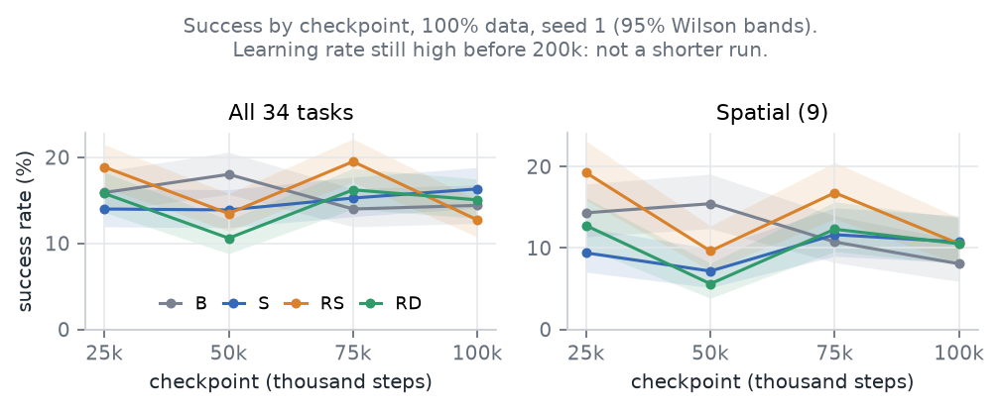

# 阶段 0（E0）报告：D5 保留的 16 个检查点（2026-10-23，20:00 UTC 最终版）

> 数据截至 10-23 19:55 UTC。16 个检查点全部评完，每个都是 944 / 944 回合。
>
> - 和 12:20 的版本相比，有两处变化：
>   - 按你 10-23 晚的决定 4，LoadDishwasher 1002 加进了剔除清单，评测集从 945 回合变为 944 回合；
>   - 那 3 个 1 卡补跑在 17:41 开始并全部跑完，缺的 7 个回合都补上了。
> - 结论不变，数字的变化见第 0 节。术语见第 7 节。

## 结论（先看这里）

1. **步数规则判 20 万步**，和在跑的 E1（20 万步）一致。按主检验，只有 RD 的第 5 万→10 万步变化超出噪声：逐任务平均差 +4.2 个百分点，规则要求小于 3；Wilcoxon p = 0.058。B、S、RS 都在噪声内（第 2 节）。
2. **E3 的任务清单：CoffeeSetupMug、OpenDrawer、SlideDishwasherRack、TurnOffStove。** 这是 9 个空间任务里四起点平均成功率在 10%–60% 之间的。
   - 按第 10 万步算：16.5%、18.5%、30.0%、14.0%。
   - 按全部 16 个检查点平均：15.0%、27.5%、38.9%、14.5%。
   - 两种算法清单相同。其余 5 个空间任务都低于 5%，其中 DeliverStraw、PrepareCoffee、SearingMeat 在 16 次评测里一次都没成功（第 3 节）。
   - 按你的决定 5，E1 评完后我会按同一规则再算一遍；清单变了就报给你，不自己替换。
3. **评测本身没有噪声。** B 第 10 万步用同样的种子评了两遍（8 个 1 卡分片一遍，一个 8 卡整机任务一遍），944 个回合的结果全部相同（第 4.1 节）。
4. **真正的噪声是训练过程中的起伏，大小和起点之间的差相当。**
   - 同一起点相隔 2.5 万步的两个检查点：总体成功率差平均 3.3 个百分点，最大 6.8；12 对里 6 对 McNemar p < 0.05。
   - 同一检查点各起点减 B：平均 2.9 个百分点，最大 7.4；12 对里 5 对 p < 0.05。
   - RS 减 B 在四个检查点上正负交替：+3.0、−4.6、+5.5、−1.7 个百分点。
   - 所以只看一个检查点时，总体 7 个百分点、空间组 10 个百分点以内的起点差，分不清是起点造成的还是检查点的起伏。
   - 按你的决定 2，E1 改评第 15 万、17.5 万、20 万步三个点，主数字用三点平均，并列出三点之间的配对差，作为训练末尾的起伏尺度（第 4.2 节）。
5. **四条曲线**（图 1）：没有一个起点在四个检查点上一直领先。
   - RS 呈锯齿：第 2.5 万、7.5 万步高，5 万、10 万步低（18.9% → 13.5% → 19.5% → 12.7%）。
   - RD 在第 5 万步有个低谷（15.8% → 10.6% → 16.2% → 15.0%）。
   - B 的空间组从第 5 万步起一路下降（15.4% → 10.7% → 8.1%），主要来自 OpenDrawer（36% → 6% → 10%）和 SlideDishwasherRack（52% → 30% → 28%）。
   - 这些都是中间检查点，学习率还高，不代表训练完的结果。
6. **剔除清单已按你的决定 4 定为 6 个回合，每次评测 944 回合**，在 E1 的评测开始时冻结。按同一规则还满足条件的另外 7 个回合（重试后都能跑完）没有加入，证据见第 5 节。

## 0. 和 12:20 版相比的变化

| 项目 | 12:20 版 | 最终版 | 原因 |
| --- | --- | --- | --- |
| 评测集 | 945 回合 | 944 回合 | LoadDishwasher 1002 剔除 |
| B 10 万步 | 137/945 = 14.5% | 136/944 = 14.4% | LoadDishwasher 1002 在这次评测里成功了，现在不计 |
| RS 2.5 万 / 5 万步 | 18.8% / 13.4% | 18.9% / 13.5% | 分母从 945 变成 944 |
| RD 2.5 万步 | 148/943 = 15.7%（空间 12.6%） | 149/944 = 15.8%（空间 12.8%） | 补跑完成 |
| RD 7.5 万步 | 152/941 = 16.2%（空间 12.2%） | 153/944 = 16.2%（空间 12.3%） | 补跑完成 |
| 步数规则 B | −1.9，Wilcoxon p = 0.215 | −2.1，p = 0.179 | 同上；仍在噪声内，判定不变 |
| OpenDrawer 16 点平均 | 27.3% | 27.5% | 补跑完成 |
| 同一检查点起点减 B，平均 | 2.8 | 2.9 | 同上 |

## 1. 四条曲线（总体、空间组）

图 1 的读法：横轴是检查点（千步），纵轴是成功率；左图是全部 34 个任务（944 回合），右图是 9 个空间任务（447 回合）。浅色带是 95% Wilson 区间。

**全部 34 个任务**（成功回合 / 回合 = 成功率，括号里是 95% 区间）：

| 起点 | 2.5 万步 | 5 万步 | 7.5 万步 | 10 万步 | 四点平均 |
| --- | --- | --- | --- | --- | ---: |
| B | 150/944 = 15.9%（13.7–18.4） | 170/944 = 18.0%（15.7–20.6） | 132/944 = 14.0%（11.9–16.3） | 136/944 = 14.4%（12.3–16.8） | 15.6% |
| S | 132/944 = 14.0%（11.9–16.3） | 131/944 = 13.9%（11.8–16.2） | 144/944 = 15.3%（13.1–17.7） | 154/944 = 16.3%（14.1–18.8） | 14.9% |
| RS | 178/944 = 18.9%（16.5–21.5） | 127/944 = 13.5%（11.4–15.8） | 184/944 = 19.5%（17.1–22.1） | 120/944 = 12.7%（10.7–15.0） | 16.1% |
| RD | 149/944 = 15.8%（13.6–18.2） | 100/944 = 10.6%（8.8–12.7） | 153/944 = 16.2%（14.0–18.7） | 142/944 = 15.0%（12.9–17.5） | 14.4% |

**9 个空间任务**：

| 起点 | 2.5 万步 | 5 万步 | 7.5 万步 | 10 万步 | 四点平均 |
| --- | --- | --- | --- | --- | ---: |
| B | 64/447 = 14.3%（11.4–17.9） | 69/447 = 15.4%（12.4–19.1） | 48/447 = 10.7%（8.2–14.0） | 36/447 = 8.1%（5.9–10.9） | 12.1% |
| S | 42/447 = 9.4%（7.0–12.5） | 32/447 = 7.2%（5.1–9.9） | 52/447 = 11.6%（9.0–14.9） | 48/447 = 10.7%（8.2–14.0） | 9.7% |
| RS | 86/447 = 19.2%（15.9–23.1） | 43/447 = 9.6%（7.2–12.7） | 75/447 = 16.8%（13.6–20.5） | 47/447 = 10.5%（8.0–13.7） | 14.0% |
| RD | 57/447 = 12.8%（10.0–16.2） | 25/447 = 5.6%（3.8–8.1） | 55/447 = 12.3%（9.6–15.7） | 47/447 = 10.5%（8.0–13.7） | 10.2% |

- "四点平均"是四个检查点成功率的简单平均，只作描述，不是检验。
- 最后两个检查点（7.5 万 → 10 万步）之差：B +0.4、S +1.1、RD −1.2 个百分点（McNemar p 都大于 0.3）；RS −6.8（McNemar p < 0.001；逐任务平均 −6.9，Wilcoxon p = 0.001）。RS 的上一段是 +6.0，所以这更像起伏，而不是曲线在往下走；无论哪种情况，都说不上第 10 万步已经变平。

## 2. 步数规则的判定

**规则**（你 10-22 定的）：四个起点第 5 万 → 10 万步的配对差都在噪声内（p > 0.05 且差小于 3 个百分点），用 10 万步；否则用 20 万。主检验是逐任务平均差和 Wilcoxon p，合并差和 McNemar p 只作参考。

| 起点 | 共同回合 | 逐任务平均差，百分点（95% 区间） | 任务 ↑ / ↓ | Wilcoxon p | 在噪声内 | 合并差，百分点（McNemar p） |
| --- | ---: | --- | ---: | ---: | --- | --- |
| B | 944 | −2.1（−5.7 到 +1.5） | 8 / 13 | 0.179 | 是 | −3.6（0.007） |
| S | 944 | +2.0（−2.5 到 +6.4） | 15 / 7 | 0.167 | 是 | +2.4（0.056） |
| RS | 944 | −1.4（−4.9 到 +1.9） | 8 / 8 | 0.756 | 是 | −0.7（0.573） |
| RD | 944 | +4.2（+0.8 到 +8.1） | 14 / 5 | 0.058 | **否**（差 ≥ 3） | +4.4（< 0.001） |

- **判定：20 万步**；改用合并差判断也是 20 万（B、RD 都不满足）。E1 已按你的决定 3 用 20 万步提交，判定和它一致。
- RD 的第 5 万步正好是它的低谷（10.6%）。+4.2 里有多少是起伏、多少是学到的东西，分不开；规则本身不区分这两者。
- 部分结果报告（E0_PARTIAL_20261023）里的 p 值和这里略有不同。原因是现在每个任务的差都在两边共同完成的回合上用整数计数直接算，相同的差在 Wilcoxon 里能正确算作并列；之前两个浮点成功率相减，舍入误差让一些并列没被认出来。平均差没受影响。

## 3. 空间任务 10%–60% 清单（给 E3 选任务）

| 任务 | B 10 万 | S 10 万 | RS 10 万 | RD 10 万 | 第 10 万步四起点平均 | 16 个检查点平均 | 四起点平均在区间内的检查点 | 进清单 |
| --- | ---: | ---: | ---: | ---: | ---: | ---: | ---: | --- |
| CoffeeSetupMug | 14% | 24% | 8% | 20% | 16.5% | 15.0% | 3 / 4 | 是 |
| OpenDrawer | 10% | 20% | 30% | 14% | 18.5% | 27.5% | 4 / 4 | 是 |
| SlideDishwasherRack | 28% | 26% | 30% | 36% | 30.0% | 38.9% | 4 / 4 | 是 |
| TurnOffStove | 12% | 12% | 20% | 12% | 14.0% | 14.5% | 4 / 4 | 是 |
| StackBowlsCabinet | 4% | 8% | 4% | 6% | 5.5% | 4.5% | 0 / 4 | 否 |
| NavigateKitchen | 4% | 6% | 2% | 6% | 4.5% | 2.9% | 0 / 4 | 否 |
| DeliverStraw | 0% | 0% | 0% | 0% | 0.0% | 0.0% | 0 / 4 | 否 |
| PrepareCoffee | 0% | 0% | 0% | 0% | 0.0% | 0.0% | 0 / 4 | 否 |
| SearingMeat | 0% | 0% | 0% | 0% | 0.0% | 0.0% | 0 / 4 | 否 |

- **各列含义**：
  - 每格是该起点在该任务 50 个回合上的成功率（剔除后 DeliverStraw 48 个、SearingMeat 49 个）。
  - "四起点平均"是四个起点取平均。
  - "16 个检查点平均"是 16 个（起点，检查点）成功率的平均。
  - 区间两端都算在内。
- **按检查点分开的四起点平均**（2.5 万 / 5 万 / 7.5 万 / 10 万步）：
  - CoffeeSetupMug 9.5% / 11.5% / 22.5% / 16.5%（只有第 2.5 万步在区间外）；
  - OpenDrawer 49.0% / 16.5% / 26.0% / 18.5%；
  - SlideDishwasherRack 51.0% / 36.0% / 38.5% / 30.0%；
  - TurnOffStove 11.0% / 14.5% / 18.5% / 14.0%。
- **单个评测的波动很大**：16 个评测里，OpenDrawer 从 4% 到 64%，SlideDishwasherRack 从 26% 到 66%，CoffeeSetupMug 从 2% 到 26%，TurnOffStove 从 2% 到 30%。

## 4. 评测噪声的初步估计

### 4.1 B 第 10 万步评两遍（你要的估计）

| | 第一遍 | 第二遍 |
| --- | --- | --- |
| 方式 | 8 个 1 卡分片，每片 1 个策略服务 × 12 个仿真进程 | 1 个 8 卡整机任务，8 个策略服务 × 96 个仿真进程 |
| 回合（剔除后） | 944 | 944 |
| 成功回合 | 136（14.4%） | 136（14.4%） |
| 每回合平均用时 | 963 秒 | 1,234 秒（1.28 倍） |

- 两遍种子相同。944 个回合里结果不同的 0 个，成功率差 0，34 个任务的逐任务差全部是 0。
- 结论：给定检查点和评测种子，评测结果是确定的。这只在这两种并行方式之间核实过；其他进程数或机器上是否也一样，未核实。
- 所以"评两遍的差"这个噪声下限是 0。比较起点时要用 4.2 节的尺度。

### 4.2 检查点之间的起伏（比较起点时更有用的尺度）

同一起点相邻的两个检查点之间，起点相同，只是多训练了 2.5 万步，所以它们的差可以当作"只看一个检查点"时的波动尺度。下表单位是百分点，配对只用两边都完成的回合。

**同一起点，相邻检查点（后减前）**：

| 起点 | 检查点 | 全部：合并差（McNemar p） | 全部：逐任务平均差 | 空间：合并差（McNemar p） | 空间：逐任务平均差 |
| --- | --- | --- | ---: | --- | ---: |
| B | 2.5 万 → 5 万 | +2.1（0.133） | +2.5 | +1.1（0.649） | +1.1 |
| B | 5 万 → 7.5 万 | −4.0（0.003） | −3.7 | −4.7（0.024） | −4.7 |
| B | 7.5 万 → 10 万 | +0.4（0.793） | +1.6 | −2.7（0.141） | −2.7 |
| S | 2.5 万 → 5 万 | −0.1（1.000） | +0.7 | −2.2（0.220） | −2.2 |
| S | 5 万 → 7.5 万 | +1.4（0.275） | +0.2 | +4.5（0.008） | +4.4 |
| S | 7.5 万 → 10 万 | +1.1（0.453） | +1.8 | −0.9（0.704） | −0.9 |
| RS | 2.5 万 → 5 万 | −5.4（< 0.001） | −3.7 | −9.6（< 0.001） | −9.6 |
| RS | 5 万 → 7.5 万 | +6.0（< 0.001） | +5.6 | +7.2（< 0.001） | +7.1 |
| RS | 7.5 万 → 10 万 | −6.8（< 0.001） | −6.9 | −6.3（< 0.001） | −6.2 |
| RD | 2.5 万 → 5 万 | −5.2（< 0.001） | −4.4 | −7.2（< 0.001） | −7.1 |
| RD | 5 万 → 7.5 万 | +5.6（< 0.001） | +5.1 | +6.7（< 0.001） | +6.7 |
| RD | 7.5 万 → 10 万 | −1.2（0.367） | −0.9 | −1.8（0.382） | −1.8 |

**同一检查点，起点减 B**：

| 比较 | 检查点 | 全部：合并差（McNemar p） | 全部：逐任务平均差 | 空间：合并差（McNemar p） | 空间：逐任务平均差 |
| --- | --- | --- | ---: | --- | ---: |
| S − B | 2.5 万 | −1.9（0.130） | −0.7 | −4.9（0.005） | −4.9 |
| RS − B | 2.5 万 | +3.0（0.018） | +2.2 | +4.9（0.007） | +4.9 |
| RD − B | 2.5 万 | −0.1（1.000） | +0.5 | −1.6（0.419） | −1.6 |
| S − B | 5 万 | −4.1（< 0.001） | −2.5 | −8.3（< 0.001） | −8.2 |
| RS − B | 5 万 | −4.6（< 0.001） | −4.0 | −5.8（< 0.001） | −5.8 |
| RD − B | 5 万 | −7.4（< 0.001） | −6.4 | −9.8（< 0.001） | −9.8 |
| S − B | 7.5 万 | +1.3（0.323） | +1.4 | +0.9（0.712） | +0.9 |
| RS − B | 7.5 万 | +5.5（< 0.001） | +5.3 | +6.0（0.002） | +6.0 |
| RD − B | 7.5 万 | +2.2（0.083） | +2.5 | +1.6（0.470） | +1.6 |
| S − B | 10 万 | +1.9（0.139） | +1.6 | +2.7（0.119） | +2.7 |
| RS − B | 10 万 | −1.7（0.174） | −3.3 | +2.5（0.135） | +2.4 |
| RD − B | 10 万 | +0.6（0.659） | −0.1 | +2.5（0.126） | +2.4 |

- **两类差的大小差不多**（合并差的绝对值）：

  | 差的种类 | 组别 | 平均 | 最大 | p < 0.05 的对数 |
  | --- | --- | ---: | ---: | ---: |
  | 同一起点相邻检查点之差 | 总体 | 3.3 | 6.8 | 12 对中 6 对 |
  | 同一检查点起点减 B | 总体 | 2.9 | 7.4 | 12 对中 5 对 |
  | 同一起点相邻检查点之差 | 空间组 | 4.6 | 9.6 | 12 对中 7 对 |
  | 同一检查点起点减 B | 空间组 | 4.3 | 9.8 | 12 对中 6 对 |

- **p 值只说明场景层面的差别。** McNemar 和 Wilcoxon 只把场景当随机抽样，没把"取哪个检查点"当随机。所以某个检查点上 p < 0.05，只说明这两个检查点在这批场景上不同，不说明起点不同。
  - 例子：RS − B 的逐任务 Wilcoxon p，在第 5 万步是 0.010（RS 低 4.0 个百分点），在第 7.5 万步是 0.022（RS 高 5.3 个百分点），方向相反。
- 这些起伏是学习率还高时测的。E1 末尾（学习率接近 0）的起伏会小多少，等第 15 万、17.5 万、20 万步三个点评完就能看到。

## 5. 剔除清单（已定）

**规则**：同一个（任务，种子）在至少两个不同检查点的评测里让仿真进程死掉或挂住，就剔除。

**清单**：你 10-23 早上定的 5 个，加上 10-23 晚的决定 4 加入的 LoadDishwasher 1002，共 6 个回合。每次评测 950 → **944 回合**，空间组 450 → 447；在 E1 的评测开始时冻结。

**证据**：17 次评测（16 个检查点加 B 10 万步第二遍）各自的 `episodes.jsonl`、`resume_*.json` 和重跑回合的 `attempt` 字段。

| （任务，种子） | 出事的检查点个数 | 最后有没有跑完 | 状态 |
| --- | ---: | --- | --- |
| StoreLeftoversInBowl 1003、DeliverStraw 1006、SearingMeat 1044、DeliverStraw 1014、PreSoakPan 1016 | 6–11 | — | 已剔除（10-23 早） |
| LoadDishwasher 1002 | 11 | 7 次评测没跑完：6 次进程连死 3 次，1 次重试时策略服务已因空闲 30 分钟关掉 | 已剔除（10-23 晚） |
| OpenDrawer 1012 | 4 | 重试都跑完了 | 满足规则，没加入 |
| StackBowlsCabinet 1012 | 4 | 重试都跑完了 | 满足规则，没加入 |
| PrepareCoffee 1003 | 3 | 重试都跑完了 | 满足规则，没加入 |
| StirVegetables 1007 | 3 | 重试都跑完了 | 满足规则，没加入 |
| CloseBlenderLid 1005、StackBowlsCabinet 1013、StackBowlsCabinet 1021 | 各 2 | 重试都跑完了 | 满足规则，没加入 |

- 策略服务空闲 30 分钟自动关闭的问题已按你的决定 4 修好：评测脚本启动服务时关掉了空闲看门狗，服务在评测结束时由脚本自己关。
- 内存方面，部分结果报告里查过：整机评测的峰值是机器内存的 29%–33%，因内存不足被杀 0 次。进程为什么会死，未核实。

## 6. 补跑

- RS 7.5 万、RD 2.5 万、RD 7.5 万步的 1 卡补跑（`pt-vq2u4q9v`、`pt-shnjllko`、`pt-wz2yc6mh`）17:41 UTC 开始，全部完成，缺的 7 个回合都跑完了。现在 16 个评测里没有缺回合的。
- 你的决定里"撤掉 3 个补跑"和"RD 若撤了有空机再提"，因为它们在决定到达前已经跑完，没有再执行。

## 7. 说明

**术语**

- **回合**：一个任务、一个评测种子的一次闭环执行。
- **成功率**：成功回合 / 回合。
- **95% 区间**：Wilson 区间。
- **全部任务与空间组**：全部 34 个任务剔除后 944 回合。空间组是 9 个空间任务（CoffeeSetupMug、DeliverStraw、NavigateKitchen、OpenDrawer、PrepareCoffee、SearingMeat、SlideDishwasherRack、StackBowlsCabinet、TurnOffStove），剔除后 447 回合。
- **配对**：两边在同一任务、同一评测种子（因而同一个初始场景）上比较，只用两边都完成的回合。
- **合并差**：所有共同回合放在一起的成功率差，p 值来自 McNemar 精确检验，只作参考。
- **逐任务平均差**：先算每个任务的差再对任务平均（34 个任务为配对单位，空间组 9 个），区间对任务重抽样 2,000 次，p 值来自 Wilcoxon 符号秩检验。这是主检验。
- **检查点**：D5（10-21 开跑、10-22 停在约 11.5 万步的 20 万步训练）每 2.5 万步存的模型；学习率按 20 万步余弦衰减。

**数据和代码**

- 原始数据：`/mnt/umm/users/yinbaiqiao/downstream_runs/experiments/DS-*-100-s1/evals_run_stopped_20261022/steps_*/`
- 本报告的全部数字和网页（含全部图和回合范例）：`/mnt/umm/users/yinbaiqiao/downstream_runs/report_stage0_20261023/`（`results.json`、`index.html`、`figures/`），由 `python -m downstream.report.build --stage0 --out <目录>` 生成（`downstream` 分支，`fc660235`）。
