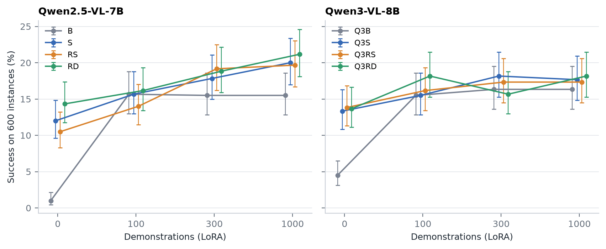

# N2 结果：少样本微调（2026-11-03）

> 依据：你 11-02 晚决定 2–3、11-03 决定 1。8 个模型 × 100 / 300 / 1,000 条示教 × 600 个实例（N1 合并的那 600 个），共 14,400 回合，0 出错。时间 UTC。
>
> 数字表在集群上：`downstream_runs/n/n2_20261103/report/report.md` 和 `report.json`，由 `downstream/n/n2_report.py` 生成。剔除坏画面实例后的版本在 `report_clean/`。曲线图 [`figures/n2_curve.png`](../figures/n2_curve.png)。
>
> **11-05 更新（你 11-05 定的"换"）：剔除版换成 `report_clean_plus_20261104/`。**
> - 多剔了 6 个实例：11-04 条图重扫、看图确认坏了，原来漏掉的。
>   - SetUpCuttingStation_s1000 的 absolute_positioning、equidistance、fov_inclusion；
>   - PickPlaceToasterToCounter_s3000 的 absolute_positioning、screen_occupancy、projective_relations。
> - 现在共剔 27 个，剩 573 个。
> - 成功率变化不超过 0.22 个百分点，配对差不超过 0.36，显著与否都不变（[重扫报告](FRAMES_RESCAN_20261104.md)）。
> - 主表和曲线图用的是全部 600 个实例，不受影响。
>
> **11-05 晚更新（任务书第 2、8 条）：下面原文保留 11-03 的数，以这里和新表为准。**
> - N1 坏画面回合重跑以后（[N1_REPAIR_20261105](N1_REPAIR_20261105.md) 第 4 条），0 条那一列变了，结论都不变。新表在 `report_n1fix_20261105/`。
>   - 主表最大变化 0.50 个百分点，100 条以上各档没变。
>   - 0 条时训练过的比底座高 +9.0 到 +13.5（原来 +8.8 到 +13.3）。
>   - RL 减 SFT 只有 0 条那一档变了：RD − S +2.3 → +2.5，Q3RS − Q3S +0.5 → +0.3，Q3RD − Q3S +0.3 → −0.2。
>   - Qwen3 三个从 0 条到 1,000 条的涨幅：Q3S +3.8，Q3RS +3.2，Q3RD +4.5（原来写的"3.5–4.5"，现在是 3.2–4.5）。
> - 剔除版换成 `report_clean_n1fix_20261105/`：只剔仍有坏画面的实例，就是 N2 自己评测里的 7 个，剩 593 个（上面说的 27 个、573 个不再用）。最大变化 0.56 个百分点，显著与否不变。
> - 曲线图按任务书"三张图按干净数据重画"，改用剔除版（593 个实例）画，纵轴写明实例数。所以上面"主表和曲线图用的是全部 600 个实例"这句改成：主表是 600 个，曲线图是 593 个。
> - 第 6 条里"底座那一跳里，很大一部分可能就是学到'先后退'这条简单规律（未单独核实）"，已经核实：是（[N2_BACKWARD_20261105](N2_BACKWARD_20261105.md)）。
>   - 底座加示教后几乎每个回合第一步都后退；
>   - 第一步不该后退的 149 个实例上，B 全做不成，Q3B 只成 0–3 个；
>   - 跳升全部来自记录的最短走法第一步是后退的 451 个实例（后退是最短的第一步之一）。
> - 第 6 条的一个数更正：B 在 1,000 条时第一步就是后退的是 590 个，不是 584 个。

## 结论

1. **两个原版模型学得最快，100 条以后就不涨了。**
   - B 从 1.0% 升到 15.7%（+14.7 个百分点，p < 10⁻²⁰）；Q3B 从 4.5% 升到 15.5%（+11.0）。
   - 300 条、1,000 条时两者都停在约 15.5%–16.3%。
2. **主线训练过的起点起步高、涨得慢，但 Qwen2.5 的三个到 1,000 条还在涨。**
   - S 从 12.0% 涨到 20.0%（+8.0），RS 从 10.5% 涨到 19.7%（+9.2），RD 从 14.3% 涨到 21.2%（+6.8），都是 p < 10⁻⁴。
   - Qwen3 的三个只涨 3.5–4.5 个百分点，300 条后不再涨（约 17%–18%）。
3. **主线训练的优势，100 条示教就抹平了；到 1,000 条，Qwen2.5 又拉开，Qwen3 没有。**
   - 0 条时，训练过的比同代底座高 8.8–13.3 个百分点（N1 的结论）。
   - 100 条时差 −1.7 到 +2.7，六个都不显著。也就是说，主线训练的好处，大约相当于给原版模型 100 条 RoboCasa 示教。
   - 1,000 条时，Qwen2.5 的三个比 B 高 4.2–5.7（p ≤ 4×10⁻⁵）；Qwen3 的三个比 Q3B 高 1.0–1.8，都不显著。
4. **设计问的"主线起点能不能用更少的示教达到底座用多的水平"：能，但很大程度是因为底座本来就到顶了。**
   - 训练过的起点用 100 条，就和底座用 1,000 条差不多（−1.5 到 +1.8，都不显著）。
   - Qwen2.5 的 RS、RD 用 300 条，就比 B 用 1,000 条高 3.3–3.7（p < 0.01）。
5. **RL 对 SFT，哪一档都分不开。**
   - RS − S、RD − S、Q3RS − Q3S 在 100、300、1,000 三档都不显著（−1.7 到 +1.3）。
   - Q3RD − Q3S 在 100 条 +2.7（p = 0.033）、300 条 −2.5（p = 0.008），方向相反，没做多重比较校正；12 个比较做 Holm 校正后都不显著。
   - 和 N1 一样：在 RoboCasa 里 RL 没有在 SFT 之上加分，少样本微调以后也没有显出来。
6. **微调后的模型几乎都先后退。**
   - B 在 1,000 条时 600 个回合里 584 个第一步就是后退（Q3B 580、S 542）；S 原样时第一步很分散。（11-05 更正：B 是 590 个，不是 584 个。）
   - 原因是 RoboCasa 重置后机器人正对台面：示教里 79% 第一步是后退，评测实例最短走法里也有 75%。
   - 所以底座那一跳里，很大一部分可能就是学到"先后退"这条简单规律（未单独核实）。B 在 300 条和 1,000 条时适配器不同（训练损失 0.166 对 0.135，600 个回合里 387 个回答不一样），600 个实例的成败却完全一样。

## 成功率（600 个实例，95% Wilson 区间）

| 模型 | 0 条（原样，N1） | 100 条 | 300 条 | 1,000 条 |
| --- | ---: | ---: | ---: | ---: |
| B | 6（1.0%，0.5–2.2） | 94（15.7%，13.0–18.8） | 93（15.5%，12.8–18.6） | 93（15.5%，12.8–18.6） |
| S | 72（12.0%，9.6–14.8） | 94（15.7%，13.0–18.8） | 107（17.8%，15.0–21.1） | 120（20.0%，17.0–23.4） |
| RS | 63（10.5%，8.3–13.2） | 84（14.0%，11.5–17.0） | 115（19.2%，16.2–22.5） | 118（19.7%，16.7–23.0） |
| RD | 86（14.3%，11.8–17.4） | 97（16.2%，13.4–19.3） | 113（18.8%，15.9–22.2） | 127（21.2%，18.1–24.6） |
| Q3B | 27（4.5%，3.1–6.5） | 93（15.5%，12.8–18.6） | 98（16.3%，13.6–19.5） | 98（16.3%，13.6–19.5） |
| Q3S | 80（13.3%，10.8–16.3） | 93（15.5%，12.8–18.6） | 109（18.2%，15.3–21.5） | 106（17.7%，14.8–20.9） |
| Q3RS | 83（13.8%，11.3–16.8） | 97（16.2%，13.4–19.3） | 104（17.3%，14.5–20.6） | 104（17.3%，14.5–20.6） |
| Q3RD | 82（13.7%，11.1–16.6） | 109（18.2%，15.3–21.5） | 94（15.7%，13.0–18.8） | 109（18.2%，15.3–21.5） |

## 配对比较

差值是百分点（前者减后者）。括号里依次是：95% 区间；只有前者成功对只有后者成功的回合数；精确 McNemar p。每一格都是同一批实例上的逐个配对。

**和自己原样比（示教加了多少）**

| 模型 | 100 条 | 300 条 | 1,000 条 |
| --- | --- | --- | --- |
| B | +14.7（11.6 到 17.7；94 对 6；p < 10⁻²⁰） | +14.5（93 对 6） | +14.5（93 对 6） |
| S | +3.7（1.2 到 6.1；40 对 18；p = 0.005） | +5.8（53 对 18；p < 10⁻⁴） | +8.0（5.2 到 10.8；62 对 14；p < 10⁻⁷） |
| RS | +3.5（38 对 17；p = 0.007） | +8.7（70 对 18；p < 10⁻⁷） | +9.2（6.2 到 12.1；71 对 16；p < 10⁻⁸） |
| RD | +1.8（34 对 23；p = 0.18） | +4.5（56 对 29；p = 0.005） | +6.8（3.7 到 10.0；68 对 27；p < 10⁻⁴） |
| Q3B | +11.0（7.9 到 14.1；81 对 15；p < 10⁻¹¹） | +11.8（86 对 15） | +11.8（86 对 15） |
| Q3S | +2.2（32 对 19；p = 0.09） | +4.8（45 对 16；p < 10⁻³） | +4.3（44 对 18；p = 0.001） |
| Q3RS | +2.3（33 对 19；p = 0.07） | +3.5（45 对 24；p = 0.015） | +3.5（47 对 26；p = 0.019） |
| Q3RD | +4.5（52 对 25；p = 0.003） | +2.0（43 对 31；p = 0.20） | +4.5（56 对 29；p = 0.005） |

**同一档和同代底座比**

| 模型 | 0 条 | 100 条 | 300 条 | 1,000 条 |
| --- | --- | --- | --- | --- |
| S − B | +11.0 | +0.0（33 对 33；p = 1） | +2.3（32 对 18；p = 0.065） | +4.5（2.5 到 6.5；33 对 6；p < 10⁻⁴） |
| RS − B | +9.5 | −1.7（33 对 43；p = 0.30） | +3.7（41 对 19；p = 0.006） | +4.2（2.2 到 6.1；31 对 6；p < 10⁻⁴） |
| RD − B | +13.3 | +0.5（35 对 32；p = 0.81） | +3.3（36 对 16；p = 0.008） | +5.7（3.4 到 7.9；41 对 7；p < 10⁻⁶） |
| Q3S − Q3B | +8.8 | +0.0（29 对 29；p = 1） | +1.8（23 对 12；p = 0.09） | +1.3（22 对 14；p = 0.24） |
| Q3RS − Q3B | +9.3 | +0.7（31 对 27；p = 0.69） | +1.0（22 对 16；p = 0.42） | +1.0（21 对 15；p = 0.41） |
| Q3RD − Q3B | +9.2 | +2.7（41 对 25；p = 0.064） | −0.7（12 对 16；p = 0.57） | +1.8（27 对 16；p = 0.13） |

**同一档 RL 减 SFT**

| 比较 | 0 条 | 100 条 | 300 条 | 1,000 条 |
| --- | --- | --- | --- | --- |
| RS − S | −1.5（p = 0.28） | −1.7（21 对 31；p = 0.21） | +1.3（26 对 18；p = 0.29） | −0.3（19 对 21；p = 0.87） |
| RD − S | +2.3（p = 0.12） | +0.5（28 对 25；p = 0.78） | +1.0（27 对 21；p = 0.47） | +1.2（22 对 15；p = 0.32） |
| Q3RS − Q3S | +0.5（p = 0.74） | +0.7（20 对 16；p = 0.62） | −0.8（13 对 18；p = 0.47） | −0.3（12 对 14；p = 0.85） |
| Q3RD − Q3S | +0.3（p = 0.90） | +2.7（33 对 17；p = 0.033） | −2.5（7 对 22；p = 0.008） | +0.5（21 对 18；p = 0.75） |

**少示教的训练过的起点，对 1,000 条的底座**

| 模型 | 100 条 | 300 条 |
| --- | --- | --- |
| S | +0.2（33 对 32；p = 1） | +2.3（32 对 18；p = 0.065） |
| RS | −1.5（33 对 42；p = 0.36） | +3.7（41 对 19；p = 0.006） |
| RD | +0.7（35 对 31；p = 0.71） | +3.3（36 对 16；p = 0.008） |
| Q3S | −0.8（28 对 33；p = 0.61） | +1.8（23 对 12；p = 0.09） |
| Q3RS | −0.2（32 对 33；p = 1） | +1.0（24 对 18；p = 0.44） |
| Q3RD | +1.8（40 对 29；p = 0.23） | −0.7（13 对 17；p = 0.58） |

## 画面损坏和重跑

- **重跑前**：8 个任务里每个模型约 40–56 个回合画面坏，落在 15 个实例上（B 是 32 个），合计约 2.6%。
- **重跑一（4 个进程并发）**：坏回合挑出来移开（没删，在每档的 `episodes_corrupted.jsonl`、`frames_corrupted/`），8 个 1 卡任务重跑，15:18–15:32。重跑后只剩 33 个坏回合，都在 `SetUpCuttingStation_s1000` 一个场景。
- **重跑二（1 个进程）**：15:33–15:41。还剩 11 个回合坏，都在这个场景的画面占比实例上。
- **说明什么**：同时开的进程少了，绝大多数回合就不坏了，支持"负载大时才坏"的猜测；但这一个场景单进程也会坏，原因未核实。
- **主表用重跑后的全部 600 个实例**，剩下 11 个坏回合留在里面。
- **剔除版**（`report_clean/`）：任何一次评测里画面坏过的实例都剔掉（N1 的 20 个加这 1 个，共 21 个，剩 579 个）。结论不变：
  - B 从 1.0% 到 15.7%，S 从 11.9% 到 20.4%；
  - 1,000 条时 S − B +4.7（p < 10⁻⁴）；
  - RL 减 SFT 只有 Q3RD 在 100 条 +2.9（p = 0.021）、300 条 −2.4（p = 0.013）两档 p < 0.05，同样方向相反、没做校正，其余都不显著。
- **11-05 起的剔除版**（`report_clean_plus_20261104/`，共剔 27 个、剩 573 个），结论同样不变：
  - B 从 1.0% 到 15.5%，S 从 11.7% 到 20.4%；
  - 1,000 条时 S − B +4.9（p < 10⁻⁵）；
  - Q3RD 的 RL 减 SFT：100 条 +3.0（p = 0.019），300 条 −2.3（p = 0.019）。

## 卡时（约 25.5，批的 30–40 以内）

| 段 | 任务 | 卡时 |
| --- | --- | ---: |
| 示教生成 | 2 个，11:13–12:17 | 约 2.2 |
| 冒烟 | 1 个，12:20–12:28 | 约 0.13 |
| 8 个模型（训练三档、评三档） | 12:29 开跑，14:46–15:17 结束 | 约 20.8 |
| 坏画面重跑两轮 | 16 个 | 约 2.3 |
| 渲染诊断 | 1 个 | 约 0.1 |

- 每个模型的训练：100 条约 1.6 分钟，300 条约 5 分钟，1,000 条约 15–17 分钟（Qwen3 稍慢）。PyTorch 显存峰值约 22 GiB。
- 训练损失（最后 10 次更新的均值）：B 0.185 / 0.166 / 0.135，S 0.140 / 0.105 / 0.060。
- 适配器每个 162 MB，24 个共约 3.9 GB，在 `n2_20261103/<模型>/adapters/`。

## 名词和口径

- **示教**：从起点到最近成功位姿的最短走法，每轮最多 3 个动作（按相同动作的连段切），每一代用它在 N1 评测时看到的提示。
- **LoRA**：秩 16、alpha 32，只训语言模型的注意力和前馈层；学习率 1e-4，3 个 epoch。评测时把适配器加到原模型权重上，不导出。
- **回合**：和 N1 一样，最多 12 轮、12 个原子动作，贪心解码，每个模型每个实例一回合。
- **0 条**：模型原样，就是 N1 和 N1 加固的结果（同样的 600 个实例）。

## 局限

- 每个模型每档只训了一次（一个种子），档与档之间的起伏（比如 Q3RD 300 条比 100 条低）没法和训练的随机性分开。
- 示教和评测都来自 X0 的 26 个任务的厨房，只是重置种子不同。"先后退"这条规律两边都有，所以这里的成功率高估了换一种起点分布时的少样本效果（未核实）。
- 适配器只在 RoboCasa 的这 6 类任务上评过，没评它们会不会伤到主线原来的能力。

## 下一步

- N3 的 8 个评测任务 15:20 已在跑（(c) 档补跑坏回合，(e) 档全评）。跑完出 N3 报告。
- 要不要把 N2 结果转给主窗口，请你定。
