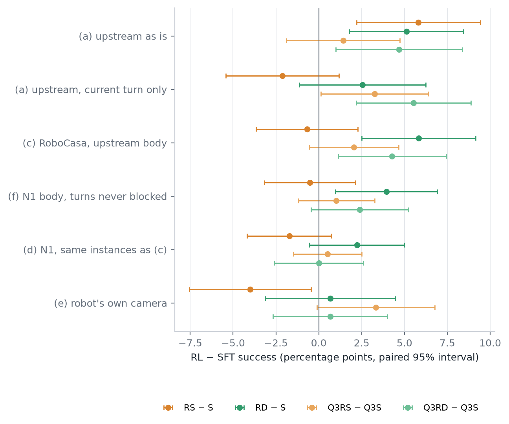

# N3 结果：迁移梯子（2026-11-03）

> 依据：你 11-02 晚决定 4、11-03 决定 2；设计 [N3_DESIGN_20261102](N3_DESIGN_20261102.md)。目的：找出"RL 在主线上比 SFT 好、到了 RoboCasa 就没了"是哪一步造成的。时间 UTC。
>
> 数字表在集群上：`downstream_runs/n/n3_20261103/report/report.md`、`report.json`，由 `downstream/n/n3_report.py` 生成。剔除 N1 坏画面实例后的版本在 `report_clean/`。图 [`figures/n3_ladder.png`](../figures/n3_ladder.png)。
>
> **11-05 更新（你 11-05 定的"换"）：剔除版换成 `report_clean_plus_20261104/`。**
> - 多剔了 1 个实例：PickPlaceSinkToCounter_s1001 的画面占比。它是 11-04 条图重扫、看图确认坏了，原来漏掉的。
> - (c) 和 (d) 剩 564 个。
> - 成功率和配对差变化不超过 0.1 个百分点，显著与否不变（[重扫报告](FRAMES_RESCAN_20261104.md)）。
> - 主表和图用的是全部实例，不受影响。

## 结论

1. **稠密奖励 RL 的优势，到了 RoboCasa 还在；换成机器人的身体才没了。**
   - **(a) 上游原样**：RD − S +5.1、Q3RD − Q3S +4.7 个百分点。
   - **(c) RoboCasa 场景 + 上游的相机球碰撞**：RD − S +5.8（p = 0.0009），Q3RD − Q3S +4.3（p = 0.011），和上游差不多大。
   - **(d) 同样这 585 个实例，换成 N1 的机器人碰撞**：只剩 +2.1 和 +0.5，都不显著。
   - **(c) 减 (d)，同一批实例配对**：RD − S 掉了 3.8（95% 区间 +0.9 到 +6.3），Q3RD − Q3S 掉了 3.8（+1.0 到 +6.5），两个区间都不含 0。
   - (c) 到 (d) 只换了碰撞判定，实例、起点、画面全都一样。
2. **原因：机器人原地转身一半会被挡，而 RL 模型转身多得多。**
   - 机器人碰撞下，所有模型的原地转身有 40%–52% 被挡；相机球下转身从不被挡（相机在转轴正上方）。
   - RD、Q3RD、RS 的动作里转身占 39%–53%（Q3RS 约 22%），SFT 只占约 10%。同样 585 个实例上，RD 转了 3,416 次，S 只转了 606 次。
   - 结果，机器人碰撞下 RD 的动作 37% 被挡，S 只有 21%；相机球下两者都只有 3%–5%。
   - 也就是说，RL 在上游学到的"多转身"的走法，碰上 PandaOmron 的身体就吃亏，优势被抵掉了。
3. **稀疏奖励 RL 的优势丢在更早的一步，不在身体上。**
   - RS − S：(a) +5.8 → (c) −0.7，两档之差 p = 0.006；(c) 到 (d) 只差 1.0（区间含 0）。
   - Qwen3 的稀疏 RL（Q3RS）在上游本来就只有 +1.4、不显著，各档都分不开。
   - (a) 到 (c) 一下子换了很多：场景和渲染、物体和厨房尺度、起点、可见性规则，还有对话历史（上游评测给模型看本回合之前的所有轮次，N 系列只给当前一轮）。这一步里到底是哪一项，这次分不开。
4. **(e) 换成机器人自己的相机，结论和 (d) 一样，稀疏 RL 还更差一些。**
   - 训练过的六个都远好于底座：+7.3 到 +15.3，p < 10⁻⁴。
   - RL 对 SFT：RS − S −4.0（p = 0.043），其余三个不显著。
   - 和 (d) 比，四个 RL 减 SFT 都看不出变化（独立样本，p ≥ 0.16）。所以换相机（离地 1.75 米、竖直视场 60°）不是 RL 优势消失的原因。

## 各档成功率（95% Wilson 区间）

| 模型 | (a) 上游原样，705 题 | (c) RoboCasa + 相机球，585 个 | (d) N1 原样，同样 585 个 | (e) 机器人相机，300 个 |
| --- | ---: | ---: | ---: | ---: |
| B | — | — | 6（1.0%） | 3（1.0%，0.3–2.9） |
| S | 279（39.6%，36.0–43.2） | 92（15.7%，13.0–18.9） | 71（12.1%） | 37（12.3%，9.1–16.5） |
| RS | 320（45.4%，41.7–49.1） | 88（15.0%，12.4–18.2） | 61（10.4%） | 25（8.3%，5.7–12.0） |
| RD | 315（44.7%，41.0–48.4） | 126（21.5%，18.4–25.0） | 83（14.2%） | 39（13.0%，9.7–17.3） |
| Q3B | — | — | 26（4.4%） | 8（2.7%，1.4–5.2） |
| Q3S | 312（44.3%，40.6–47.9） | 102（17.4%，14.6–20.7） | 78（13.3%） | 44（14.7%，11.1–19.1） |
| Q3RS | 322（45.7%，42.0–49.4） | 114（19.5%，16.5–22.9） | 82（14.0%） | 54（18.0%，14.1–22.7） |
| Q3RD | 345（48.9%，45.3–52.6） | 127（21.7%，18.6–25.2） | 81（13.8%） | 46（15.3%，11.7–19.8） |

## RL 减 SFT（百分点，按题或按实例配对）

括号里依次是：95% 区间；只有前者成功对只有后者成功的个数；精确 McNemar p。

| 比较 | (a) | (c) | (d) 同样 585 个 | (e) |
| --- | --- | --- | --- | --- |
| RS − S | +5.8（2.2 到 9.4；106 对 65；p = 0.002） | −0.7（−3.6 到 2.3；37 对 41；p = 0.73） | −1.7（22 对 32；p = 0.22） | −4.0（−7.5 到 −0.5；9 对 21；p = 0.043） |
| RD − S | +5.1（1.8 到 8.4；91 对 55；p = 0.004） | **+5.8（2.5 到 9.1；67 对 33；p = 0.0009）** | +2.1（40 对 28；p = 0.18） | +0.7（18 对 16；p = 0.86） |
| Q3RS − Q3S | +1.4（−1.9 到 4.7；p = 0.45） | +2.1（−0.5 到 4.6；36 对 24；p = 0.16） | +0.7（19 对 15；p = 0.61） | +3.3（−0.1 到 6.8；19 对 9；p = 0.087） |
| Q3RD − Q3S | +4.7（1.0 到 8.4；105 对 72；p = 0.016） | **+4.3（1.1 到 7.4；57 对 32；p = 0.011）** | +0.5（30 对 27；p = 0.79） | +0.7（14 对 12；p = 0.85） |

**跨档**

| 比较 | (c) 减 (d)，同一批 585 个实例，按实例重抽 2,000 次 | (a) 对 (c)，独立样本 z 检验 p | (e) 对 (d) p |
| --- | --- | ---: | ---: |
| RS − S | +1.0（−1.9 到 +3.8） | 0.006 | 0.25 |
| RD − S | **+3.8（+0.9 到 +6.3）** | 0.77 | 0.49 |
| Q3RS − Q3S | +1.4（−0.9 到 +3.6） | 0.77 | 0.16 |
| Q3RD − Q3S | **+3.8（+1.0 到 +6.5）** | 0.87 | 0.88 |

## 被挡的动作：(c) 和 (d)，同样 585 个实例

| 模型 | 转身占动作 | (d) 转身被挡 | (d) 平移被挡 | (d) 全部被挡 | (c) 全部被挡 | (c) 成功 → (d) 成功 |
| --- | ---: | ---: | ---: | ---: | ---: | --- |
| S | 9% | 312/606（51%） | 18% | 21% | 5% | 92 → 71 |
| RD | 53% | 1,792/3,416（52%） | 20% | 37% | 3% | 126 → 83 |
| Q3S | 10% | 272/647（42%） | 20% | 22% | 7% | 102 → 78 |
| Q3RD | 39% | 1,006/2,537（40%） | 26% | 31% | 4% | 127 → 81 |

- RS（转身占 41%）、Q3RS（22%）在 (d) 被挡 35%、28%，在 (c) 5%、6%。
- (c) 里转身被挡 0 次：相机球在转轴正上方，原地转身不动位置；照上游的规则，起点就在框里才会挡。

## 各档怎么做的

- **(a)**：用现成的逐题结果，0 卡时。Qwen2.5 的 S、RS、RD 来自 X4（`x/X4/eval_{val,test}_v2/orig-*`），Qwen3 的三个来自模型线（`sft_q3formal_e8`、`q3s0_100`、`q3d_300`；Qwen3 的 RL 用 action_names 格式示例）。都是主线 v2 验证 413 题加测试 292 题，贪心解码，带对话历史。
- **(c)**：`n3_env` 照主线 `collision_detector.py` 实现上游碰撞判定：每个有碰撞的几何体的世界框外扩 0.15 + 0.05 米，查新中心点在不在框里、移动线段穿不穿框。机器人的接触不再算。渲染还是相机 A，不画机器人。
  - 600 个实例先在新进程里按新规则重核可解：先沿实例自己的最短走法重放，走不通再在能到的位姿里搜。
  - 585 个做得成（582 个沿自己的走法），12 个相机中心一开始就在外扩的框里、一步也动不了，2 个不确定，1 个画面坏。
  - 同时按 N1 原规则重核，600 个都做得成。所以 N1 生成时的坏画面没有造出做不成的实例。
- **(d)**：N1 和 N1 加固现成的结果，取同样 585 个实例和 (c) 配对。
- **(e)**：相机换成机器人自己的（策略看的 `robot0_agentview_left`：实测离地 1.75 米、竖直视场 60°，照你说保持水平，在转轴正上方），判定用这个相机的内参；碰撞照 N1。
  - 在 X0 的全部 253 个场景上重新生成，取 300 个实例（六类各 50，107 个场景）；遮挡在 253 个场景里只找到 51 个。

## 坏画面

- **(c)**：每个模型约 7 个回合坏，挑出来用 4 个进程重跑，全好了。
- **(e)**：每个模型 6–11 个回合坏，同样重跑，全好了。
- **(d)**：用的是 N1 的结果，里面 20 个实例受影响，要不要重跑等你定。
- **剔除版**（N1 那 20 个实例在各档都剔掉，(c) 和 (d) 剩 565 个）结论不变：
  - (c) 里 RD − S +6.0（p = 0.0008），Q3RD − Q3S +4.8（p = 0.005）；
  - (c) 减 (d)：RD − S +3.5（+0.7 到 +6.4），Q3RD − Q3S +4.2（+1.4 到 +7.3）。
- **11-05 起的剔除版**（`report_clean_plus_20261104/`，再多剔 1 个，剩 564 个）：
  - (c) 里 RD − S、Q3RD − Q3S 不变；
  - (c) 减 (d)：RD − S +3.5（+0.7 到 +6.4），Q3RD − Q3S +4.3（+1.4 到 +7.3）。

## 卡时（约 11，批的 11–15 以内）

| 段 | 卡时 |
| --- | ---: |
| 重核：第一次有缺陷、停掉的约 0.25，重交的约 0.5 | 约 0.75 |
| (e) 生成：2 个 1 卡任务，12:30–13:43 | 约 2.4 |
| 评测第一轮：(c) 评完；(e) 因相机高度比较的错误一个回合也没跑 | 约 4.5 |
| 评测第二轮：(c) 补跑坏回合，(e) 全评 | 约 3.0 |
| (e) 坏回合重跑 | 约 0.4 |

## 局限

- 每个模型一个检查点、一个训练种子。
- (c) 的相机球规则让相机能从台面上方过去，能到的地方比机器人大得多，所以 (c) 的成功率普遍比 (d) 高（S 15.7% 对 12.1%）。这个差别 SFT 和 RL 都吃到了；配对比较只看 RL 减 SFT 的变化。
- (a) 到 (c) 之间混着好几项变化（见结论 3），稀疏 RL 的优势丢在哪一项这次答不出来。要把对话历史这一项分开，得把 6 个模型在 v2 上不带历史再评一遍（约 6–9 卡时，未核实，等你定）。
- (e) 的实例和 (d) 不是同一批，(e) 对 (d) 只能做独立样本比较，检验力弱。

## 下一步（要你定）

- 要不要把 N3（和 N2）的结果转主窗口。这一条对主线可能有用："稠密 RL 的优势在 RoboCasa 里被机器人原地转身被挡抵掉"，提示主线的 RL 学到的走法很依赖上游的相机球身体。
- 要不要做 (a) 档不带历史的重评，以分开稀疏 RL 那一步。
- N1 的 75 个坏画面回合要不要重跑。
