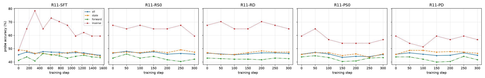

# 诊断基线：失败拆解和 P1 探针

对现有的 SFT 和 RL 检查点跑诊断 1（失败拆解）和诊断 3（QA 探针曲线），作为以后矩阵 A–E 的对照。
代码在 `eval/diagnostics/`（分支 `transition-qa`），产物在 `exps/diagnostics_20261018/`。2026-10-18。

## 结论

1. **主要的失败方式是"差最后一步"，不是走着走着偏了。**
   - 所有 SFT、RL 模型都有约三分之一的题（28%–37%）用完 12 个动作时，最好的那个回合只差一个成功条件（下文叫"门"）。
   - 另有 21%–27% 的题始终至少差两个门。
   - 提前停下的不超过 0.4%。"到过又走偏"是 0：现行规则下满足就立刻结束，按规则不会出现。
   - 只差一个门时，最常差的是：画面里的比例、距离、等距、高度占比、目标能否看清。
2. **等距族最差。** R11-SFT 第 9 个 epoch 成功 15%（验证集）/ 10%（评测集），一半上下的题始终差两个门以上；投影族其次（27% / 40%）。
3. **现有的动作训练几乎不改变模型回答 P1 转移题的能力。**
   - 36 个检查点在 500 道探针题上的准确率都在 43.4%–48.0%；原始 7B 是 45.4%，随机猜是 36.4%。
   - 500 道题的标准误约 ±2.2 个百分点，所以 SFT 各个 epoch、RL 各次更新之间的差别都在随机波动之内。
4. **只有"相机做了什么动作"（逆向题）随 SFT 上升：** 原始 7B 49%，SFT 后 59%–78%。只有 37 道题，标准误约 ±8 个百分点，看趋势不看单点。
5. **"当前是否已满足任务要求"（`goal_now`）所有模型都是 51%，**和是非各半时随机猜一样：只练动作的模型说不出眼前的画面是否已满足要求。
6. **用途：** 这是矩阵 A–E 的基线。
   - D 组练了 P1，探针题和 P1 是同一种题，D 在探针上会直接占优；所以探针主要用来看 RL 过程中 QA 能力保持还是丢失。
   - 动作上的迁移看评测成功率和本页的失败拆解。

## 1. 失败拆解（诊断 1）

**做法。** 读评测程序（`data_gen/interiorgs_v10/evaluation.py`）已有的结果，每道题判一个结论，不重跑评测，不用 GPU。
评测结果从第八轮起记录了每个回合结束时"任务要求是否满足"（`met`），以及"没满足的成功条件"（`failed_gates`，下文叫"门"）。
五个结论：

- **到过（成功）**：某个回合结束时满足了任务要求。
- **没到就停了**：没满足就提前结束了，原因是画面几乎一片、连续三次答不出动作等。
- **用完步数·最好时只差一个门**：12 个动作用完；在它最好的那个回合，只有一个成功条件没满足。
- **用完步数·其他**：12 个动作用完，始终至少差两个门。
- **到过又走偏**：到过之后最后一个回合又不满足。现行规则下不会出现：每个动作后都检查成功，满足就立刻结束。这里照样统计，用来确认它是 0。

"到过"的比例就是评测成功率，和以前的表逐位相同（例如第十轮最终 SFT 验证集 43.5%、评测集 40.1%）。

**验证集（`interiorgs_v10_r11_20261016/eval_val400`，398 道 val 题）**

| 模型 | 到过（成功） | 没到就停了 | 用完步数·最好时只差一个门 | 用完步数·其他 | 到过又走偏 |
| --- | --- | --- | --- | --- | --- |
| 原始 7B（`base_7b`） | 5.8% | 1.5% | 17.1% | 75.6% | 0.0% |
| 第十轮 SFT 最终（`r10_sft_e5`） | 43.5% | 0.0% | 32.2% | 24.4% | 0.0% |
| R11-SFT 第 6 个 epoch（`sft_formal_e6`） | 38.7% | 0.3% | 33.9% | 27.1% | 0.0% |
| R11-SFT 第 9 个 epoch（`sft_formal_e9`） | 42.0% | 0.0% | 30.9% | 27.1% | 0.0% |
| R11-RS0 第 300 次（`rs0_300`） | 39.7% | 0.3% | 33.4% | 26.6% | 0.0% |
| R11-RD 第 300 次（`rd_300`） | 38.7% | 0.0% | 34.2% | 27.1% | 0.0% |
| R11-PS0 第 300 次（`ps0_300`） | 48.7% | 0.0% | 28.4% | 22.9% | 0.0% |
| R11-PD 第 300 次（`pd_300`） | 45.5% | 0.3% | 30.2% | 24.1% | 0.0% |

**评测集（`interiorgs_v10_r11_20261016/eval_test`，279 道 test 题）**

| 模型 | 到过（成功） | 没到就停了 | 用完步数·最好时只差一个门 | 用完步数·其他 | 到过又走偏 |
| --- | --- | --- | --- | --- | --- |
| 原始 7B（`base_7b`） | 9.0% | 3.2% | 16.1% | 71.7% | 0.0% |
| 第十轮 SFT 最终（`r10_sft_e5`） | 40.1% | 0.4% | 35.8% | 23.7% | 0.0% |
| R11-SFT 第 6 个 epoch（`sft_formal_e6`） | 39.4% | 0.0% | 34.4% | 26.2% | 0.0% |
| R11-SFT 第 9 个 epoch（`sft_formal_e9`） | 39.4% | 0.0% | 36.9% | 23.7% | 0.0% |
| R11-RS0 第 300 次（`rs0_300`） | 41.2% | 0.0% | 34.8% | 24.0% | 0.0% |
| R11-RD 第 300 次（`rd_300`） | 44.1% | 0.0% | 31.9% | 24.0% | 0.0% |
| R11-PS0 第 300 次（`ps0_300`） | 43.4% | 0.0% | 34.1% | 22.6% | 0.0% |
| R11-PD 第 300 次（`pd_300`） | 45.2% | 0.4% | 33.7% | 20.8% | 0.0% |

**按任务族（R11-SFT 第 9 个 epoch，验证集；评测集在括号里）**

| 任务族 | 题数 | 到过（成功） | 用完步数·最好时只差一个门 | 用完步数·其他 |
| --- | --- | --- | --- | --- |
| 投影（左右） | 75（50） | 26.7%（40.0%） | 38.7%（26.0%） | 34.7%（34.0%） |
| 绝对距离 | 75（50） | 60.0%（52.0%） | 30.7%（42.0%） | 9.3%（6.0%） |
| 屏幕占比 | 75（50） | 60.0%（56.0%） | 25.3%（34.0%） | 14.7%（10.0%） |
| 等距 | 75（50） | 14.7%（10.0%） | 29.3%（50.0%） | 56.0%（40.0%） |
| 遮挡 | 23（29） | 39.1%（37.9%） | 52.2%（41.4%） | 8.7%（20.7%） |
| 视野 | 75（50） | 49.3%（40.0%） | 24.0%（30.0%） | 26.7%（30.0%） |
| 合计 | 398（279） | 42.0%（39.4%） | 30.9%（36.9%） | 27.1%（23.7%） |

只差一个门时，最常差的是：画面里的比例不够（`inside_frame`）22 道、距离 19 道、等距 16 道、高度占比 13 道（验证集）；
其中 29 道起点就只差一个门，即走了 12 步也没把起点时就差的那一个门补上。

每个模型、每个任务族的完整表：`exps/diagnostics_20261018/failure_r11_eval_val400.md`（51 个结果目录）、`failure_r11_eval_test.md`（37 个）。

## 2. P1 探针曲线（诊断 3）

**做法。**
- 题目：每个检查点回答 `p1_probe.jsonl` 的 500 道题。这些题来自 val 场景，按题类、按答案字母均匀抽。
- 提问：和训练行完全一样，没有系统提示，图放在 `<image>` 处。
- 生成：不采样，最多 256 个词元；读出第一个能认出的答案（是 / 否，或选项字母）。读不出的算错，另列"读不出"。
- 运行：每个模型单独一个进程，用 vLLM 推理。模型来自评测结果目录里记录的同一个路径。
- 用卡：4 个 SCO 单卡任务（试跑 1 个，正式 3 个），每个模型约 4–5 分钟，大部分是读权重，合计约 3 卡时。
- 随机猜的准确率：全部 36.4%（状态题、前向题各 37.3%，逆向题 25%）。

**曲线。** 每条 RL 曲线的第 0 步是它的起点：RS0 / RD 从 SFT 第 6 个 epoch，PS0 / PD 从 SFT 第 9 个 epoch。



| 检查点 | 全部 | 状态题（230 道） | 前向题（233 道） | 逆向题（37 道） |
| --- | --- | --- | --- | --- |
| 原始 7B | 45.4%（读不出 4.2%） | 49.1% | 41.2% | 48.6% |
| R11-SFT 第 1 / 5 / 9 / 10 个 epoch | 47.4% / 47.2% / 45.8% / 45.0% | 48.3% / 46.1% / 45.7% / 44.3% | 43.8% / 44.6% / 43.8% / 43.3% | 64.9% / 70.3% / 59.5% / 59.5% |
| 第十轮 SFT 最终 | 46.6% | 46.5% | 43.3% | 67.6% |
| R11-RS0 第 50 / 300 次 | 48.0% / 45.8% | 47.4% / 47.4% | 45.9% / 42.1% | 64.9% / 59.5% |
| R11-RD 第 50 / 300 次 | 46.0% / 46.4% | 45.7% / 47.4% | 42.5% / 42.5% | 70.3% / 64.9% |
| R11-PS0 第 50 / 300 次 | 47.2% / 45.6% | 47.0% / 46.1% | 44.6% / 43.3% | 64.9% / 56.8% |
| R11-PD 第 50 / 300 次 | 46.8% / 45.0% | 48.7% / 46.5% | 43.8% / 41.6% | 54.1% / 56.8% |

**按题类（每类约 37 道，95% 区间约 ±16 个百分点，只看大的差别）。** 原始 7B → R11-SFT 第 9 个 epoch：
- 左右（现在）89% → 81%，左右（动作后）68% → 73%；
- 哪个更近（动作后）70% → 54%；
- 距离（动作后）14% → 24%，原始 7B 低于随机猜的 25%；
- 是否都在画面里（动作后）30% → 30%；
- 是否已满足要求 51% → 51%，动作后是否满足 51% → 57%。

完整表（36 个检查点 × 15 种题）：`exps/diagnostics_20261018/probe_all/curve.md`；
每道题的回答：`probe_all/<检查点>.jsonl`。

## 3. 还没跑的两个诊断

- **诊断 2，历史打乱**（`eval/diagnostics/history_ablation.py`）：评测时历史保持原样、打乱顺序或删掉，输出三档成功率。
  代码和测试已有，还没在 GPU 上跑过；要用评测任务的环境（渲染服务 + vLLM）。
- **诊断 4，迁移表**（`eval/diagnostics/transfer_table.py`）：训练用了哪些 QA 任务族 × 各任务族成功率的变化，3×3。
  要等矩阵的结果，现在没有可填的数。

## 4. 复现

在 `/mnt/umm/users/yinbaiqiao/VAGEN-Lite-data` 下执行。`PY=/mnt/umm/users/yinbaiqiao/.conda/envs/vagen-lite/bin/python`；
`E=/mnt/umm/users/yinbaiqiao/VAGEN-Lite/exps/vagen_active_spatial/interiorgs_v10_r11_20261016`。

```bash
$PY -m eval.diagnostics.failure_breakdown --eval $E/eval_val400 --out exps/diagnostics_20261018/failure_r11_eval_val400
$PY -m eval.diagnostics.sco_probe --run exps/diagnostics_20261018/probe_sft --probe exps/transition_qa_20261018/p1_probe.jsonl \
    --from-eval $E/eval_val400 --names base_7b,sft_formal_e1,...,sft_formal_e10,r10_sft_e5 --submit
$PY -m eval.diagnostics.qa_probe curve --out exps/diagnostics_20261018/probe_all --chain "R11-SFT=base_7b:0,sft_formal_e1:154,..." ...
```
