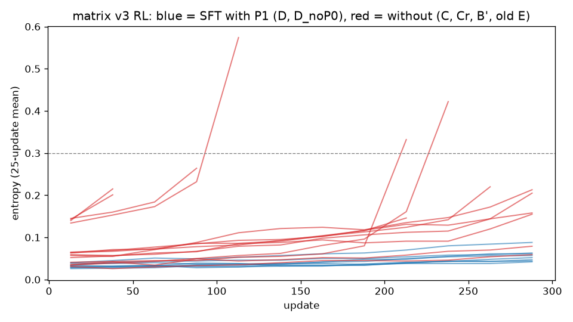

# 分析 2：稳不稳，按 SFT 含不含 P1（探索性）

With P1: D, D_noP0 (8 runs).  Without: C, Cr, B', the old E (from C0's SFT, P2q only) (14 runs).  C0's 4 runs (the model line's) ran without the entropy and image-token lines and with KL 0.2, so they are listed apart, outside the test.  Per run: stopped by a stop line or not and which (each chain's progress.json guard_stops), trainer crashes (trainer_crashes; the image-token ones by their message), the start's sampling-acceptance entropy (the picked SFT's accept_summary), and the entropy and format-error means of each 25-update window (the chain's PROGRESS.md table). Fisher's exact test (two-sided) on stopped x P1.  Writes OUT/a2.{json,md} and OUT/a2_entropy.png.

**被停止线停下**：含 P1 的 0 / 8，不含 P1 的 9 / 14；Fisher 精确检验（双侧）p = 0.0055。

| 组 | 含 P1 | RL 数 | 被停下 | 停下的线 | 训练任务崩溃（其中图像 token） | 起点采样验收的熵 | 最高一窗的熵（各 RL 平均） |
| --- | --- | --- | --- | --- | --- | --- | --- |
| C | 否 | 4 | 4 | 熵线 2、图像 token 崩溃线 2 | 6（6） | 0.106 | 0.314 |
| Cr | 否 | 4 | 3 | 读不出线 2、图像 token 崩溃线 1 | 2（2） | 0.053 | 0.182 |
| B' | 否 | 2 | 0 | — | 0（0） | 0.045 | 0.184 |
| E（旧） | 否 | 4 | 2 | 熵线 2 | 0（0） | 0.024 | 0.223 |
| D | 是 | 4 | 0 | — | 0（0） | 0.023 | 0.050 |
| D_noP0 | 是 | 4 | 0 | — | 1（0） | 0.032 | 0.064 |

## 每个 RL

| 组 | RL | 跑到第几次 | 停下的线 | 崩溃（图像 token） | 熵：第 1–25 次 → 最后一窗 | 最高一窗 |
| --- | --- | --- | --- | --- | --- | --- |
| B' | `m3bs1s0` | 300 | 跑满 | 0（0） | 0.052 → 0.155 | 0.155 |
| B' | `m3bs1d` | 300 | 跑满 | 0（0） | 0.057 → 0.213 | 0.213 |
| C | `m3cs1s0` | 96 | 熵线 | 1（1） | 0.145 → 0.264 | 0.264 |
| C | `m3cs1d` | 47 | 熵线 | 1（1） | 0.143 → 0.201 | 0.201 |
| C | `m3cs2s0` | 101 | 图像 token 崩溃线 | 2（2） | 0.134 → 0.574 | 0.574 |
| C | `m3cs2d` | 50 | 图像 token 崩溃线 | 2（2） | 0.140 → 0.215 | 0.215 |
| Cr | `m3crs1s0` | 270 | 读不出线 | 0（0） | 0.064 → 0.220 | 0.220 |
| Cr | `m3crs1d` | 286 | 读不出线 | 0（0） | 0.065 → 0.205 | 0.205 |
| Cr | `m3crs2s0` | 300 | 跑满 | 0（0） | 0.059 → 0.158 | 0.158 |
| Cr | `m3crs2d` | 223 | 图像 token 崩溃线 | 2（2） | 0.063 → 0.146 | 0.146 |
| D | `m3ds1s0` | 300 | 跑满 | 0（0） | 0.026 → 0.042 | 0.042 |
| D | `m3ds1d` | 300 | 跑满 | 0（0） | 0.028 → 0.057 | 0.057 |
| D | `m3ds2s0` | 300 | 跑满 | 0（0） | 0.029 → 0.052 | 0.052 |
| D | `m3ds2d` | 300 | 跑满 | 0（0） | 0.031 → 0.047 | 0.047 |
| D_noP0 | `m3dns1s0` | 300 | 跑满 | 0（0） | 0.039 → 0.061 | 0.061 |
| D_noP0 | `m3dns1d` | 300 | 跑满 | 0（0） | 0.040 → 0.088 | 0.088 |
| D_noP0 | `m3dns2s0` | 300 | 跑满 | 0（0） | 0.034 → 0.044 | 0.044 |
| D_noP0 | `m3dns2d` | 300 | 跑满 | 1（0） | 0.034 → 0.063 | 0.063 |
| E（旧） | `m3es1s0` | 300 | 跑满 | 0（0） | 0.036 → 0.079 | 0.079 |
| E（旧） | `m3es1d` | 208 | 熵线 | 0（0） | 0.041 → 0.332 | 0.332 |
| E（旧） | `m3es2s0` | 227 | 熵线 | 0（0） | 0.034 → 0.422 | 0.422 |
| E（旧） | `m3es2d` | 300 | 跑满 | 0（0） | 0.031 → 0.059 | 0.059 |

## 熵随更新次数（每 25 次一窗，组内平均；图在 `a2_entropy.png`）

| 组 | 1–25 | 26–50 | 51–75 | 76–100 | 101–125 | 126–150 | 151–175 | 176–200 | 201–225 | 226–250 | 251–275 | 276–300 |
| --- | --- | --- | --- | --- | --- | --- | --- | --- | --- | --- | --- | --- |
| C | 0.141（4） | 0.182（4） | 0.178（2） | 0.248（2） | 0.574（1） | — | — | — | — | — | — | — |
| Cr | 0.063（4） | 0.066（4） | 0.070（4） | 0.079（4） | 0.085（4） | 0.090（4） | 0.102（4） | 0.113（4） | 0.128（4） | 0.129（3） | 0.169（3） | 0.181（2） |
| B' | 0.054（2） | 0.056（2） | 0.067（2） | 0.077（2） | 0.098（2） | 0.104（2） | 0.109（2） | 0.102（2） | 0.113（2） | 0.119（2） | 0.146（2） | 0.184（2） |
| E（旧） | 0.036（4） | 0.037（4） | 0.038（4） | 0.044（4） | 0.047（4） | 0.051（4） | 0.060（4） | 0.068（4） | 0.149（4） | 0.178（3） | 0.062（2） | 0.069（2） |
| D | 0.029（4） | 0.030（4） | 0.031（4） | 0.032（4） | 0.033（4） | 0.035（4） | 0.037（4） | 0.037（4） | 0.042（4） | 0.045（4） | 0.046（4） | 0.050（4） |
| D_noP0 | 0.037（4） | 0.039（4） | 0.042（4） | 0.042（4） | 0.043（4） | 0.043（4） | 0.046（4） | 0.050（4） | 0.053（4） | 0.059（4） | 0.062（4） | 0.064（4） |

括号里是还在跑的 RL 数：被停下的 RL 停下之后就没有数了。

C0 的 4 个 RL（模型线）不在检验里：它们跑的时候没有熵线和图像 token 崩溃线，KL 线是 0.2；种子 1 的 S0 在第 150 次被读不出线停下，其余 3 个跑满。

